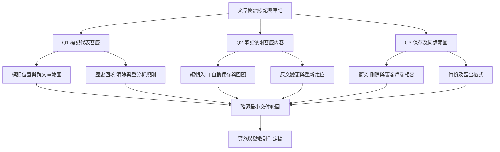

# 文章詳解單詞標記與筆記功能規劃草案

日期：2026-10-15

此草案已由使用者採納三項主要建議，並收斂為[文章詳解單詞標記與筆記功能實施計劃](20261015133427783_文章詳解單詞標記與筆記功能實施計劃.md)。以下保留第一輪調研及訪談內容，當中的待回答項目已由新計劃取代。

狀態：歷史草案，已由上述實施計劃取代。本文保留第一輪程式調研、候選方案、實施順序及驗收方向，供追溯規劃依據。

目標是在閱讀文章時辨認已獲取解釋或已收藏的詞，並按需要保存自己的理解、用法與疑問。工程重點包括文章身分、標記恢復、筆記位置、資料保存與同步衝突。

## 一 已確認的程式現況

| 範圍 | 現況 | 對本功能的影響 |
| --- | --- | --- |
| 點詞查詢 | `features/article/article.js:2992` 的 `showArticleWordAnalysis` 按單詞與所在句子尋找詳解；成功結果在約 3084 行保存至文章結果 | 可利用已有詳解顯示「已有解釋」，但不能直接認定為永久查閱歷史 |
| 加入生詞本 | 詞浮框、選字操作與句子解析都有加入詞書入口；文章詞書以 `articleId` 關聯 | 「已收藏」可由實際詞書成員推導，避免另存會過期的布林值 |
| 正文標記 | `styles.css:1743` 的互動詞統一顯示虛線 | 尚無持久可見的已查、已收藏或有筆記狀態 |
| 個人筆記 | 文章功能中未找到使用者筆記資料模型及編輯器 | 需要新增使用者資料模型、編輯與回顧入口 |
| AI 快取 | `modules/cache.js:93` 支援 TTL；查詞 API 使用 30 天快取 | 筆記及永久學習記錄須獨立於可過期的 AI 快取 |
| 文章保存 | `modules/storage.js:595` 的 `saveAnalysisResult` 按 ID 或全文查找，合併文章外層並替換 `result` | 個人筆記不宜塞進會重建的 AI `result` |
| 同步 | `modules/sync-core.js:560` 對 articles 採整組較新者覆蓋；目前同步功能從 `features/sync/sync.js` 使用 Cloudflare adapter | 手機與電腦各改一篇文章也可能互相覆蓋，筆記不能直接沿用而宣稱安全合併 |
| 本機備份 | `modules/local-backup.js:106` 以 `buildLocalSnapshot` 建立備份，保存於同一網站的 localStorage | 新資料必須加入快照建立與還原；要抵抗清除網站資料，另需下載檔案或雲端副本 |
| 雙語介面 | 繁簡字典與 `t()` 已存在 | 新按鈕、空狀態、錯誤、保存狀態和無障礙文字均須提供 zh-CN／zh-HK |

以上為程式碼檢視結果；本輪為規劃，尚未進行瀏覽器功能實測。

## 二 第一輪需要確認的三個選擇

### Q1 已經獲取的定義

- A：使用者點詞，成功取得並顯示解釋。
- B：已加入生詞本。
- C：兩者都要，分別顯示「查過」與「已收藏」。

建議 C。查閱記錄與收藏狀態分開，才不會把偶爾查過的詞當作待複習生詞。若目的只是避免重複查詢，A 的範圍更小。

選定後，下一輪再確認標記限於該位置、同句同詞、本文同詞，還是跨文章；以及「曾查過」是否在解釋被重建後仍保留。

### Q2 筆記首先服務甚麼場景

- A：單詞／短語的本文意思、用法或記憶提示。
- B：句子的語法、理解或疑問。
- C：整篇文章的閱讀心得或摘要。
- 也可只先完成標記，將筆記列為後續階段。

建議先 A＋B。筆記依附原文，重讀時有明確上下文。任意跨句、跨段選區會增加定位及手機操作複雜度，待範圍選定後再確認是否有必要。

### Q3 保存與使用裝置

- A：先在同一瀏覽器持久保存，重新開啟仍可使用。
- B：本機離線保存，同時支援手機、電腦同步與備份恢復。

建議 B，前提是同時處理筆記逐項合併與衝突保留。若選 A，仍需明確告知保存失敗，並為後續同步保留穩定 ID 及資料版本。

## 三 設計依賴樹

每輪只確認前置條件已明確的決策。第一輪未回答的選項不視為已接受；下一輪問題依回答調整。

## 四 先處理文章身分與查詢歸屬

無論選擇哪種標記，下列基礎問題都會影響正確性，應在擴充介面前處理。

1. **歷史載入恢復文章上下文。** `loadArticleHistoryRecord`（`article.js:2095`）載入原文與來源資料，沒有在該流程恢復 `currentArticleId`／`currentWordbookId`。須讓目前畫面、查詞儲存目標與文章詞書指向同一篇。
2. **重新分析保留文章身分。** `analyzeArticle`（約 1769 行）建立 meta 時未傳入既有 ID；`storage.js:401` 對非 URL 來源產生新 ID。應區分「重分析同一篇」及「新建另一篇」，避免筆記和詞書失聯。
3. **發起查詞時固定上下文。** 現在約 3069 行發起查詢，約 3086 行完成後才讀目前文章。須先保存發起時的文章 ID、原文版本及目標詞句；結果只能寫回原文章，浮框只顯示仍對應目前選取的結果。
4. **保護已保存的個人記錄。** 約 1882 行重建 `finalResult`，既有懶載詞詳解可能被新段落結果取代。需明確區分可重建的 AI 解釋與使用者行為／筆記，並處理需要保留的既有詳解。

驗收案例：在文章 A 查詞、請求尚未完成時切到 B；完成後不得在 B 顯示或保存 A 的解釋／標記。從歷史開啟 A 再加詞，必須加入 A 的詞書。

## 五 標記的候選設計

### 狀態來源

| 狀態 | 建議來源 | 更新時機 |
| --- | --- | --- |
| 已有解釋 | 目前文章有效的詞句詳解 | 詳解成功、歷史載入、重分析及同步套用 |
| 曾查過 | 若要求永久歷史，另存成功查閱記錄 | 使用者主動查詞且取得有效結果後；失敗不記錄 |
| 已收藏 | 依確認範圍查文章詞書或全部詞書 | 加詞、刪詞、詞書匯入及同步後重新推導 |
| 有筆記 | 有效且未刪除的筆記記錄 | 筆記保存、刪除、恢復及同步後 |

「已有解釋」和「曾查過」的差異必須確認：歷史詳解可包含批次分析結果，不能可靠證明使用者曾主動打開。舊資料回填應如實表示其來源。

### 呈現與重繪

- 使用低干擾的下劃線變化／小圖示，保留既有朗讀、句子聯動及中英配對高亮的辨識度。
- 顏色以外提供可辨識狀態，例如浮框文字及無障礙標籤。
- 從資料建立目前文章的查閱、收藏與筆記索引，再統一套用至詞句元素，避免每個詞都反覆搜尋全部文章。
- 全篇載入、歷史還原、段落翻譯更新、重試及同步完成後，使用同一個標記恢復入口；不能只在點擊後加一次 CSS class。
- 「隱藏標記」與「清除記錄」是否需要提供，待標記定義和回顧目的確認。

## 六 筆記的候選設計

### 操作流程

1. 在單詞浮框或句子解析中選擇「新增筆記」；若需要選字筆記，沿用目前選字工具列增加入口。
2. 編輯器顯示引用原文與可編輯筆記。開啟編輯器前先保存選區，避免鍵盤或焦點切換使選字消失。
3. 保存後正文顯示筆記提示，可再次開啟修改或刪除。
4. 提供「本文筆記」列表，顯示引用與筆記摘要，點選後回到原文。
5. 桌面和手機共用資料及操作邏輯，編輯容器按螢幕調整；檢查手機鍵盤遮擋及既有長按／迷霧操作衝突。

純文字或 Markdown、自動保存或明確保存、一個位置一則或多則筆記、是否需要全文搜尋，均在 Q2 確認後收斂。建議初版以簡單文字輸入為主，降低編輯與還原成本。

### 資料與原文定位

候選筆記欄位包括：穩定 `id`、`articleId`、筆記類型、使用者內容、`createdAt`／`updatedAt`、資料版本，以及同步刪除所需的刪除記錄。

若筆記依附詞句，定位還需要原文版本／雜湊、引用文字、前後文與字元範圍。只用段落／句子序號會在插入文字後移位；只用詞形則分不清同句重複詞。定位應以原文文字為準，顯示時再映射至渲染後的 DOM。

原文未變時直接還原；原文變動後可嘗試以引用和上下文重新定位。若有多個候選或找不到，建議保留筆記並顯示「待重新定位」，讓使用者重新連結，避免悄悄貼到另一句。

筆記保存於獨立的使用者資料結構，不放入 `result`、Tooltip DOM 或 AI 快取。初版可評估獨立 localStorage key 並沿用集中 storage 入口；容量、草稿與同步需求確認後決定實際結構。

### 保存可信度

- 只有資料寫入成功才顯示已保存；容量不足或寫入失敗須保留輸入內容並提示重試。
- 重新分析、切換語言及 AI 刷新均不能改寫筆記內容。
- 刪除文章時如何處理筆記、清空歷史是否連帶清除、同一 URL 重新匯入是否沿用原筆記，需要有一致規則。

## 七 若要求跨裝置同步

現有 articles 整組覆蓋不適合承載珍貴的個人筆記。候選方向是在快照中新增筆記／閱讀記錄資料區，採逐項合併，不把整個文章同步系統重寫列為預設前提。

- 不同筆記可以合併並存；同一筆記兩端離線編輯時，需有版本或基準版本資訊，才能辨識分歧。
- 若要保證不遺失內容，衝突時保留兩份或提供衝突副本，不能只按裝置時間靜默選一份。
- 刪除必須留下可同步的刪除標記，避免另一部裝置把舊內容同步回來；清理刪除記錄的時機需明確。
- 新快照欄位同時接入建立、套用、備份及恢復；舊快照沒有該欄位時，不能誤當作要求清空本機筆記。
- 更新 `features/sync/sync.js:1590` 的備份匯入組別識別，以及 Cloudflare／Supabase adapter 的空本機恢復判斷；不能因只剩筆記而誤判沒有資料。
- 檢查舊版客戶端推送是否保留新欄位，避免新舊版本交替使用時丟資料。
- 跨裝置筆記必須能取得對應原文／文章版本；文章整組覆蓋可能導致只有筆記而沒有文章，需一併設計保留或恢復來源的做法。
- 可重用目前 Cloudflare 同步傳輸及版本控制，先驗證 payload 相容性；Supabase adapter 是否需要維持相容依專案支援範圍決定。

Cloudflare 目前將完整 payload 保存為 JSON（`cloudflare-worker/schema.sql:15`），僅新增資料區一般不需新增資料表；仍需驗證客戶端合併及還原契約。

備份與日常閱讀匯出是兩種用途。若要求可恢復，至少需包含 ID、原文關聯、位置和筆記的 JSON 備份；Markdown／純文字適合閱讀分享，是否加入待下一輪確認。

既有詞書匯出只保存名稱和單詞／釋義／音標文字（`features/vocabulary/vocabulary.js:1046`），不保留文章 ID、語境或筆記，因此不能拿來替代筆記備份。

## 八 預計修改範圍

| 檔案或模組 | 工作 |
| --- | --- |
| `features/article/article.js` | 文章上下文、查詢歸屬、標記恢復、筆記入口、重分析與重繪整合 |
| `features/article/` 下新增職責單一模組（按需要） | 整理標記及筆記操作，沿用 `initArticle` 統一初始化，避免繼續堆大單檔 |
| `modules/storage.js` | 文章身分保存、筆記 CRUD、舊資料讀取、保存失敗回報及變更事件 |
| `modules/state.js` | 目前文章與必要共享狀態；避免另存可從持久資料推導的狀態副本 |
| `modules/vocab.js` | 收藏狀態查找、加刪詞後通知文章更新；實作前先檢查既有事件可否直接重用 |
| `modules/dom.js`、`index.html`、`styles.css` | 集中 DOM 引用、筆記列表／編輯入口、標記樣式與手機版 |
| `locales/zh-CN.js`、`locales/zh-HK.js` | 同步加入完整操作、保存、失敗、空狀態及無障礙文案 |
| `modules/sync-core.js`、`modules/sync-signals.js` | 按選定範圍新增快照欄位、合併、套用、刪除與舊版本相容 |
| `modules/local-backup.js`、`features/sync/sync.js` | 確認備份、恢復及匯出流程覆蓋新資料 |

目前沒有理由為筆記引入另一套 AI API；若日後要求 AI 整理筆記，再經 `modules/api.js` 擴充並單獨確認範圍。

## 九 建議實施順序與交付條件

| 階段 | 交付內容 | 完成條件 |
| --- | --- | --- |
| 0 需求定稿 | 標記語義、筆記粒度、保存／同步範圍及關鍵生命週期 | 訪談分支收斂，使用者確認理解一致 |
| 1 基礎修正 | 穩定文章 ID、歷史上下文、非同步查詢歸屬 | 切文章與重新分析不串資料；既有加詞正常 |
| 2 單詞標記 | 選定狀態、標記索引、重繪恢復及雙語提示 | 成功／失敗／快取命中／歷史載入均符合定義 |
| 3 筆記最小版本 | 選定筆記類型、編輯、保存、刪除、原文定位及本文列表 | 關閉重開不丟資料；原文變更不錯配 |
| 4 同步及備份 | 按 Q3 納入逐項合併、衝突保存、刪除傳播、恢復 | 兩裝置離線修改後可合併；備份還原完整 |
| 5 綜合驗收 | 桌面／手機、雙語、朗讀及既有文章功能回歸 | 下列適用情境通過 |

階段 2 可先形成可交付的小版本；若筆記首發承諾跨裝置，階段 3 與 4 需一起驗收後才視為完成。工時估算待前述範圍確認，主要差異來自精確選區定位及同步衝突需求。

## 十 驗收情境

1. 查詞成功才新增相應記錄；失敗、取消或空結果不顯示成功標記。
2. 直接命中既有解釋／快取時也正確更新顯示，並遵循確認後的「查過」定義。
3. 同詞不同句、同句重複詞、同句在不同段落重複出現，均不混淆。
4. 查詢期間切文章、連續點不同詞、同時回來多個結果，不串文章、不丟掉後保存的記錄。
5. 歷史載入、重新整理、段落重試、整篇重分析、介面語言切換後標記與筆記仍正確。
6. 加入／移除生詞、刪除詞書及同步詞書後，「已收藏」與真實成員一致。
7. 筆記新增、修改、刪除、保存失敗與重試完整可用；AI 刷新不覆蓋未保存輸入。
8. 修改原文後可唯一定位才自動恢復，無法定位時保留內容供重新連結。
9. 手機選字、觸控、鍵盤及關閉編輯器不造成選區遺失或遮擋操作；朗讀、句子高亮和迷霧正常。
10. zh-CN／zh-HK 分別檢查初始介面、動態 DOM、保存成功與失敗、空狀態及無障礙文字；筆記原文不被轉換。
11. 若納入同步：不同筆記離線編輯、同一筆記衝突、編輯與刪除衝突、舊快照恢復及舊客戶端推送都不能靜默丟失筆記。
12. 若納入備份：匯出後重新匯入可恢復全部筆記及原文關聯；本機快照不被誤稱為清除網站資料後仍可用的備份。

專案沒有既定 build／lint／test runner。實作後以本機 HTTP 服務手動巡檢受影響頁面，補做修改 JS 的語法檢查及 `git diff --check`。若涉及浮動控制或持久化 UI，同時驗證 `test-floating-statusbar.html`。同步合併與定位演算法若新增，宜針對衝突、重複文字等真實失效案例做可重現驗證。

## 十一 訪談狀態

- 已完成：文章互動、保存、同步及備份程式調研。
- 待回答：第一輪 Q1、Q2、Q3。
- 下一步：依回答展開標記範圍、筆記流程及資料生命週期，再更新本檔案至可實施版本。
