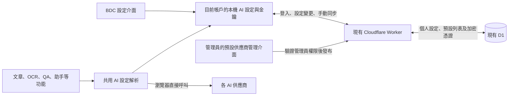

# D1 按使用者同步 AI 供應商設定完整方案

採用「本機優先、D1 保存與同步、瀏覽器直接呼叫供應商」。供應商分成管理員集中維護的「預設供應商」及使用者自己的「個人供應商」。預設供應商必須通過登入驗證才可在 BDC 使用；個人供應商可選擇按帳戶同步。日常 AI 請求直接連接供應商，預設供應商另受登入有效期約束。

本方案沿用現有 Cloudflare Worker、D1、通行碼登入及供應商設定介面。預設供應商的網址、模型、任務預設及共享金鑰全部移出 `ai-config.js`，改由 D1 及管理員介面維護。主要新增項目為個人憑證表、預設列表發布表、管理員權限與介面，以及共用加密、帳戶儲存和同步模組。預設列表的資料契約及維護流程見第 15 節。

## 1. 目標與使用邊界

| 項目 | 第一版行為 |
| --- | --- |
| 預設供應商 | 管理員集中發布，登入驗證成功的使用者可選用，普通使用者不可修改共享設定 |
| 預設列表維護 | 在 BDC 管理介面新增、測試、調整模型、排序、換 Key、停用及發布 |
| 使用者自行新增（必須保留） | 所有使用者均可新增、編輯、測試及刪除自己的供應商；無須管理員批准，不受預設列表限制 |
| 每人多個供應商 | 個人供應商以使用者及供應商 ID 分開保存；全站預設集中保存 |
| 跨裝置 | 個人普通設定沿用 snapshot、自有 Key 使用專用接口同步；預設列表按發布版本下載 |
| 本機保存 | 個人設定及 Key 保存在帳戶 profile；預設共享 Key 僅留在本頁記憶體 |
| 雲端保存 | D1 保存經 Worker 加密的金鑰 |
| AI 呼叫 | 瀏覽器直接連接已選供應商 |
| 雲端暫時故障 | 個人供應商沿用本機設定；預設供應商只在本次已驗證登入的有效期內繼續使用 |
| 單一供應商失效 | 該供應商報錯，其他供應商及本地學習功能繼續使用 |
| 未登入 | 預設供應商鎖定；可使用自己手動設定的「此裝置」供應商，不繼承共享 Key |
| 局域網供應商 | 由瀏覽器所在網絡直接連接，受該瀏覽器的連通及權限限制 |
| 自動切換供應商 | 第一版保留手動選擇，避免失敗重試意外產生多次收費 |

「雲端不可用仍能用 AI」的條件是：目前裝置已有可用設定、網站已能載入，而且供應商可達。個人供應商不逐次驗證登入；預設供應商還須符合第 15.2 節的登入有效期。新頁面啟用預設供應商需要在線驗證，不能只因 localStorage 留有 user ID 就放行。網站本身載入失敗和互聯網整體斷線不在此保證內。

雲端刪除或登入通行碼失效，不能立即撤銷已交付到離線裝置的供應商金鑰；需要立即撤銷時，應到供應商更換或停用該金鑰。

## 2. 架構與資料流



AI 呼叫時只讀取本機狀態及已驗證登入狀態；不得將每個 `requestAI()`、模型探索或助手串流請求都綁定在在線驗證及下載上。預設供應商未完成登入驗證或已過期時，立即提示先登入／重新驗證；個人供應商缺少金鑰時提示設定或同步。

使用預設供應商的流程：登入驗證 → 取得已發布列表及預設任務映射 → 下載啟用供應商的共享 Key → 在本次已驗證登入內直接使用。普通使用者無須填 API Key。

首次設定個人供應商的流程：開啟「我的供應商」→ 新增供應商 → 輸入名稱、網址、金鑰、模型 → 本機保存成功 → 直接選用。未登入也可完成此流程，保存到「此裝置」profile；登入後可明確匯入帳戶並選擇「同步金鑰到帳戶」→ 背景上傳 → 顯示已同步。測試連線由瀏覽器執行；連線測試失敗不應刪除已輸入的設定。

新裝置恢復個人供應商的流程：驗證登入 → 下載普通設定及憑證版本清單 → 下載缺少或更新的金鑰 → 驗證端點與金鑰綁定 → 寫入該帳戶本機資料 → 可以直接呼叫 AI。

## 3. 現有程式與必要修正

| 現況 | 方案處理 |
| --- | --- |
| `users` 已有 `user_id`，`snapshots` 每人一列 | 沿用現有使用者，不另建帳戶系統 |
| `sanitizeAISettings()` 已同步供應商及任務設定 | 僅同步個人供應商及使用者選擇；共享預設定義以管理員發布版本為準 |
| `pen_global_secrets` 的 `aiProviders` 未按帳戶分開 | 改由目前帳戶的本機 AI 資料提供 |
| `auth.signOut()` 目前只移除登入相關欄位 | 加入 AI 憑證、同步工作與請求生命週期清理 |
| `getProviderConnection()` 可能給指定供應商套用 default 的網址或金鑰 | 指定供應商缺設定時明確報錯，禁止跨供應商借用金鑰 |
| `saveGlobalSettings()` / `saveGlobalSecrets()` 可能在儲存失敗時回傳舊值 | 新的 AI 保存操作必須回報成功或失敗，避免誤顯示「已保存」 |
| 助手串流有獨立 fetch | 同樣經過帳戶及端點綁定檢查，驗證中途退出與取消 |
| 普通 AI 設定目前以整組時間戳合併 | 第一版保留此限制；憑證另外使用逐供應商版本控制 |

設定與憑證走兩條同步路徑，可能不同時間到達。因此「端點及金鑰綁定一致才可呼叫」是必要條件，不靠請求先後次序保證正確性。

## 4. 資料儲存與單一來源

### 4.1 普通設定

個人供應商名稱、網址、啟用狀態、模型及使用者任務選擇，繼續放在 `snapshots.payload.aiSettings`。新增的認證方式欄位也要加入 `sanitizeAISettings()` 的白名單。管理員維護的預設供應商定義及預設任務映射放在全站預設列表，使用者 snapshot 只保存指向預設項目的選擇，不複製整份預設定義。API Key、登入通行碼、憑證同步佇列不可加入普通 snapshot，也不可出現在一般匯出、學習資料備份或錯誤紀錄。

金鑰同步開關只控制金鑰；已登入帳戶的普通設定仍按現有流程同步。如果連內網網址都只想留在本機，使用獨立的「此裝置」設定，不把「只在本機保存 Key」誤解為整個供應商設定均不會上傳。

供應商 ID 是穩定識別，不以名稱或網址產生；改名不換 ID。新建個人供應商使用 `personal-<UUID>`，管理員預設使用保留的 `managed-<UUID>` 命名空間；不使用冒號，避免與現有 `provider:model` 解析衝突。個人舊 ID 經來源核對後可保留，但舊 `default` 須遷移為明確 ID，不能兼作共享預設與個人設定。刪除後重新建立新供應商使用新 ID；恢復舊 ID 必須是明確的恢復操作。

### 4.2 D1 憑證表

新增 `user_ai_credentials` 保存個人供應商金鑰，不把所有金鑰塞進 `users` 或普通 snapshot。共享預設 Key 只在全站列表保存一份，不複製成每位使用者的個人憑證列。

```sql
CREATE TABLE user_ai_credentials (
    user_id TEXT NOT NULL,
    provider_id TEXT NOT NULL,
    binding_json TEXT NOT NULL,
    key_ciphertext TEXT,
    nonce TEXT,
    key_version INTEGER,
    version INTEGER NOT NULL CHECK (version >= 1),
    deleted INTEGER NOT NULL DEFAULT 0 CHECK (deleted IN (0, 1)),
    last_mutation_id TEXT NOT NULL,
    updated_at TEXT NOT NULL,
    PRIMARY KEY (user_id, provider_id),
    FOREIGN KEY (user_id) REFERENCES users(user_id),
    CHECK (
        (deleted = 0 AND key_ciphertext IS NOT NULL
            AND nonce IS NOT NULL AND key_version IS NOT NULL)
        OR
        (deleted = 1 AND key_ciphertext IS NULL
            AND nonce IS NULL AND key_version IS NULL)
    )
);
```

| 欄位 | 用途 |
| --- | --- |
| `user_id + provider_id` | 使用者隔離及單一供應商定位 |
| `binding_json` | 綁定的最終 API URL、模型列表 URL、認證方式及格式版本；不含金鑰 |
| `key_ciphertext` | AES-GCM 密文及認證標籤，Base64 編碼 |
| `nonce` | 每次加密重新產生的 12-byte nonce，Base64 編碼 |
| `key_version` | Worker 主密鑰版本，供輪換使用 |
| `version` | 使用者修改版本，用於防止多裝置覆蓋 |
| `deleted` | 刪除標記，避免舊裝置將已刪金鑰重新上傳 |
| `last_mutation_id` | 最近一次寫入識別，處理成功寫入但回應遺失的重試 |
| `updated_at` | 伺服器 UTC 時間，只作顯示，不作衝突裁決 |

刪除時立即清空密文、nonce 及密鑰版本，但保留行的版本與刪除標記。第一版不自動清除刪除標記，避免長期離線裝置恢復後令資料復活。實施時設定每帳戶記錄數及請求大小上限；建議首版最多 200 個供應商識別（包括刪除標記），單次 JSON 請求最多 32 KiB，單個 Key 最多 8 KiB。達上限時明確報錯，不自動淘汰有效記錄。

### 4.3 本機 AI 資料

新增帳戶範圍的單筆 JSON 儲存，概念鍵名：

```text
bdc_ai_profile_v1:<encoded-sync-endpoint>:<encoded-user-id>
bdc_ai_profile_v1:device:guest
```

端點使用正規化後的同步服務 origin 及 path，與 user ID 一起編碼，避免測試及正式服務使用相同 user ID 時混用金鑰。使用者修改同步服務地址後，必須重新驗證身分，不把現有登入通行碼自動送往新的任意地址。

每個 profile 包含：個人 AI 普通設定、個人供應商金鑰及 binding、各供應商 `baseVersion`、本機未同步操作、最後同步時間及資料格式版本。把待上傳操作與該操作的本機金鑰放在同一次儲存中，避免重開頁面後遺失更新。預設列表可按帳戶快取非秘密中繼資料；共享預設 Key 首版只放頁面記憶體，不寫入個人 profile、訪客設定、localStorage 或一般匯出。

每個供應商另有本機同步模式：`cloud`（參與上下載）、`local-only`（保留本機版本、不自動上下載）、`cloud-removal-pending`（雲端刪除待確認）。新裝置發現雲端已有的供應商時，可建立 `cloud` 記錄；已有的 `local-only` 記錄不能被背景下載覆蓋。使用者重新開啟同步時，先比較本機與雲端狀態，必要時顯示版本選擇。

`loadGlobalSettings()` 和 `loadGlobalSecrets()` 保持外部相容，但 AI 部分由目前 profile 提供。其他主題、閱讀及 TTS 設定仍依現有方式處理。新的帳戶 AI 資料不得再雙寫到 `pen_global_secrets.aiProviders`，防止兩個來源互相覆蓋。

本機持久保存沿用 localStorage。這便於小量設定的同步讀取，並非額外的秘密保險箱；同源腳本或可存取瀏覽器資料的人仍可能讀取金鑰。將加密密鑰也放在同一頁面可讀的儲存中，不能消除此風險。[OWASP 本機儲存說明](https://cheatsheetseries.owasp.org/cheatsheets/HTML5_Security_Cheat_Sheet.html#local-storage)

## 5. 金鑰加密與登入授權

### 5.1 雲端加密

Worker 收到已驗證使用者上傳的 Key 後，以 Web Crypto 的 AES-256-GCM 加密，再寫入 D1。每次加密使用新的隨機 96-bit nonce，認證標籤採 128-bit。[AES-GCM 參數依據](https://developer.mozilla.org/en-US/docs/Web/API/AesGcmParams)

個人憑證的附加認證資料使用固定順序的序列化格式，包含：格式版本、scope=personal、user ID、provider ID、binding、業務 version、key version。解密時重建同一份資料，防止不同帳戶、供應商或端點之間錯置密文；共享憑證使用第 15.3 節的 managed 領域格式。

主密鑰以具版本的 Worker Secret 保存，例如 `AI_CREDENTIAL_KEY_V1`，當前版本以普通 Worker 設定指定。開發與正式環境使用不同主密鑰；不得寫入 `ai-config.js`、前端程式、Git 或 D1。[Worker Secrets 官方說明](https://developers.cloudflare.com/workers/configuration/secrets/)

D1 自動提供靜態資料加密；上述應用層加密額外讓資料庫查詢或匯出不直接得到 Key 明文。[D1 資料安全說明](https://developers.cloudflare.com/d1/reference/data-security/)

下載時 Worker 解密，以 HTTPS 回傳給已驗證的使用者，供瀏覽器直接呼叫供應商。因此本方案不是端對端加密，Worker 及擁有其部署／密鑰權限的人可以取得明文。

### 5.2 授權

沿用 Bearer 通行碼登入，所有個人憑證接口先驗證，再由伺服器取得 `user_id`。路徑及 body 不接受指定其他 user ID；個人憑證 SQL 都包含已驗證的 user ID，並使用參數綁定。全站預設列表及管理接口另按第 15 節檢查登入與角色，不接受用戶端聲稱的 role。

現有程式容許六字元新通行碼。當同一通行碼可以下載供應商金鑰時，應在上線前改用高強度隨機通行碼：介面提供 32-byte 隨機值生成並使用 Base64URL 表示。憑證接口拒絕少於 32 字元的舊通行碼，提示先更新；長度只是最低門檻，不能取代隨機生成。修改／重設流程及建立使用者工具同步採用新的規則，既有學習資料登入不必即時作廢。

保留現有恢復碼機制，配合登入、恢復及憑證接口的請求限流；不要新增一套 JWT、帳戶資料庫或自訂密碼登入架構。恢復碼可重設取得憑證的登入能力，應按登入秘密保存。

憑證路由限定明確的前端 origin 清單；CORS 不是身分驗證，Bearer 驗證不可省略。所有憑證回應（包括錯誤）加入 `Cache-Control: no-store`，不經 CDN、自訂 Cache API 或 Service Worker 快取；日誌不得記錄 Authorization、Key、請求 body 或明文回應。

以上通行碼強度、Origin、回應快取及日誌規則同樣適用於預設共享 Key 下載和管理員發布接口。

### 5.3 端點綁定

每份 Key 綁定該供應商實際使用的完整 API URL 和模型列表 URL。URL 先解析成絕對地址，移除 fragment，拒絕 username/password 及攜帶憑證的 query 參數；相對地址在不同網站 origin 可能指向不同服務，不能無條件視為同一目的地。

改名、換模型不影響綁定；變更目的地址或認證方式後，必須在設定介面確認該 Key 可用於新地址，再寫入新的綁定版本。普通 snapshot 更新先到而金鑰尚未到時，暫停該供應商並提示同步未完成，絕不能把舊 Key 自動送往新地址。攜帶憑證的 fetch 遇到重定向應報錯，讓使用者填入最終地址。

沒有認證需求的本地模型明確標記為無金鑰模式，不建立空 Key 記錄，也不發送空白或 default 的 Authorization。協議支援按第 16 節分階段增加；只有完成請求、回應、串流及能力驗證的適配器才可標示為支援，不能只靠模型發現成功宣稱可用。

## 6. Worker 接口契約

所有下列路由均位於現有同步 Worker；只處理保存及讀取，不代呼叫供應商。

| 方法與路徑 | 功能及回應 |
| --- | --- |
| `GET /ai-credentials` | 取得目前使用者所有記錄的 provider ID、version、deleted、binding、updatedAt、lastMutationId；不解密或回傳 Key |
| `GET /ai-credentials/:providerId` | 取得單個有效記錄的 Key、binding 及 version；刪除記錄回傳 deleted 和 version，不含 Key；從未建立則 404 |
| `PUT /ai-credentials/:providerId` | 帶 `expectedVersion`、`mutationId`、`binding`、`apiKey`，建立或更新 |
| `DELETE /ai-credentials/:providerId` | JSON body 帶 `expectedVersion`、`mutationId`，清除密文並保留刪除標記 |

`PUT` 範例使用佔位值：

```json
{
  "expectedVersion": 3,
  "mutationId": "new-uuid-for-this-edit",
  "binding": {
    "formatVersion": 1,
    "apiUrl": "https://provider.example/v1/chat/completions",
    "modelsUrl": "https://provider.example/v1/models",
    "authMode": "bearer"
  },
  "apiKey": "REDACTED"
}
```

成功寫入回傳 `{ providerId, version, deleted, updatedAt, lastMutationId }`，不回顯 Key。首次建立要求 `expectedVersion = 0`，首次記錄版本為 1；更新或刪除後版本加 1。已刪除記錄保留版本，重新設定須基於其當前版本。

更新必須用 `WHERE user_id = ? AND provider_id = ? AND version = ?` 的條件式寫入，再檢查變更列數；不能只先 SELECT 比較再無條件 UPDATE。並行首次建立以唯一主鍵處理衝突。D1 binding 支援參數化 statement 執行及結果讀取，具體實作沿用現有 Worker 風格。[D1 API](https://developers.cloudflare.com/d1/worker-api/d1-database/)

同一個未完成寫入在重試時沿用原 `mutationId` 及相同內容。如果資料列的 `last_mutation_id` 相同且內容相同，回傳原成功結果；同 ID 不同內容須拒絕。若後來已有另一裝置修改，保留衝突，不能以重試之名覆蓋新版本。

| 狀態 | 行為 |
| --- | --- |
| 400 / 413 | 欄位或大小錯誤，不重試，保留本機草稿 |
| 401 | 通行碼無效，停止背景同步，提示重新登入 |
| 403 | Origin 或憑證登入條件不符，顯示具體錯誤碼 |
| 404 | 記錄不存在或舊 Worker 尚無接口；不解讀為批量刪除本機金鑰 |
| 409 | 版本衝突，回傳目前版本及刪除狀態，等待使用者選擇 |
| 429 | 按 Retry-After 或退避重試 |
| 500 / 503 | 暫停該次同步，保留本機資料；不影響直接 AI 呼叫 |

錯誤 body 使用穩定的機器碼，由前端 `t()` 翻譯。清單接口只讀取中繼資料，個別記錄解密失敗僅影響該記錄的下載。主密鑰缺失時只有憑證路由不可用，不讓整個 Worker 在載入時拋錯而拖累學習資料同步。

## 7. 同步規則與故障恢復

本節描述個人供應商與憑證同步；全站預設使用第 15 節的列表發布機制，不參與使用者 snapshot 合併。

### 7.1 觸發時機

啟用雲端金鑰同步後，於成功登入、保存金鑰、使用者按同步、網絡恢復及回到前景時觸發。前景檢查沿用既有 90 秒起的輪詢節奏，優先查版本清單；版本不變就不下載明文。不要再建立一套秒級輪詢服務。

憑證與學習 snapshot 工作各自回報結果；任一失敗不阻止另一項完成。使用 `Promise.allSettled()` 或同等錯誤隔離，避免將全站初始化綁定在同步成功上。單個同步請求建議 10 秒逾時；網絡及 5xx 以 5、15、60 秒退避加隨機偏移，之後等待下一個前景／網絡事件或手動重試。

### 7.2 保存與版本

每次金鑰編輯先完成本機原子保存，包括新 Key、binding、基準版本、不可變的待同步操作；`local-only` 模式只保存本機，不建立上傳操作。若 localStorage 寫入失敗，提示未保存，不開始上傳並偽稱成功。已同步到雲端但本機落盤失敗時，也要顯示本機未保存，保留可重試狀態。

對參與雲端同步的記錄，先取得遠端版本，再按下表處理；不得以客戶端時間戳決定誰的 Key 較新。`local-only` 記錄不套用此自動下載／刪除流程。

| 本機狀態 | 遠端狀態 | 決策 |
| --- | --- | --- |
| 沒有本機修改 | 遠端版本較新 | 下載並驗證，成功落盤後才更新本機基準版本 |
| 有本機修改 | 遠端版本等於本機基準 | 用 expectedVersion 上傳 |
| 有本機修改 | 遠端亦已變更 | 標記衝突，保留本機可用版本，要求選擇 |
| 沒有本機修改 | 遠端為較新的刪除標記 | 清除對應本機 Key，保留版本及刪除狀態 |
| 本機有修改 | 遠端已刪除 | 視作衝突，不自動復活 |
| 遠端版本低於本機基準 | 可能是資料庫還原或錯誤環境 | 停止自動寫入，提示重新核對來源及版本 |
| 清單或下載失敗 | 無法判斷遠端 | 保留本機資料，不把失敗當成空清單 |

衝突介面提供「使用雲端版本」「保留本機版本並更新雲端」「稍後處理」。覆寫仍須以剛取得的遠端版本作條件寫入，若再次變更則重新提示；沒有不受版本限制的強制覆寫接口。

本機在某次上傳尚未回應時又修改 Key，要保留較新的草稿。成功回應只清除相符 `mutationId` 的操作，不以舊回應覆蓋新內容；更新基準版本後再處理新操作。

同一瀏覽器多分頁以 `storage` 事件通知修改和退出。可用時以 Web Locks 序列化同一 profile 的儲存及同步；不支援時停止多分頁自動寫入、提示從一個分頁操作設定，仍由伺服器版本條件阻止雲端無聲覆蓋。

### 7.3 設定與金鑰的兩階段同步

普通設定先保存並同步，金鑰操作獨立排程。另一裝置只收到其中之一時，保留另一份待配對資料；完整 URL 綁定相符才啟用。不要為了讓它「看起來可用」而套用 default 金鑰。

第一版的普通設定仍是整組 LWW，同時在兩台裝置修改不同供應商的普通設定，仍可能只保留其中一組。這是既有同步限制，不宣稱已解決；介面應顯示設定更新，編輯中的草稿遇到遠端變更時提示重新載入或保留草稿。若日後需要逐供應商合併，再將整組 AI 設定獨立版本化，避免本次同時重寫學習資料同步。

## 8. 帳戶切換與退出

每個異步工作啟動時記住 `syncEndpoint + userId + sessionGeneration`。回應、重試及寫入之前都再次檢查；帳戶或 generation 變更便丟棄舊結果。

同一帳戶重開頁面時可從其本機 profile 即時使用個人供應商，背景再驗證雲端登入；預設供應商須先完成本次頁面的在線驗證及 Key 下載。同步回傳 401 時停止同步並鎖定、清除預設供應商的共享 Key，保留使用者自己的本機 Key；管理員接口單純回傳角色不足的 403 只關閉管理入口，不等同整個帳戶登出。

明確退出或換帳戶則採以下流程：

1. 如有未上傳修改，說明退出會清除此裝置的未同步金鑰，讓使用者先同步或選擇放棄。
2. 增加 sessionGeneration，取消舊帳戶的憑證同步、重試及尚未完成的 AI 請求。
3. 清除舊帳戶的本機 AI profile、預設列表快取、記憶體共享及個人 Key、管理員草稿、設定表單及未完成操作；其他分頁同步失效。
4. 清除登入狀態，切回獨立的「此裝置」profile；登入另一帳戶時只讀取該帳戶資料。

已傳送到供應商的請求不能保證撤回；取消只保證本機不繼續處理結果。退出某台裝置不刪除雲端金鑰，也不登出其他裝置。

「此裝置」設定不得自動繼承帳戶金鑰，帳戶也不得自動繼承訪客金鑰；提供明確的匯入操作。snapshot 的建構及套用亦帶帳戶範圍，防止舊帳戶 AI 設定隨既有自動同步被上傳至新帳戶。本文處理 AI 設定隔離；不將整個詞書及文章資料模型順帶改造成多帳戶容器。

## 9. 介面及雙語文案

沿用目前的供應商設定區，顯示「預設供應商」與「我的供應商」。前者為管理員維護的唯讀列表，普通使用者可以選擇模型或任務但不能改網址、共享 Key 或停用全站項目。後者增加金鑰同步開關、狀態、手動同步及移除雲端副本。金鑰預設遮罩；使用者沒有編輯時代表「保留原值」，不能將遮罩字串或空欄位當作新的 Key 上傳。刪除必須是獨立操作。

「我的供應商」是第一版必須保留的完整功能，不能在接入管理員預設後刪除或改成僅選擇預設列表。保留清晰可見的「新增供應商」按鈕，空列表及未登入時亦顯示。新增表單預設只顯示服務網址及 API Key，按第 16 節自動辨識、取得模型；名稱、協議、端點覆寫及認證方式放入預設收合的進階設定，模型選擇在連接後顯示。使用者可編輯、刪除自己的項目，亦可選擇局域網或無需 Key 的相容服務，受瀏覽器網絡與權限限制。

各任務的模型選擇器同時列出可用的「預設供應商」與「我的供應商」，使用者明確選擇個人模型時優先採用該選擇。個人模型不受管理員預設模型白名單限制，但仍需符合任務能力及已支援的協議。管理員更新或停用共享項目，不修改、刪除或停用使用者自己的供應商；個人項目也不能借用共享 Key。預設列表載入失敗或登入過期，不阻止新增及使用已配置的個人供應商。

| 翻譯鍵示例 | zh-CN | zh-HK |
| --- | --- | --- |
| `settings.aiMyProviders` | 我的供应商 | 我的供應商 |
| `settings.aiAddProvider` | 添加供应商 | 新增供應商 |
| `settings.aiOwnProviderHint` | 使用自己的接口地址和密钥，也可连接兼容的局域网服务。 | 使用自己的接口地址及金鑰，亦可連接相容的局域網服務。 |
| `settings.aiKeySync` | 同步密钥到我的账号 | 同步金鑰至我的帳戶 |
| `settings.aiKeySyncHint` | 登录其他设备后可下载使用，密钥也会保存在此设备。 | 登入其他裝置後可下載使用，金鑰亦會保存在此裝置。 |
| `settings.aiKeyLocalOnly` | 仅保存在此设备 | 只儲存在此裝置 |
| `settings.aiKeyPending` | 已保存到此设备，等待同步 | 已儲存至此裝置，等待同步 |
| `settings.aiKeySynced` | 已同步 | 已同步 |
| `settings.aiKeySyncFailed` | 同步失败，仍可使用此设备的设置 | 同步失敗，仍可使用此裝置的設定 |
| `settings.aiKeyConflict` | 其他设备已修改，请选择保留的版本 | 其他裝置已修改，請選擇保留的版本 |
| `settings.aiKeyEndpointChanged` | 服务地址已变更，请确认密钥可用于新地址 | 服務地址已變更，請確認金鑰可用於新地址 |
| `settings.aiKeyRemoveCloud` | 移除云端密钥 | 移除雲端金鑰 |
| `settings.aiKeyKeepLocal` | 在此设备保留副本 | 在此裝置保留副本 |
| `settings.aiKeyDeleteEverywhere` | 删除密钥并同步到其他设备 | 刪除金鑰並同步至其他裝置 |

首次升級不自動上傳既有 Key。使用者對供應商開啟同步後，後續編輯可自動上傳；其他裝置登入後可下載已選擇同步的憑證。

關閉開關不應留下語意不明的雲端副本：介面提供「停止此裝置自動同步，保留雲端副本」或「移除雲端副本，保留此裝置」。後者發出有版本條件的 DELETE；成功前顯示待刪除。已選保留的本機副本標記為 local-only，不被同一刪除標記回頭清除。

一般「刪除金鑰並同步」會在此裝置立即停用並排程雲端刪除，其他裝置在下次同步時移除；離線裝置無法保證立即移除。刪除整個供應商時，先保存本機刪除意圖，憑證同步任務不可因普通設定項目消失而遺失。

靜態介面使用 `data-i18n*`，動態提示使用 `t()`，同時維護兩份字典。新增 DOM 參照優先放在 `modules/dom.js`。設定狀態分為學習資料同步與 AI 金鑰同步，部分失敗時分開顯示。

## 10. 程式改動位置

| 檔案 | 修改內容 |
| --- | --- |
| `cloudflare-worker/schema.sql` 及新增 migration | 建立個人憑證表及預設列表發布表；users 新增 role，snapshots 保留 |
| `cloudflare-worker/src/worker.js` | 接入憑證路由、授權、CORS 方法及穩定錯誤碼；避免改寫既有 snapshot 路由 |
| 新增 `cloudflare-worker/src/ai-credentials.js` | 憑證 CRUD、版本條件、刪除標記及重試識別 |
| 新增 `cloudflare-worker/src/ai-catalog.js` | 已登入的列表／共享 Key 讀取、管理員發布、歷史版本及角色檢查 |
| 新增 `cloudflare-worker/src/credential-crypto.js` | AES-GCM、binding 格式、主密鑰版本及解密錯誤 |
| `cloudflare-worker/wrangler.toml.example`、README | 非秘密開關、Origin 清單及 Secret 部署說明 |
| `cloudflare-worker/add-user.mjs` 與修改／重設通行碼流程 | 高強度通行碼生成與最低規則 |
| 新增 `modules/ai-profile-storage.js` | 本機帳戶 AI profile、遷移、保存失敗回報及退出清理 |
| 新增 `modules/ai-credential-sync.js` | 版本同步、待處理操作、衝突、退避、帳戶 generation |
| 新增 `modules/ai-catalog.js` | 預設列表版本、登入有效期、記憶體共享 Key 及使用者選擇合併 |
| 新增 `modules/ai-provider-detection.js` | 網址正規化、有限候選辨識、取消及錯誤分類；不自行保存或同步 Key |
| 新增 `modules/ai-protocols/` | 各協議獨立適配請求、回應、串流、模型列表及能力；共用既有 API 入口 |
| 新增 `features/ai-admin/ai-admin.js` | 管理員列表編輯、測試、預設模型、發布及版本恢復，提供 init 入口 |
| `main.js` | 初始化管理介面入口，獨立處理載入失敗 |
| `modules/settings.js` | 現有設定讀寫接口銜接目前 AI profile |
| `modules/sync-cloudflare.js` | 共用已驗證請求能力及登入事件；憑證模組不另存登入通行碼 |
| `modules/sync-core.js` | 普通 AI 設定的帳戶範圍、過濾憑證、同步套用通知 |
| `modules/ai-models.js` | 指定供應商獨立解析、端點綁定、無金鑰模式及模型快取隔離；任務層的網址／金鑰覆寫同樣受目前帳戶與綁定規則約束 |
| `modules/api.js`、助手串流路徑 | 共用呼叫前檢查、正確認證標頭、退出時取消；保持瀏覽器直連 |
| `features/sync/sync.js`、`modules/dom.js`、必要 HTML/CSS | 同步開關、狀態、衝突及帳戶事件 |
| `locales/zh-CN.js`、`locales/zh-HK.js` | 完整雙語文案 |
| `ai-config.example.js`、所有相關靜態 import | 移除預設 AI 網址、Key、列表及任務模型定義，改為雲端來源；保留同步端點及非 AI 供應商基礎設定 |

不需要在每個文章、詞書、OCR、QA 功能各寫一套同步邏輯。AI 派生結果快取可保留原有設計；依登入金鑰權限取得的模型列表快取須包含帳戶／供應商／端點／憑證版本範圍，避免換帳戶後顯示上一帳戶的專用模型。

## 11. 遷移與相容性

升級時辨認舊設定來源：已確認由使用者自行提供的供應商及 Key 才可遷移到「此裝置」profile；舊 `default`、`aiApiKey` 及來源不明的項目先隔離、停用，不能直接視為訪客自有 Key。管理員將全站預設內容匯入預設列表，使用者確認自有項目後再遷移。完成新紀錄寫入並讀回核對後，才移除舊儲存中的 AI 秘密；不影響其他 TTS 等欄位。失敗時保留隔離資料並提示，不恢復舊的匿名共享 Key 回退路徑。

已登入使用者可明確將選定的「此裝置」供應商匯入目前帳戶；先取得遠端狀態，不能以新裝置空資料覆蓋雲端。匯入不等於同意上傳所有 Key；使用者選擇同步的供應商才建立雲端記錄。

`ai-config.js` 不再保存預設 AI 的網址、Key、供應商列表或任務模型映射。管理員透過受權限保護的介面建立雲端預設；若需要一次性匯入，只能由管理員在本機明確選擇檔案，不能由一般使用者瀏覽器自動上傳整份設定。曾經靜態下發的共享 Key 應在遷移時換發並停用舊 Key，否則只刪除檔案不能收回舊瀏覽器副本。

同步修改 `API_URL`、`API_KEY`、`AI_PROVIDERS`／`AI_PROFILES`、`AI_TASKS`／`AI_MODELS` 的讀取點，以及 `QA_CHECK`、`OCR_CONFIG`、`ASSISTANT` 等可能提供 AI 端點／Key／模型覆寫的分支，確保任何 AI 入口都不能繞回靜態預設。TTS、同步服務地址及其他非本次 AI 供應商設定可保留。禁止以保留真實靜態 Key 的方式兼容舊版；舊匯出名稱如為過渡而保留，只能是空值。

普通 snapshot 必須持續排除憑證，並檢查 URL 的 query 以及 `discoveryError` 等錯誤欄位，防止敏感內容以別的欄位繞過過濾。含秘密的舊網址先要求拆出 Key 或改用供應商支援的認證標頭，不盲目刪除參數後宣稱已相容。

舊版前端不認識新憑證表，不會刪除其資料，但可能覆寫普通 snapshot 的設定。遷移後應更新常用裝置；新版依 binding 拒絕錯配，不保證新舊版本同時編輯時能自動合併。

## 12. 分階段實施與交付條件

| 階段 | 交付 | 完成條件 |
| --- | --- | --- |
| 1 本機隔離 | AI profile、遷移、指定供應商解析及帳戶清理 | 不接新雲端接口也能正常用現有供應商；A 的 Key 不會進入 B |
| 2 雲端保存及管理 | 個人憑證、預設列表、角色、加密、CRUD、發布版本及刪除 | 兩個使用者及管理員驗證隔離；普通使用者不可發布；匿名不可下載共享 Key |
| 3 同步與介面 | 個人同步、管理員編輯／發布、登入下載、衝突及雙語狀態 | 兩台裝置同步；雲端中斷時個人直連及預設登入有效期符合規格 |
| 4 遷移驗收 | 舊資料匯入、模型列表、各 AI 功能與退出回歸 | 完成下列測試矩陣後再啟用正式雲端金鑰同步 |

供應商介面按第 16 節同步簡化為網址及 Key 兩欄，協議適配分階段驗收；這是正式需求，不能以完成儲存和登入改造代替介面及多協議交付。

依賴部署順序為：備份 D1 → 套用 migration → 安全設定首名管理員及主密鑰 → 部署新 Worker → 管理員建立和測試預設列表 → 部署移除靜態 AI 預設的新前端 → 啟用登入列表 → 停用舊共享 Key 並檢查靜態資源／快取 → 小範圍驗收 → 全面啟用。

加入預設列表管理、登入門檻及靜態設定清理後，整體按中型改造估算，工作量主要在權限、版本、遷移及帳戶生命週期。先完成階段 1 及 2 的驗證，再根據實際遷移資料與瀏覽器相容性估算剩餘工時。

## 13. 驗收矩陣

使用假 Key 和測試供應商驗證，不把真實 Key 寫進測試 fixture、截圖或日誌。本次文件規劃不需要修改或測試正式服務；以下為實施時的交付檢查。

| 測試 | 預期結果 |
| --- | --- |
| A、B 使用者有同名／同 ID 供應商 | 查詢、下載、更新、刪除只影響自己的資料 |
| 修改路徑、body 嘗試指定其他 user ID | 不能取得或改動其他人的 Key |
| 檢查 D1 測試資料 | 只有密文，沒有明文 Key；nonce 不重用 |
| 密文、user ID、binding、版本被錯置 | 解密驗證失敗，其他供應商可正常下載 |
| 指定供應商缺 Key | 不傳送 default 或靜態 Key |
| 未登入新增、編輯及刪除個人供應商 | 入口可見，保存到此裝置，支援直接使用；預設供應商仍要求登入 |
| 一般使用者新增個人供應商並指定任務 | 無須管理員批准，可取得或手動填寫模型，使用自有 Key；不受預設模型白名單限制 |
| 管理員更新、停用預設或列表載入失敗 | 個人供應商與明確的個人任務選擇保留，新增及使用入口仍可用 |
| URL 先同步、Key 後同步 | 錯配期間不發出攜帶 Key 的請求 |
| 兩台裝置同時從版本 3 更新 | 一個成功至版本 4，另一個得到 409 |
| 寫入成功後回應丟失 | 原 mutation 重試可確認結果，不反覆增加版本 |
| 上傳期間本機再修改 | 舊回應不覆蓋新草稿 |
| 遠端刪除、本機仍有離線修改 | 衝突提示，不自動復活 |
| 清單或單個下載失敗 | 不清空本機有效 Key；單個失敗不拖累其他記錄 |
| Worker / D1 斷線及缺少主密鑰 | 已設定個人供應商仍能直連；預設只在本頁已驗證有效期內且已下載 Key 時可用；學習資料與憑證錯誤分開處理 |
| 同步 401 與使用者明確退出 | 401 保留個人 Key、鎖定並清理共享預設 Key；明確退出清理該帳戶全部 AI 資料 |
| A 同步中退出並登入 B | A 的回應、重試及草稿不能寫入 B；多分頁亦一致 |
| localStorage 滿或停用 | 顯示本機未保存，不誤報成功 |
| 舊 Key 遷移、重跑遷移 | 不遺失、不重複上傳、不混入另一帳戶 |
| 普通 snapshot、備份及錯誤紀錄 | 不含 Key、Authorization、秘密 URL 或待上傳明文 |
| 同源／跨域／局域網供應商 | 支援的環境可直連；CORS、權限或網絡阻擋顯示可理解錯誤 |
| 文章、OCR、QA、詞彙生成、助手串流 | 都使用選定供應商及目前帳戶，取消操作有效 |
| zh-CN 與 zh-HK | 保存、待同步、部分失敗、衝突、退出等動態狀態都有翻譯 |
| `test-floating-statusbar.html` | 因涉及持久化介面，額外確認原有行為沒有回歸 |

專案沒有統一 npm build／test 工作流，但已有獨立 `tests/` 腳本。實施時先讀取與改動相關腳本的使用方式，選擇必要的現有檢查；針對跨帳戶授權、CAS 衝突、nonce／AAD、刪除與帳戶切換增加少量有意義的測試，再以瀏覽器完成兩種語言和直接網絡呼叫驗證。

## 14. 維護、備份與回退

日常只記錄憑證接口的成功／失敗、版本衝突、延遲及錯誤碼，不記錄內容。供應商的連線失敗與雲端同步失敗分開顯示；沒有必要部署新的監控資料庫。

備份 D1 時另行安全保管對應版本的 Worker 主密鑰；只有密文備份不能恢復 Key。普通使用者的學習資料匯出仍不包含 Key。測試還原必須確認相應 key version 可解密。

主密鑰輪換順序：新增 V2 並保留 V1 → 新寫入使用 V2 → 逐批用 V1 解密再以 V2 加密 → 用資料版本及舊 key version 作條件更新，避免覆蓋同時修改 → 核對仍需 V1 的現存記錄及備份 → 按備份保留政策處理舊密鑰。輪換密文不必改使用者業務 version，既有裝置無須因此重新下載 Key。

功能出問題時可獨立關閉個人憑證同步或預設列表下載；個人本機直連能力保留，預設供應商仍遵守登入有效期。新增表不急於刪除，原有學習同步繼續使用。前端回退使用具備新儲存及登入門檻的相容版本，不得恢復含靜態共享 Key 的舊部署。預設列表錯誤可由管理員以歷史內容發布新的修復版本。

若 D1 曾還原到舊備份，本機偵測遠端版本倒退時暫停自動覆寫，核對後再重新建立同步基準。若主密鑰遺失且沒有可用備份，雲端密文無法恢復；已有本機 Key 的使用者可重新上傳，其他人須重新向供應商取得 Key。

## 15. 登入限定的預設供應商與管理維護

本節補充最新需求：預設供應商由管理員集中維護，只有已登入使用者可取得及在應用內使用。仍採用瀏覽器直連，Worker 只負責認證、設定與憑證保存，不轉發 AI 請求。

### 15.1 兩種來源與使用權限

| 身分 | 全站預設供應商 | 個人供應商 | 維護全站列表 |
| --- | --- | --- | --- |
| 未登入 | 顯示登入提示，不下載共享 Key，不發出預設 AI 請求 | 可新增、編輯、測試、刪除及使用此裝置的自有接口 | 不可 |
| 已登入的一般使用者 | 可選擇已發布且啟用的供應商／模型 | 可新增、修改及選擇是否同步自有 Key | 不可 |
| 管理員 | 與一般使用者相同 | 與一般使用者相同 | 可編輯、測試、發布及恢復列表 |

第一版所有有效帳戶共用同一份預設列表，不增加群組、套餐或按使用者複製預設 Key。供應商名稱、網址、模型、共享 Key、排序、啟用狀態及任務預設由管理員擁有；普通使用者只保存自己的選擇，例如 `{ provider: 'managed-…', model: '…' }`。

未指定任務模型時，先採用第 16 節的個人預設（如有且適用）；沒有個人預設才跟隨目前發布的任務預設。使用者已明確指定的模型不被列表更新覆蓋；該項目停用或移除後顯示不可用，讓使用者重新選擇，不靜默轉到另一個可能收費不同的供應商。排序只影響顯示，不代表自動故障轉移。

普通 snapshot 只允許個人供應商設定及合法的選擇引用；用戶端和服務端均排除偽造的 managed 定義。解析時以可信列表決定 managed 的網址、認證模式及 Key，拒絕任務層 `apiUrl`／`apiKey` 覆寫，避免把共享 Key 傳到個人指定的網址。保留相容用的 `default` 別名只能指向已驗證列表中的當前任務預設。

### 15.2 登入判定、記憶體 Key 與故障邊界

登入門檻不能只依賴 localStorage 存在 user ID。新開或重新載入頁面必須完成線上帳戶驗證，再下載預設列表及所選供應商的 Key。可以預先保存列表的非秘密內容以呈現介面，但離線啟動時仍鎖定預設 AI。

第一版共享 Key 只存目前頁面的記憶體，不寫入 localStorage、IndexedDB、個人 profile、snapshot、一般匯出或 Service Worker 快取。個人自有 Key 仍按前述本機與雲端同步規則處理。模型探索如需共享 Key，也經相同登入門檻並由瀏覽器直連。

建議採用以下明確的可用性政策：

1. 成功驗證時取得服務端 `verifiedAt`、`expiresAt`，本頁最長有效期設為 60 分鐘；這是建議的產品參數，日後可調整。
2. 可見頁面約每 5 分鐘、重新取得焦點或網絡恢復時，合併並限頻地重新驗證及檢查列表版本。每次 AI 呼叫只檢查本機有效期、供應商狀態及 Key 綁定，不另向 D1 發請求。
3. 網絡失敗不延長有效期。有效期內已取得的 Key 可繼續直連；尚未下載 Key 的供應商仍可能不可用。期限屆滿則清理共享 Key、阻止新的預設請求並取消仍在進行的預設請求。
4. 任一帳戶驗證回傳 401，或使用者明確退出，立即清理共享 Key、撤銷本頁可用狀態並取消相關請求；跨分頁傳遞退出事件，不傳遞 Key。角色不足的管理接口 403 不清理個人資料。
5. 每次請求與回應均攜帶本機帳戶 generation；退出、換帳戶、列表更新後，舊下載結果不得重新寫回。供應商停用、網址或 Key 版本改變時，立即丟棄對應舊 Key。

60 分鐘是應用的離線寬限策略，不是供應商端的安全令牌。瀏覽器直連必須取得共享 Key，登入使用者可以從瀏覽器複製它；刪除帳戶、停用列表或清理本機記憶體，不能使已複製的 Key 在供應商端失效。緊急撤銷須在供應商端停用或更換 Key。若日後要求每次請求都強制驗證 BDC 登入或限制個人額度，須另採供應商支援的短期受限憑證或代理方案；本版不宣稱提供這種控制。

### 15.3 D1 資料模型與管理員初始化

小型預設列表採整份發布：一次讀取就取得一致的供應商與任務預設，不需要為每個欄位設同步流程。建議第一版最多 30 個預設供應商，發布請求最大 512 KiB，單個 Key 沿用 8 KiB 上限；所有上限由服務端驗證。

```sql
ALTER TABLE users ADD COLUMN role TEXT NOT NULL DEFAULT 'user'
    CHECK (role IN ('user', 'admin'));

CREATE TABLE IF NOT EXISTS ai_default_catalog_releases (
    version INTEGER PRIMARY KEY CHECK (version >= 1),
    config_json TEXT NOT NULL,
    credentials_json TEXT NOT NULL,
    mutation_id TEXT NOT NULL UNIQUE,
    request_digest TEXT NOT NULL,
    published_by TEXT NOT NULL,
    published_at TEXT NOT NULL
);
```

`config_json` 包含 schemaVersion、供應商穩定 ID、顯示名稱、API／模型發現網址、協議、認證模式、啟用狀態、排序、允許模型及能力、各任務預設。網址不得包含秘密。`credentials_json` 按 provider ID 保存獨立加密信封：ciphertext、nonce、keyVersion、credentialRevision、binding；不保存明文 Key。供應商無需認證時沒有信封。

共享憑證沿用第 5 節的加密工具，但使用獨立的 AAD 領域：`scope=managed`、providerId、binding、credentialRevision、keyVersion；個人憑證使用 `scope=personal` 及 userId，兩者不得互換。credentialRevision 在 Key 或端點綁定變更時增加，與列表 version 分開。純改名或調序可沿用既有信封，因此 AAD 不包含列表發布版本。換端點不能自動沿用 Key；管理員須明確確認重新綁定或提供新 Key。

Worker 先驗證完整草稿及任務引用，再建立新的發布列。`baseVersion` 必須等於當前最大 version；以條件插入及 version 唯一限制保證只有一位管理員發布成功，另一位收到 409。禁止 `INSERT OR REPLACE` 覆蓋既有版本。首版 currentVersion 為 0，第一個發布版本為 1。

每次發布附帶 mutationId。request_digest 使用獨立 Worker Secret 計算規範化請求的 HMAC，涵蓋操作者、baseVersion、設定及 Key 操作，避免存放可離線猜測 Key 的普通摘要。相同操作者、mutationId 與摘要的重試回傳原發布結果；同一 ID 不同內容返回衝突。客戶端不能提交或覆寫密文信封，`preserve` 操作從服務端當前版本取得。摘要 Secret 輪換時，保留歷史驗證所需版本並在摘要欄位包含版本前綴。

發布歷史保留最近 10 版；用戶端只能讀當前共享 Key，不能下載歷史 Key。恢復舊版是載入舊設定後發布新版本，預設使用目前仍有效的 Key；缺 Key 的項目要求重新輸入。不能靠恢復歷史令已撤銷的供應商 Key 重新有效。發布歷史清理後，過期 mutationId 不保證仍可識別；舊 baseVersion 會衝突，客戶端先讀取現況，不自動換 ID 重送。

第一名管理員由部署者在 D1 以已確認 user_id 執行一次角色更新。第一版後續角色調整也由部署者維護，不新增公開升級角色接口。既有建立／重設通行碼工具須保留既有 role，不能意外提升或清除權限。Worker 每次管理請求從可信帳戶資料取得角色；`/me` 回傳 role 供介面顯示，前端隱藏按鈕不構成授權。

### 15.4 接口與版本一致性

| 接口 | 權限與行為 |
| --- | --- |
| `GET /ai-catalog` | 已登入；回傳當前 version、已啟用供應商與任務預設，不含 Key；尚無發布時回傳空列表 |
| `GET /ai-catalog/providers/:id/credential?catalogVersion=N` | 已登入；只允許當前版本中啟用的供應商，回傳綁定資訊、憑證版本及 Key；版本不符返回 409，重新取得列表 |
| `GET /admin/ai-catalog` | 管理員；完整設定、是否已設定 Key、憑證版本，不回傳 Key |
| `GET /admin/ai-catalog/history` | 管理員；最近版本、發布人、時間及歷史設定，不回傳歷史 Key |
| `POST /admin/ai-catalog/publish` | 管理員；接收 baseVersion、mutationId、完整草稿及明確 Key 操作，驗證後原子發布 |

恢復歷史同樣使用 publish，不增加第二套寫入接口。停用或不存在的供應商不能下載 Key。列表與 Key 回應都帶 catalogVersion；若取得 Key 前已發布新列表，客戶端先重取列表，不將舊網址和新 Key 拼接。所有接口先認證，管理接口再檢查角色；未登入 401、權限不足 403、版本衝突 409，各有獨立雙語提示。

供應商 Key 按需取得、獨立解密；一個信封損壞只影響該供應商。版本不變不重複下載 Key。發布時驗證完整配置，避免無效 JSON 或懸空任務引用破壞整份列表；已使用中的頁面仍受第 15.2 節期限限制。

### 15.5 日常如何維護預設列表

在「設定 → AI 供應商」增加管理員專用的「管理預設供應商」入口；一般使用者只看見可選的預設列表及個人設定。

| 管理工作 | 操作流程與結果 |
| --- | --- |
| 新增供應商 | 輸入名稱、相容協議、網址、認證模式和 Key，新增穩定 ID，取得或手動填寫模型 |
| 維護模型列表 | 從供應商發現模型後勾選允許使用的項目；發現接口不可用時手動填寫；發現結果不自動成為全站可用模型 |
| 調整任務預設 | 為文章、詞彙、QA、助手、OCR 等實際支援的任務選模型；檢查 vision 等所需能力 |
| 改名、排序或停用 | 編輯草稿，發布前顯示受影響任務；有懸空預設時要求重選或明確設為「暫無預設」 |
| 更換 Key | 選擇替換並輸入新值，測試後發布；其他使用者重新整理列表時清理舊 Key 並按需下載 |
| 發布與撤回錯誤 | 檢視差異後發布；發現設定錯誤時從歷史載入設定，核對當前 Key 後發布修復版本 |

編輯草稿留在管理員本頁記憶體，只有「發布」才影響使用者。Key 欄位明確區分保留、替換、清除；空欄預設保留，不用遮罩字串當作新 Key。清除有認證需求的啟用供應商 Key 時拒絕發布，要求先停用該項目。一般管理表單只顯示已設定及版本，不自動填入明文。

測試由管理員瀏覽器直接呼叫供應商，通過同一解析與綁定檢查；未發布的新 Key 僅用於本頁測試。介面說明測試會發出一次請求，可能產生供應商費用。測試失敗不影響已發布版本，且不設為所有發布的硬性條件，避免供應商暫時離線時無法停用或修正配置。必須通過的發布檢查是 schema、權限、端點綁定、Key 狀態及任務／模型引用。

一般換 Key：在供應商建立新 Key → 在草稿測試 → 發布 → 確認裝置已刷新或等待寬限期 → 於供應商撤銷舊 Key。事故處理則先撤銷外洩 Key，再發布替代值，接受期間請求可能失敗。停用列表只能限制應用後續選用；要立即停止已外流 Key 的消費，必須由供應商撤銷。

日常增加、停用、排序、改模型及換 Key 均不需要修改 `ai-config.js` 或重新部署前端。只有新增未支援的協議、改加密規則或新增權限類型，才需要程式變更與部署。

### 15.6 雙語、驗收及維護補充

新增文案至少覆蓋以下概念，實施時加入兩份 locale 並按既有 `t()`／`data-i18n*` 規範使用：

| 概念 | zh-CN | zh-HK |
| --- | --- | --- |
| 管理入口 | 管理默认供应商 | 管理預設供應商 |
| 登入門檻 | 登录后可使用默认供应商 | 登入後可使用預設供應商 |
| 跟隨預設 | 跟随管理员默认设置 | 跟隨管理員預設設定 |
| 發布 | 发布更改 | 發布變更 |
| 停用 | 此供应商已停用，请重新选择 | 此供應商已停用，請重新選擇 |
| 驗證過期 | 请连接网络验证登录后继续使用 | 請連接網絡驗證登入後繼續使用 |
| 管理衝突 | 列表已更新，请检查最新版本后重新发布 | 列表已更新，請檢查最新版本後重新發布 |

補充驗收：匿名不能取得列表或 Key；偽造 role／managed 設定不能發布或覆寫可信端點；一般使用者仍不能呼叫管理接口；兩名管理員同時發布只有一方成功；列表與憑證版本交錯不錯配；停用後無法下載 Key；退出及過期清理記憶體；離線新開頁面只可使用個人供應商；舊版靜態資源不再含可用共享 Key；普通 snapshot 不能覆蓋全站列表；兩種語言完整呈現草稿、測試、發布、衝突及錯誤狀態。

備份及主密鑰輪換必須同時涵蓋個人憑證和仍保留的列表歷史。列表業務內容發布後不原地修改；純加密維護可以在版本及舊信封條件比對下重加密，維持業務版本不變。加密主密鑰與 mutation 摘要密鑰分開保管。共享額度及限額先在供應商控制台設定，不能把瀏覽器回報的使用量當作可信的按使用者計費依據。

## 16. 供應商設定簡化與協議自動辨識

### 16.1 目標及目前問題

新增供應商的主要操作收斂成「貼上服務網址＋API Key → 連接 → 選模型並保存」。使用者不必先理解 Base URL、請求端點、模型列表端點、供應商 ID 或逐項任務映射。無需 Key 的局域網服務可留空 Key。

目前 `features/sync/sync.js` 的供應商卡片同時呈現 ID、啟用開關、名稱、Base URL、API URL、模型 URL、Key、模型勾選、手動新增及探索狀態，任務選擇又在同一設定區。`modules/ai-models.js` 主要推導 `/chat/completions` 與 `/models`；模型探索同時發出 Bearer 及 x-api-key，`modules/api.js` 的主要請求與回應則按 Chat Completions 結構處理。新設計須同時簡化介面與統一協議處理，不能只收起表單後宣稱多協議已完成。

### 16.2 基本介面與新增流程

供應商列表改為精簡列：名稱、來源、連接狀態、目前模型，以及「編輯」和更多操作。預設不展開每個供應商的整份表單；點「新增供應商」或「編輯」才打開單一表單。保留「預設供應商／我的供應商」分組，管理員另有維護入口。

初始表單只包含：

```text
新增供應商

服務網址  [ https://example.com/v1       ]
API Key   [ •••••••••••••               ] [顯示]
          無需金鑰的服務可留空

▸ 進階設定

[取消]                         [連接]
```

不在輸入期間自動發送 Key；點「連接」後才辨識。名稱先以主機名稱產生，同名顯示序號，使用者日後可改名；ID 在內部產生。成功取得列表後才顯示可搜尋的模型下拉選單，不要求先逐個勾選「允許模型」。只有一個適用模型時預選；多個且沒有可信預設時請使用者選一次，不按價格未知的列表首項自動選定。

完成按鈕為「保存」。若尚未有可用的個人預設，可提供清楚標示的「設為我的預設模型」選項；已有任務指定時不自動覆蓋。一般文字任務可繼承個人預設，特殊任務仍檢查所需能力。原有逐任務選擇保留在「按功能指定模型」收合區，優先順序為：使用者明確的任務選擇 → 使用者選定的個人預設 → 已登入可用的管理員任務預設。明確選項失效時提示重新選擇，不靜默改用另一個供應商。

進階設定包含可選名稱、協議覆寫、API／模型端點覆寫、無認證模式、手動模型及個人模型收藏／篩選。同步選項在保存區顯示簡短摘要，按需展開；未登入只保存此裝置，不能為了新增而強迫登入。修改既有 Key 時空欄維持「保留」，另有明確的清除操作；不能把留空當作將現有供應商自動改為無認證。

連接成功不自動上傳 Key；按保存並明確選擇同步後才按原方案同步。管理員亦使用相同的兩欄連接表單，但接入後仍需選擇對使用者開放的模型及任務預設，再明確發布；不能把探索到的所有模型直接全站開放。

### 16.3 網址與協議辨識規則

自動辨識是有限規則加已實作適配器，不能保證任意 URL 與 Key 都能完全自動配置。模型名稱及 Key 前綴只作弱提示，不作協議判定依據；同一轉接服務可能同時提供多種格式。

1. 接受服務根網址、帶版本的基址、完整已支援請求端點。用 URL parser 處理，保留使用者提供的路徑前綴及版本，不重複加入 `/v1`，不把 `/gateway/team-a/v1` 裁成網站根目錄。不擅自把 HTTPS 降成 HTTP；本地服務可明確填 HTTP，能否呼叫由瀏覽器決定。
2. 先用完整端點特徵與精確官方 hostname 規則縮小候選；不得用包含字串方式把假域名判為官方服務。未知基址優先嘗試現有相容格式；只有已實作的適配器可以參與辨識。
3. 使用適配器對應的認證標頭取得模型列表，不能為求相容把所有認證標頭一次發出。只在輸入的同一 origin 及明確推導的路徑範圍探測；禁止追隨重定向傳送 Key、枚舉其他主機或掃描局域網。跨 origin 的自訂模型 URL 必須在進階設定中明確確認綁定。
4. 初次辨識最多 3 個候選，建議每次最長 5 秒、總時限 15 秒，支援取消；時間及數量上限是可調整產品參數。404／405 才按已知規則嘗試下一個路徑；401／403 先提示權限或認證方式問題；429 尊重限流，5xx 不亂換協議。網絡／CORS／TLS 錯誤顯示「無法連接，可能受網絡或瀏覽器限制」，不聲稱能精確判斷原因。
5. 列表成功只代表模型探索可用，不代表生成、OCR、JSON 輸出或串流均已通過。標示「已取得模型」，另提供「測試模型」以使用固定短內容驗證生成，明示可能產生供應商費用，不傳送文章或歷史對話。自動辨識只做列表探索，不暗中輪流發出多次生成測試。
6. 完成後保存實際協議、正規化端點、認證模式及必要的版本設定。日常生成不重新探測協議；網址／Key 變更或使用者選擇重新辨識時才更新。舊異步結果必須受帳戶 generation 與草稿版本約束，不覆蓋新輸入。

模型列表不一定能唯一判斷生成協議；多個候選均成立時優先保留已驗證的相容設定，首次接入無法判定則顯示一個簡單協議選擇。沒有列表接口時直接顯示模型名稱輸入；允許保存為待驗證設定，不刪除使用者輸入，也不把「列表失敗」等同「服務不可用」。

### 16.4 多協議支援與維護邊界

共用入口保持 `modules/api.js`。新增的適配器各自負責認證、模型探索、生成請求編碼、回應正規化、串流事件解碼及能力聲明。功能模組繼續使用同一任務資料結構；助手原有獨立串流路徑也接入相同適配層，避免一般生成可用而助手失敗。

| 階段 | 支援與交付條件 |
| --- | --- |
| 第一階段 | 完成兩欄 UI、現有 Chat Completions 相容接口的地址辨識與模型取得、手動補救；保留自訂供應商與所有既有任務能力 |
| 第二階段 | 增加 Anthropic Messages、Gemini 原生協議；每種協議分別通過文字、圖片／OCR、結構化輸出處理、串流、取消及錯誤測試，才標示對應能力可用 |
| 後續按需 | 其他協議（包括 Responses 類接口或局域網原生協議）另加適配器；未實作時明確提示改用已支援的相容端點或手動配置，不宣稱自動支援 |

各服務的模型列表與能力資料不同，例如 Anthropic 提供自己的模型列表 API，Gemini 模型資料提供 supportedGenerationMethods。這些資料可協助篩選，但不能單憑名字推斷模型支援圖片或 JSON。[Anthropic 模型列表](https://platform.claude.com/docs/en/api/models/list)、[Gemini 模型與能力](https://ai.google.dev/api/models)。

能力記錄區分「支援／不支援／未知」。已知不支援的組合不能指定給該任務；未知時可讓使用者明確測試，不能顯示為已驗證。共用回應需保留本文、結束原因與必要使用量；對拒絕、截斷、結構化輸出失敗及圖片格式分別處理，不只抽一段文字便當作適配完成。協議與認證模式納入第 5 節 binding，不能把同一 Key 自動重新綁定至另一種目的設定。

原有個人模型勾選遷移為個人篩選偏好並保留已選任務；新建個人供應商預設提供已發現且適用的模型，不要求建立白名單。管理員開放模型白名單仍獨立保留。普通 snapshot 白名單同步增加協議、個人預設及能力來源等非秘密欄位；不把探測原始回應、認證標頭或 Key 寫入設定。

### 16.5 雙語與驗收

| 概念 | zh-CN | zh-HK |
| --- | --- | --- |
| 服務網址 | 服务地址 | 服務網址 |
| Key 提示 | 无需密钥的服务可留空 | 無需金鑰的服務可留空 |
| 連接 | 连接 | 連接 |
| 探索成功 | 已获取模型，请选择 | 已取得模型，請選擇 |
| 進階設定 | 高级设置 | 進階設定 |
| 手動補救 | 无法自动获取模型，可手动填写 | 無法自動取得模型，可手動填寫 |
| 個人預設 | 设为我的默认模型 | 設為我的預設模型 |
| 模型測試 | 测试模型（可能产生费用） | 測試模型（可能產生費用） |

驗收須包括：兩種語言與窄屏；初始只見兩個主要輸入；根網址、版本路徑、完整端點、帶前綴轉接地址；多模型須選擇、單模型可預選；局域網無 Key；沒有列表接口仍可手填；401／403、404／405、429、5xx、超時與 CORS；取消及修改輸入後舊結果失效；不跨主機傳 Key；不暗中生成測試；列表成功不誤報所有功能已驗證；個人新增與管理員發布共用表單但權限分離；既有模型與逐任務選擇遷移後保留。

介面簡化及協議適配均為本次方案的正式需求。第一階段可先交付，但完整多協議目標必須在第二階段驗收後才算完成；此文件修訂尚未實作上述 UI 或適配器。

---

## 17. 實作落地與必要偏差（2026-10-17）

本節記錄實作時與上文的最終差異；完整理由與取捨見 `docs/decision/20261017174843744_AI供應商設定落地偏差決策.md`。

1. **模組拆分**：供應商 UI 位於 `features/sync/ai-provider-settings.js`（由 `features/sync/sync.js` 掛載），管理員介面為 `features/ai-admin/ai-admin.js`；新增 `modules/ai-settings-sanitize.js`、`cloudflare-worker/src/http.js`、`cloudflare-worker/src/snapshot-sanitize.js`。初始化仍只由 `main.js` 觸發。
2. **同步／非同步解析分離**：`resolveAIRequestConfig` 保持同步供可用性與快取使用；`resolveAIRequestConfigAsync` 才按需下載 managed 共享 Key，並由 `requestAI`／`streamAIResponse` 使用。同步版本絕不回傳未下載的共享 Key。
3. **401 與明確退出分開**：`SESSION_INVALID` 只移除登入 token／角色，保留 user id 讓帳戶 profile 的個人 Key 繼續可用，同時清除共享 Key 與鎖定預設列表；`SIGNED_OUT` 才清除帳戶 profile、列表快取與管理草稿。這是為了同時滿足「同步 401 保留個人 Key」與「個人供應商不逐次驗證登入」。
4. **無認證供應商不建立憑證列**：`authMode: 'none'` 只在普通設定／snapshot 保存 binding；`/ai-credentials` 對無 Key 的 PUT 回 `400 key_not_required`。
5. **個人設定匯入延伸**：`importGuestProviders()` 除供應商與 Key，也匯入尚未設定的任務選擇與個人預設（引用供應商存在時）。
6. **快取隔離**：模型列表快取除帳戶／endpoint／provider／憑證版本外，加入非秘密 `keyStamp`，覆蓋 local-only 換 Key 但 version 不變的情況。
7. **Gemini URL 佔位符**：binding 以 `%7Bmodel%7D:generateContent` 保存生成端點，請求時替換模型，避免 URL 正規化破壞 `{model}`。
8. **發布 Key 操作**：`preserve` 在端點變更時拒絕（`binding_changed_requires_key`）；`clear` 僅允許停用供應商；發布摘要使用獨立 HMAC Secret。
9. **靜態設定遷移**：本次未直接改寫使用者私有的 `ai-config.js`（避免讀出／輸出／提交秘密），改為提供 `scripts/migrate-ai-config.mjs`（備份與匯入 JSON 均放在網站根目錄外、不列印 Key）及管理員 UI 的明確 JSON 匯入。部署前必須執行並撤銷舊 Key；在此之前本機靜態 Key 仍是已知風險。
10. **伺服器端 snapshot 過濾**：Worker 對 snapshot 的讀與寫都套用白名單，舊資料或惡意客戶端都無法保存／取回 Key、managed 定義或任務層網址／Key 覆寫。
11. **限流**：Worker 限流為單 isolate 記憶體滑動視窗，屬盡力而為，不是全域配額；供應商端限額仍須在供應商控制台設定。
12. **文案與空狀態**：逐任務選擇標題改為「按功能指定模型」；無可用供應商時模型下拉顯示引導文字並停用，而非空白。
13. **舊 `AI_PROMPTS`／`EMAIL`**：目前沒有任何模組引用；提示詞已集中於 `modules/prompts/`，遷移腳本不保留這兩個匯出。

實作報告與實際測試結果：`docs/report/20261017174843744_按使用者同步AI供應商設定實作報告.md`；部署與遷移步驟：`docs/release/20261017174843744_AI供應商設定同步部署與遷移指南.md`。
