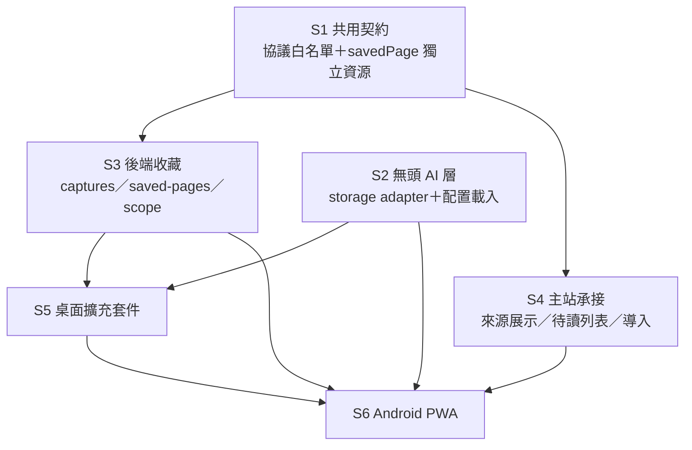

# 跨平台即時查詞、AI 問答與文章收藏 A 方案：開發實施過程

- 文件版本：1.0
- 編制日期：2026-11-02（Asia/Hong_Kong）
- 上游文件：[BDC 跨平台即時查詞、AI 問答與文章收藏：A 方案完整報告](../report/20261102013247144_BDC跨平台查詞與文章收藏A方案完整報告.md)
- 本文用途：把報告轉成可執行的開發順序、每階段落點與完成標準。分工、工期與人力估算不在本文範圍。
- 核對基準：HEAD `1dda21a`（2026-10-29）。工作區僅有未追蹤的 `docs/`，應用程式無改動，工作樹乾淨。

## 1. 本輪額外核對到的源碼事實

以下為本次直接閱讀源碼取得的結果，用來決定第 2 節的順序；不同於上游報告的既有證據。

| 編號 | 事實 | 出處 | 對開發順序的影響 |
| --- | --- | --- | --- |
| F1 | `savedPage` 不在 `READING_ENTITY_TYPES`（只有 `learningItem, articleDocument, conversation, message, vocabularyBook, vocabularyEntry, vocabularyLink`） | `shared/reading-protocol.mjs:11-19` | 不能直接塞進既有閱讀流，必須獨立資源 |
| F2 | 本地 `storeForType()` 對未知型別回 `invalid_entity_type`，`writeEntity()` 直接失敗 | `modules/reading-store.js:616-618` | 同上；且要先有 store 才能有 outbox |
| F3 | 伺服器 `parseKeys()` 以 `READING_ENTITY_TYPES` 過濾，未知型別被丟棄 | `cloudflare-worker/src/reading.js:186-193` | 同上；後端也要分流 |
| F4 | 詞條來源會被正規化成只剩 `sentence, context, articleId, contentVersion, anchor, addedAt`，逐來源釋義／譯文／url／title／savedPageId 全被靜默剝掉；來源上限 `slice(0, 100)` | `shared/reading-protocol.mjs:209-219` | 不改白名單，收藏再多也只剩原句 |
| F5 | 只有 `addVocabularyEntryWithLinkInner()` 走 `mergeVocabularySources()`（append＋去重，去重鍵 `articleId+sentence+anchor.start+anchor.quote`）；`upsertVocabularyEntry()` 是整筆覆蓋 patch，不合併 | `modules/reading-store.js:1361, 1437, 1269` | 「同詞多義追加來源」必須走前者，不能走後者 |
| F6 | 後端已有完整 mutationId 冪等帳本：`reading_mutations` 表 + `readingMutationFingerprint()` + `priorResponse()` | `cloudflare-worker/src/reading.js:198-260`、`migrations/006_reading_storage.sql:40-51` | 收藏接口沿用同一套，不要另造 |
| F7 | `token.js` 只有 `sha256Hex` 與 `randomToken`；`authenticate()` 只給出 `user_id / label / role / username / hasPassword`，沒有 scope | `cloudflare-worker/src/token.js` 全文、`worker.js:484-495` | 報告 §14 的「僅收藏 scope」是新增能力 |
| F8 | 已有 `device-pairing.js`（`handlePairRequest`、`randomPairingCode`、`normalizePairingCode`） | `cloudflare-worker/src/device-pairing.js:28,37,54` | 擴充套件連結有現成基礎可長 |
| F9 | Worker 路由是 `worker.js` 的 `path` if 鏈，共用 `http.js` 的 `json / errorJson / readJsonBody / readOptionalJsonBody / isOriginAllowed / rateLimit / getClientKey` | `cloudflare-worker/src/worker.js:431-554`、`http.js:11-166` | 新增 `/captures`、`/saved-pages` 有固定套路 |
| F10 | 四個 AI 函式本身不寫閱讀記錄、不彈 toast、不碰 DOM | `modules/api.js:740,855,934,1011` | 無頭化的障礙不在這四個函式本身 |
| F11 | 但它們間接依賴 `loadGlobalSettings()` 讀 localStorage `pen_global_settings`／`pen_global_secrets`；快取 `makeKey` 需 `globalThis.crypto.subtle`，且有 localStorage 後備 | `modules/settings.js:15-16`、`modules/cache.js:92-93,132-147` | `chrome-extension://` 下讀不到 → 需可注入的 storage adapter |
| F12 | `ai-profile-storage.js` 純 localStorage，帳戶鍵 `bdc_ai_profile_v1:<endpoint>:<user>`，`getStoredSyncUserId()` 讀 `sync_user_id`，讀不到就掉進 guest 分支 | `modules/ai-profile-storage.js:16,18,72,93,318` | 同上，這是無頭 AI 的真正瓶頸 |
| F13 | `emitChange()` 用 `document.dispatchEvent` 但包在 `try{}` 內，MV3 service worker 中安全 no-op | `modules/reading-store.js:151-157` | 好消息：事件廣播不需改 |
| F14 | 目前專案內沒有任何 `*.webmanifest`，也沒有 `sw.js` | 全庫搜尋無結果 | PWA 是全新建設，且必須 HTTPS 才能驗 |
| F15 | 備份不是 `local-backup.js` 單點決定，而分散在 `sync-core.js buildLocalSnapshot()`、`local-backup.js dataSignature()`、`reading-store.js snapshotScopeStores()/exportAll()/restoreAll()/permanentEntityCounts()` | `modules/sync-core.js:401-484`、`modules/local-backup.js:167-224`、`modules/reading-store.js:2671,2893,2965,3588` | 新增資源要一次改五處才算完整交付 |
| F16 | 遷移是 `migrations/00N_*.sql` 序列，目前到 `006_reading_storage.sql` | `cloudflare-worker/migrations/` | 新表走 `007_*` |

## 2. 開發順序總覽

**核心結論：右鍵選詞與分享入口在最後，不在最前。** 報告 §16 把「桌面最小閉環」排在第 1 階段，但從依賴看，桌面與手機都只是入口；兩者共同依賴的契約、無頭 AI、後端冪等才是前置。入口做得再快，沒有前三階段也只是個不能落盤的翻譯器。



| 順序 | 階段 | 一句話目標 | 依賴 | 可並行 |
| --- | --- | --- | --- | --- |
| S1 | 共用契約 | 讓「來源」與「待讀」有地方可存 | — | 與 S2 並行 |
| S2 | 無頭 AI 層 | 讓 AI 能在沒有 BDC 分頁、沒有 localStorage 的地方跑 | — | 與 S1 並行 |
| S3 | 後端收藏 | 讓收藏能落盤、去重、跨裝置 | S1 | 與 S4 部分並行 |
| S4 | 主站承接 | 讓使用者在 BDC 看得到收藏成果 | S1 | 前端本機部分可先做 |
| S5 | 桌面擴充套件 | 原網頁取詞、解釋、收藏 | S2 + S3 | — |
| S6 | Android PWA | 分享接收、手機查詞、收藏 | S2 + S3 + S5 的共用視圖 | — |

貫穿 S1–S6 的三條橫切線：雙語文案（第 8 節）、備份與還原（F15）、驗證（第 9 節）。這三條不是最後補，而是每階段都要同步走。

## 3. S1：共用契約

### 3.1 為什麼先做

F1–F4 是硬的：在協議白名單改好之前，任何平台收藏的逐來源釋義、譯文、URL 都會被靜默剝掉，看起來「成功」但資料已丟。這類問題在後期很難查。

### 3.2 工作項目

1. **擴充 `shared/reading-protocol.mjs`**
   - `PATCH_FIELDS.vocabularyEntry`（`:73-77`）補 `savedPageId`、`sourceUrl`、逐來源 `meaning`/`translation`/`title`。
   - `normalizeVocabularySources()`（`:209-219`）允許逐來源 `meaning`、`translation`、`savedPageId`、`url`，各自加上限。
   - 來源上限維持 `slice(0, 100)`，**不改大**：改成超限回報明確狀態，不靜默截斷（報告 §13）。
2. **新增 `savedPage` 獨立資源**，不進 `READING_ENTITY_TYPES`（F1–F3 的結論）
   - 自己的 protocol 模組（`savedPage` 的欄位與限制），放在 `shared/` 下。
   - `modules/permanent-db.js`：`STORE`（`:18-35`）加 `SAVED_PAGES`、`SAVED_OUTBOX`；`PERMANENT_DB_VERSION`（`:16`）4 → 5；在 `onupgradeneeded`（`:98`）內用 `createKeyedStore()`（`:39`）建立。
   - 自己的 outbox 與 requestId 冪等，模式沿用 `buildOutboxMutation()`／`markOutboxAcknowledged()`（F6 的客戶端對應）。
3. **URL 正規化純函式**：保留原始回訪 URL、只接受 http/https、拒絕夾帶帳密、追蹤參數只從查重鍵移除。獨立成模組以便單測。
4. **詞條保存路徑統一走合併**：所有外部收藏都必須經 `addVocabularyEntryWithLinkInner()` 的 `mergeVocabularySources()` 路徑，禁止走 `upsertVocabularyEntry()` 直接覆蓋（F5，對應報告 §5.1）。

### 3.3 完成標準

- 同一詞書對同一詞收藏兩次不同原句，來源為 2，主釋義未被覆蓋。
- 同一來源同一引用重送，去重後仍為 1。
- 來源達 100 時回傳明確狀態並保留可重試資料，不靜默裁掉。
- 未知來源（無 URL）的引用可保存，且不會被歸到上一次的網址。

### 3.4 驗證

```bash
node --test tests/ai-worker.test.mjs tests/ai-units.test.mjs tests/ai-sync-regressions.test.mjs
```

並新增：URL 正規化單測、來源合併與去重單測、來源超限單測。這批是純函式，是本專案最容易拿到自動化保障的部分，應優先補。

## 4. S2：無頭 AI 層

### 4.1 為什麼先做

F10 是假的好消息——四個 AI 函式本身乾淨，但 F11、F12 指出真正的障礙在配置來源：設定、AI profile、快取全都綁 localStorage，而 `chrome-extension://` 是另一個 localStorage 分區，帳戶鍵讀到空、直接掉進 guest 分支。不在這階段解決，擴充套件會表現成「AI 沒設定」而查不到原因。

### 4.2 工作項目

1. **抽環境適配**：把 `loadGlobalSettings()`、`loadAIProfile()`、`cache` 後面的儲存介面抽成可注入的 storage adapter。預設仍是瀏覽器 localStorage／IDB；擴充套件注入 `chrome.storage.*` 實作。
2. **配置載入改走帳戶**：擴充套件不讀本地 localStorage，改為連結後從後端取得任務配置與必要憑證（報告 §7）。
3. **語境擴充**：`analyzeWordInSentence(word, sentence, opts)` 目前只收 word＋sentence，需能帶附近段落語境；同步擴充提示與快取鍵（報告 §6.2）。快取鍵需含帳戶、供應商／模型、詞、原句、語境、語言、提示版本。
4. **確認無頭可行性**：`emitChange()` 已可安全 no-op（F13）；逐一確認 `api.js` 中 `typeof window !== 'undefined'` 保護是否覆蓋全部路徑。

### 4.3 完成標準

- 在沒有任何 BDC 分頁、沒有網站 localStorage 的環境，完成一次受控查詞。
- 缺少本機 Key 時有明確提示，不是靜默降級成 guest。
- 原句不同、詞相同時，不命中同一筆快取。

## 5. S3：後端收藏與待讀

### 5.1 工作項目

1. **Worker 路由**（F9 套路）：在 `worker.js:554` 的 `not_found` 之前加入
   - `POST /captures`、`GET /vocabulary/books`
   - `GET /saved-pages`、`PATCH /saved-pages/:id`、`DELETE /saved-pages/:id`
   - 建議各自獨立 handler 模組（仿 `handleReadingRoute`），不要塞進 `worker.js`。
2. **冪等沿用既有模式**（F6）：`captures` 用 `requestId` 去重 + mutationId 帳本。同 ID 同內容回原回執；同 ID 換內容拒絕。
3. **跨資源一致**（報告 §13）：有 URL 的加詞要完成詞條、來源引用、待讀關聯三部分。同庫用 D1 batch 交易提交；跨服務要有可恢復協調與明確部分結果。
4. **待讀 cursor**：沿用 `reading_changes` 的 `seq` 模式，但獨立表與獨立 cursor（F1–F3）。
5. **token scope**（F7）：在 `token.js` 與 `authenticate()` 層實作 capture-only scope，並在路由層實際限制，不是只加名稱。以 `device-pairing.js`（F8）的配對流程為連結入口。
6. **遷移**：新增 `migrations/007_capture_storage.sql`（F16）。

### 5.2 與既有流的邊界

- 正文保存沿用 `/articles` 系列，詞條同步沿用 `/reading` 系列。
- `savedPage` 不進 `/reading` 流（F1–F3）。
- 既有 `/articles/import` 是舊資料遷移用途，不當成 URL 抓取接口。

### 5.3 完成標準

- 重送同一 requestId 返回原回執且不產生副本。
- 多裝置同時收藏同一 URL 不出現兩個待讀記錄。
- 抓取／AI 失敗不撤銷已成功的詞與 URL。
- 只用 capture scope 的 token 無法讀取 snapshot 或 AI 憑證。

## 6. S4：主站承接

依賴 S1 的本地契約；本機部分可在 S3 聯調前先做。

1. `features/vocabulary/vocabulary.js`、`features/learning/learning.js`：詞條詳情新增來源區，可回看原句、當次意思、原句譯文、原網址。
2. `features/article/article.js`：新增待讀列表（網址、標題、收藏時間、已讀／未讀、正文狀態、操作入口）、明確正文導入、本篇已收藏詞彙總。
3. 英文學習稿：`modules/prompts/import.js` 增明確英文提取模式，保留原始內容；整理稿沿用 `articleDocument` 體系時需在 `article-store.js` 補來源版本與模式。
4. 引用重定位：刪段、重排後按 quote／原句重新確認 anchor，不能套用原 DOM offset。
5. `modules/reading-actions.js` 等共用行動層需認識新的目標詞書選擇路徑。

## 7. S5 與 S6：平台入口

### 7.1 S5 桌面擴充套件（MV3）

- `contextMenus.selectionText` 取選取文字；附近語境在使用者操作後用 `activeTab + scripting` 臨時擷取。
- content script 只傳選取內容與來源；帳戶 session、AI 憑證、供應商請求在受信任界面／背景處理。
- 背景可能停止 → 待傳資料存擴充套件自己的 IndexedDB（S1 的 outbox 模式）。
- 面板顯示與請求快照綁定：切換單詞、頁面或帳戶後，舊回應不得覆蓋目前結果。
- 共用視圖（面板 UI、詞書選單、結果呈現）現在就抽成平台中立模組，S6 直接復用。

### 7.2 S6 Android PWA

- 全新建設（F14）：`lookup/manifest.webmanifest`（含 `share_target`）、`lookup/sw.js`、`/lookup/`、`/lookup/share`。
- `start_url`、`scope` 與 `share_target` action 保持一致。
- 接收採 POST + service worker：驗證格式與大小 → 寫入短期 `shareInbox` → 303 導向只帶交接 ID → 消費成功後清理。
- Android 的 URL 常在 `text` 欄位裡，不能只讀 `url` 欄位。
- 需 HTTPS 才能驗證 PWA 安裝與系統分享，`scripts/serve.py` 的本地伺服器無法取代實機。

### 7.3 兩者的共同約束

- 查詢不直接增加永久學習資料；明確收藏才寫入（報告 §2）。
- 收藏時保存已展示的有效結果，不為同一次收藏重新生成另一個意思。
- 永久待傳操作固定 endpoint、帳戶、目標、requestId；切換帳戶後原操作保持原歸屬並暫停。

## 8. 橫切線一：雙語文案

依既有規範，`zh-CN` 與 `zh-HK` 兩份字典鍵集合必須一致，靜態文案用 `data-i18n*`，動態文案用 `t()`，不得硬編碼。本方案的動態文案量很大（解釋結果、收藏回執、錯誤、空狀態、aria 名稱），必須在 S1 就建立鍵名清單，不要等 UI 做完再補。

## 9. 橫切線二：備份與還原

F15 指出新增資源要一次改五處才算完整：

- `modules/permanent-db.js` 的 `STORE` 與版本
- `modules/reading-store.js` 的 `snapshotScopeStores()`、`exportAll()`、`restoreAll()`、`permanentEntityCounts()`
- `modules/sync-core.js` 的 `buildLocalSnapshot()` payload
- `modules/local-backup.js` 的 `dataSignature()`

漏掉任何一處，備份都不完整。

## 10. 橫切線三：驗證

既有可沿用：

```bash
node --test tests/ai-worker.test.mjs tests/ai-units.test.mjs tests/ai-sync-regressions.test.mjs
node --test tests/articles-protocol.test.mjs tests/article-import-progress.test.mjs
node tests/audit-i18n.mjs
```

新增建議：URL 正規化、來源合併去重、收藏冪等、離線佇列重送、跨帳戶作用域。

Android 實機結果不能由桌面模擬取代；PWA 安裝與系統分享必須在正式 HTTPS 上驗。

## 11. 若要壓縮範圍

按依賴從後往前砍，不要從中間砍：

1. 先砍 S6 的原生增強（本來就在報告 §1.2 之外）。
2. 再砍 S5 的「整篇導入」，保留查詞與加詞聯動待讀——這是最小閉環。
3. 保留 S1–S3 全部：這三段被砍等於整個方案不成立。

**不可砍的是 F4 的協議白名單與 F5 的合併路徑**，因為砍掉後發生的資料丟失是靜默的。

## 12. 主要風險

| 風險 | 依據 | 對應 |
| --- | --- | --- |
| 協議白名單沒改就先做 UI，收藏看似成功但資料被剝掉 | F4 | S1 前置，且先寫單測 |
| `savedPage` 塞進既有閱讀流，舊版客戶端同步被阻 | F1–F3 | 獨立資源、獨立 cursor |
| 擴充套件表現成「AI 沒設定」 | F11、F12 | S2 的 storage adapter |
| 只加 scope 名稱但沒在路由層限制 | F7 | S3 第 5 項 |
| 備份漏掉新資源 | F15 | 第 9 節五處一次改完 |
| 來源陣列超限被靜默截斷 | F4 | 明確回報並保留可重試資料 |
| PWA 在模擬環境看起來能用 | F14 | 實機 HTTPS 驗證 |

## 13. 與上游報告的差異

- 報告 §16 的階段 0／1／2 在本文拆分為 S1–S4，並把 S1（契約）與 S2（無頭 AI）提到最前且並行；報告的手機查詞界面開發可與前期共用服務並行這點，本文沿用。
- 本文的階段編號 S1–S6 與報告 §16 的階段 0–4 不是一對一對應，請以本文順序執行、以報告第 2 節產品規則與第 17 節驗收標準為準。
- 報告第 15 節列出的模組清單仍有效，本文只補充了具體函式落點與順序理由。
