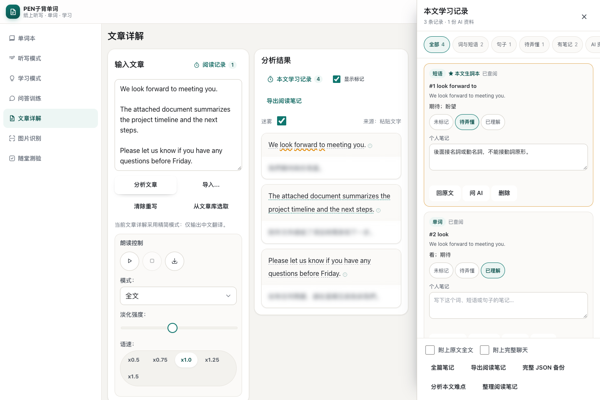
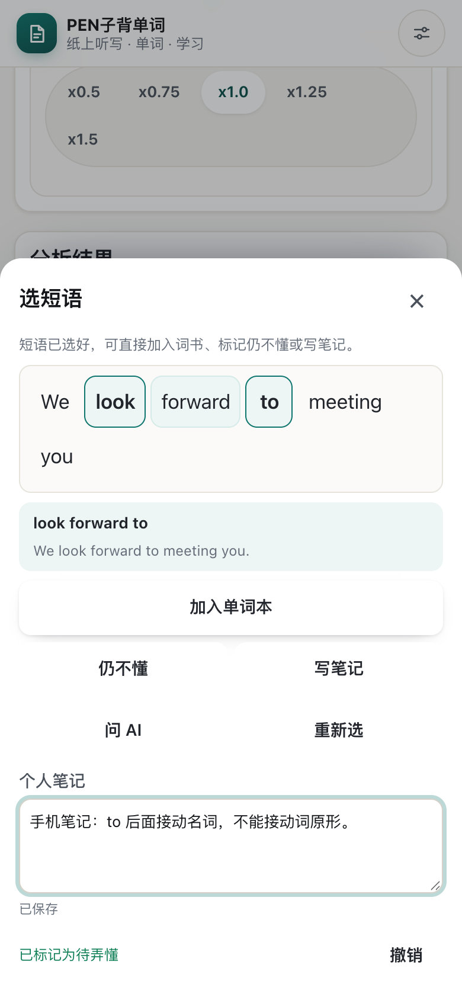

# 文章閱讀檔案：最終獨立驗收與效果

日期：2026-10-20（Asia/Shanghai）  
工作區：`/Users/linus/CODE/bdc`  
結論：本機實作與本輪驗收完成。依使用者要求，由指定「代碼執行」助手實作，主代理負責計劃、獨立重現、複核與交付。正式雲端尚未部署。

## 交付依據

- [具體修改計劃](../plan/20261019165700961_文章閱讀檔案與逐項同步實施計劃.md)：A–E 的資料遷移、逐項同步、按需讀取、閱讀操作與匯出。
- [實作及回歸報告](20261019230300000_文章閱讀檔案最終定點修正與驗收報告.md)：主要修改與本機測試結果。
- [最後備份修正報告](20261019232815677_修復完整備份文章上下文與驗證漏檢.md)：修正文章／閱讀 generation 混用，並補實際 JSON 還原驗證。本報告及此修正報告取代上一份報告中尚未充分驗證的完整備份結論。
- 執行助手最後兩輪：session 409、410；最後任務 `89989c45-252e-4cbc-8718-ec35541ee783` 已完成。

## 現在的行為與儲存關係

| 使用需求 | 已實作的行為 |
| --- | --- |
| 快速開啟文章 | 啟動讀摘要；打開時才載入該篇原文、分析與記錄，長文件和會話按需載入 |
| 重開已查詞／句 | 優先讀文章永久記錄，再讀共用快取，必要時才請求 AI |
| 文章學習檔案 | 詞、短語、句子以 articleId、原文版本及精確引用位置關聯；同詞不同出現位置可分開記錄 |
| 詞書收藏 | 詞書、詞條及文章條目透過關聯記錄連接；移出詞書不等於刪除個人筆記 |
| 閱讀標記 | 已查及待弄懂以不同線型呈現；可關閉標記；本文學習記錄集中篩選、回原文及修改理解狀態 |
| 個人筆記 | 自動保存；關閉或匯出前提交草稿；保存失敗保留輸入並允許重試 |
| AI 資料 | 聊天逐條永久保存；保留的 AI 文件具有來源條目、消息及文章版本引用 |
| 手機短語 | 點詞 → 選短語 → 點末詞；固定預覽可直接加入詞書、標記仍不懂、寫筆記或問 AI |
| 閱讀筆記匯出 | 本機產生 Markdown，包含生詞短語、句子、筆記、待弄懂及保留的 AI 資料；另提供完整 JSON 備份 |

永久層集中使用 `bdc-articles` IndexedDB v3：文章文件／摘要、學習條目、詞書／詞條／來源關聯、文章文件、會話／消息、必要的原文版本，以及 outbox／同步狀態。AI 可重建快取與永久學習資料分離。資料按同步端點及帳戶區分，訪客獨立。

同步按實體處理，使用版本、mutationId、刪除標記及衝突副本。實體與待同步操作同交易保存；舊回執不移除新修改；跨帳戶的舊非同步結果失效。Cloudflare 與 selfhost 的路由及 migration 已提供，本機回歸使用 SQLite／D1 adapter。

## 獨立驗收證據

主代理已實際重現並複核以下核心情境：

- 文章保存期間 A 切 B，舊保存返回 `stale_scope`，B 的記憶體及永久原文保持正確。
- Markdown 匯出期間切帳戶，不混入另一帳戶詞書，返回 `stale_scope`。
- 12 篇長文章的啟動只載入摘要；打開指定文章與會話才讀取相應內容。
- 雙分頁同一引用不重複建立；不同欄位修改保留；後端並發 CAS、重送與刪改衝突通過。
- 精確位置標記、關閉時保存草稿、舊 ack 保留新 outbox、舊全域資料唯一認領通過。

最後曾從實際 JSON 發現「閱讀記錄齊全但文章原文缺失」。已修正為分別捕捉文章及閱讀模組的上下文，驗證相同 scope；文章讀取失敗不可再當成空備份成功。補入的定點回歸共 5 項通過，原文章備份回歸通過。

**完整 JSON 的獨立 UI 驗證**：在空白隔離 Chrome，從產品備份介面匯入實際檔案 → 還原 → 比對 → 刷新 → 再比對。結果如下：

| 資料 | 還原數量／結果 |
| --- | --- |
| 文章原文及分析 | 1 篇，`art_reading_preview`，ID／標題／原文／分析／來源一致 |
| 詞、短語、句子學習記錄 | 3 筆，內容、引用位置、理解狀態及筆記一致 |
| 個人／AI 文件 | 2 份，內容與來源引用一致 |
| 詞書／詞條／來源關聯 | 各 1 筆，引用均存在 |
| 會話／消息 | 1 個會話、70 條消息，ID／內容／時間及會話關聯一致 |
| 刷新及執行錯誤 | 刷新後仍一致，`pageErrors=[]` |

此 fixture 沒有原文修訂，因此 `articleVersions=0`；不能以這個備份樣本宣稱驗證了非空原文歷史版本的還原。

獨立腳本與通過日誌已保存在 [驗收證據目錄](assets/20261020015728721/validation/)。原始程式完整回歸包含 Node 84/84、文章同步 29、閱讀同步 17、閱讀檔案 52、閱讀記錄 41，以及雙語／設定相關檢查；詳細逐項結果見實作報告。最後備份修正只重跑相關定點測試，沒有無目的地重跑全部套件。交付整理時 `git diff --check` 通過。

## 實際效果

以下是合成文章在實際產品模組中的操作截圖。

桌面：原文標記及本文學習記錄側欄。

手機：首末詞選出 `look forward to`，筆記顯示已保存。

- [實際匯出的閱讀筆記](assets/20261019230030000/reading-notes-zh-CN.md)
- [完整 JSON 備份樣本](assets/20261019230030000/full-backup-sample.json)
- [備份往返結果](assets/20261019230030000/full-backup-roundtrip.json)
- [雙語／尺寸截圖清單及量測](assets/20261019230030000/manifest.json)
- [預覽重現方式](assets/20261019230030000/PREVIEW.md)

桌面 1440 的句子未被側欄遮擋；手機 390×844 及窄屏 320 的兩種語言均無水平溢出，篩選列可見。畫面中的翻譯模糊是原有「迷霧」功能；教材及個人內容不隨 UI 語言轉換。

## 交付邊界

- 正式 Cloudflare／selfhost 尚未部署 migration，正式多裝置同步尚未驗收；需要新後端才能啟用本輪逐項同步。
- 本機驗證使用合成帳戶、隔離瀏覽器及阻斷外網；沒有讀取私有 `ai-config.js` 或改動正式帳戶資料。
- PostgreSQL、真實 AI 供應商輸出、iOS／Android 實機軟鍵盤與 safe-area 尚未驗證。
- IndexedDB 不可用時的 localStorage 後備模式不具備跨分頁交易保證。
- i18n 稽核仍有既有 `phonetics.` 與 phonetic-chart 硬編碼項；本輪新增鍵的 zh-CN／zh-HK 集合一致。
- 未 commit／push。以上為本機可審查交付，正式部署步驟見實作報告。
