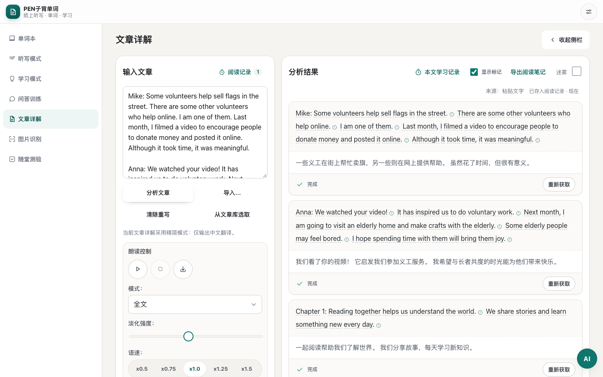
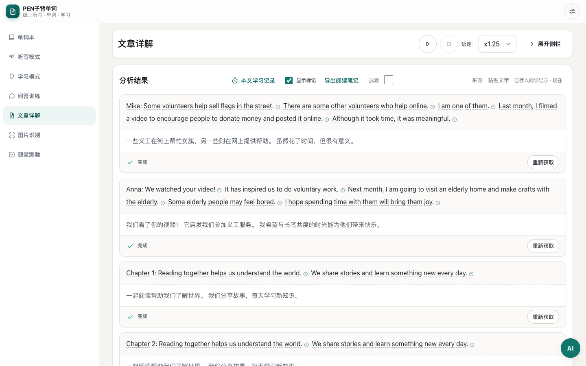

# 文章閱讀側欄收合與播放控制驗證

日期：2026-10-27（Asia/Shanghai）。

文章詳解頁新增「收起側欄／展開側欄」按鈕。收起輸入及設定後，正文填滿可用寬度，頂部保留播放／暫停、停止及語速控制；控制列會在捲動時停留於導覽下方。手機改為兩行排列，亦支援文字放大至 200%。

收合狀態即時儲存至 `pen_global_settings.reading.articleSidebarCollapsed`，重新載入後仍保留。收合時保留文章輸入、分析 DOM 及播放狀態；兩組朗讀控制共用既有音訊流程，語速及播放狀態同步。預設維持展開。

新增文案同時支援 `zh-CN` 與 `zh-HK`。切換語言會更新操作文案，保留文章內容及目前朗讀狀態，包括載入、暫停和被其他音訊打斷的情況。

主要修改為 `index.html`、`styles.css`、`features/article/article.js`、`modules/dom.js`、`modules/settings.js` 及兩份 locale 字典。新偏好僅屬本機介面設定，沿用設定合併機制，沒有新增同步資料結構。資源版本映射已由腳本更新為 `1dec8e53c620`（85 個模組）。

## 驗證結果

| 驗證 | 結果 |
| --- | --- |
| `tests/article-reading-layout.cjs` | 70/70 通過；兩種語言，375、390、768、900、1024、1440px 視窗及 200% 文字 |
| `tests/settings-autosave.cjs` | 18/18 通過 |
| `tests/release-asset-versioning.cjs` | 18/18 通過，沒有過期模組請求或頁面例外 |
| `node --test tests/audio-owner.test.mjs` | 2/2 通過 |
| `test-floating-statusbar.html` | 平台偵測、持久化、浮動控制三組檢查通過；暫停／繼續及移除可操作 |
| `node tests/audit-i18n.mjs` | 兩份字典各 2028 鍵；鍵集合及插值參數一致 |
| 語法、`git diff --check`、release map 檢查 | 通過 |

閱讀回歸涵蓋正文擴闊、收合記憶、設定合併、播放／暫停／恢復／停止、自然完成、音訊中斷與錯誤、空文章提示、載入時切換語言、黏頂控制可點擊，以及開啟學習記錄後的佈局。

i18n 稽核仍列出既有的動態鍵片段 `phonetics.`、655 項疑似硬編碼 JS 中文及 8 項 HTML 文字；本次新增翻譯鍵完整，未處理上述既有項目。瀏覽器測試使用隔離資料及語音／供應商／同步 mock，沒有驗證真實遠端 TTS 音質或連線。

## 畫面

展開側欄：

收起後正文擴闊，頂部保留朗讀控制：

香港繁體手機介面，捲動時控制列保持可見：

