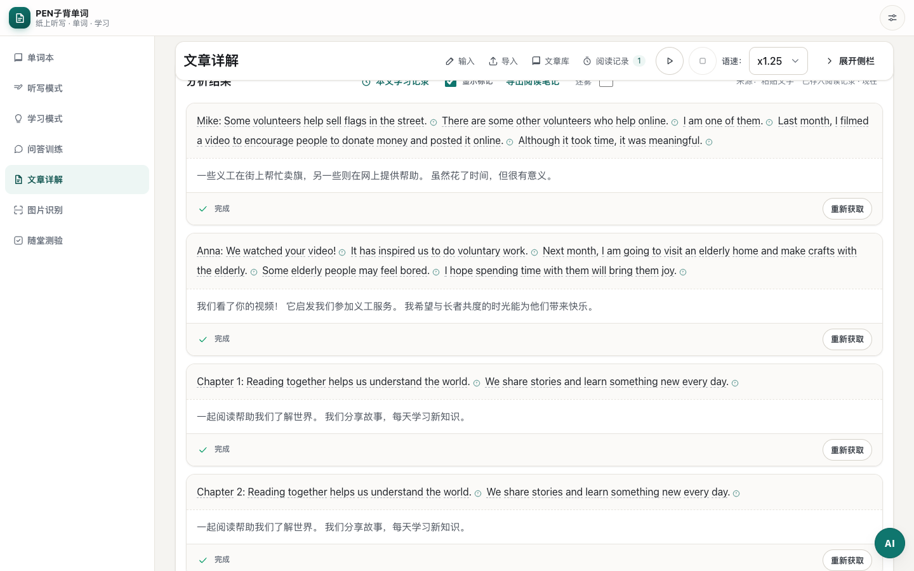
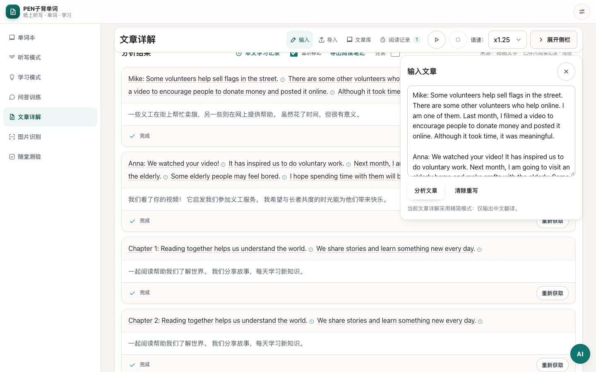

# 文章頂部精簡工具列與輸入面板驗證

日期：2026-10-27（Asia/Shanghai）。測試地址：<http://127.0.0.1:8313/#a>。

文章詳解的「輸入、匯入、文章庫、閱讀記錄」集中至頂部黏附工具列。桌面使用圖示加短文字，手機縮為圖示並保留操作名稱、提示與記錄數量。收起側欄後，正文填滿可用寬度，頂部保留播放／暫停、停止、語速及展開側欄入口。

收起側欄時，點「輸入」可展開精簡面板，直接編輯、分析或清除文章；再次點擊、按 Escape、關閉按鈕或點面板外可收起。輸入區沿用同一份 DOM 與原有操作，保留原文、分析進度及版本提示；切換語言或展開側欄時不遺失編輯內容。側欄展開時，頂部輸入入口會定位至原有編輯區。

輸入面板依視窗高度限制尺寸並可獨立捲動，手機避開底部導覽。側欄收合偏好沿用即時儲存，預設仍為展開。資源版本映射由腳本更新為 `f913d42662cf`，涵蓋 85 個模組。

## 驗證

| 項目 | 結果 |
| --- | --- |
| `tests/article-reading-layout.cjs` | 106/106 通過；zh-CN／zh-HK，375、390、768、900、1024、1440px 視窗及 200% 文字 |
| `tests/reading-records.cjs` | 41/41 通過；閱讀記錄開啟、搜尋、來源篩選、排序、改名、刪除及復原、草稿保護、文章庫匯入與手機佈局 |
| `tests/release-asset-versioning.cjs` | 18/18 通過；沒有過期模組請求或頁面例外 |
| `node tests/audit-i18n.mjs` | zh-CN／zh-HK 各 2033 鍵，鍵集合及插值參數一致；新增鍵完整 |
| JavaScript 語法、`git diff --check`、release map 檢查 | 通過 |

工具列回歸亦涵蓋焦點、Escape、鍵盤開啟匯入、切換語言保留輸入、直接清除與分析、播放狀態及語速同步、自然播放完成、音訊錯誤、載入狀態、收合記憶及學習記錄面板共存。

閱讀記錄舊測試以固定的 2026-10-18 作為最近閱讀日期，日曆推進後三篇範例均正確歸入「更早」，導致測試誤報。本次將其中一篇範例的最近閱讀時間改為執行當日，恢復跨日期分組的有效覆蓋，產品日期分組邏輯沒有變更。

i18n 稽核仍列出既有動態鍵片段 `phonetics.`、655 項疑似硬編碼 JS 中文及 8 項 HTML 文字。瀏覽器測試採隔離資料及語音／供應商／同步 mock，未驗證真實遠端語音音質及連線。前次已通過的設定即時儲存、音訊擁有者及獨立浮動控制測試，記錄於 [側欄收合驗證](20261027193809120_文章閱讀側欄收合與播放控制驗證.md)。

## 畫面

桌面精簡工具列與擴闊正文：

桌面按需展開輸入：

香港繁體手機工具列：

香港繁體手機輸入面板：

