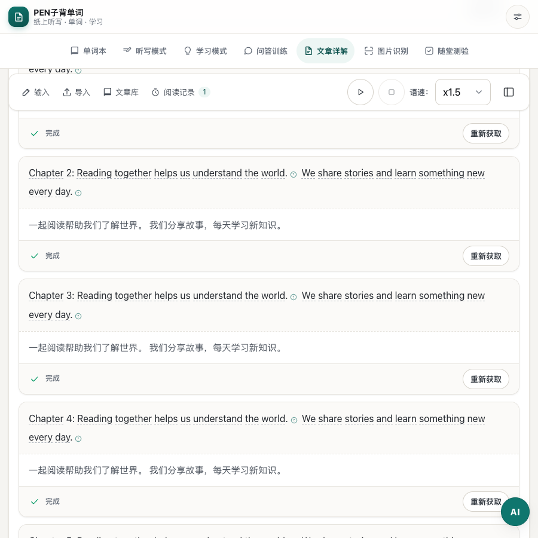

# 文章工具列標題移除與側欄圖示精簡

日期：2026-10-27（Asia/Shanghai）。測試地址：<http://127.0.0.1:8313/#a>。

移除文章懸浮工具列左側重複的「文章詳解」標題，輸入、匯入、文章庫及閱讀記錄入口從左側開始排列。右側展開／收起側欄按鈕改為單一側欄圖示，保留 44px 點擊區域、滑鼠提示、雙語輔助名稱及展開狀態。文章區域保留輔助名稱，無須顯示重複標題。

手機第一行顯示文章操作及側欄圖示，第二行保留播放、停止及語速。桌面沿用單行排列。展開／收起、輸入面板及原有播放功能沿用同一套邏輯。

驗證結果：`tests/article-reading-layout.cjs` 106/106 通過，涵蓋 zh-CN／zh-HK、375 至 1440px 視窗、200% 文字、按鈕可點擊、輸入面板、播放與語速同步及收合記憶；另已檢視桌面及手機截圖。JavaScript 語法、`git diff --check` 及資源版本映射檢查通過，版本為 `9bd9c46f1168`（85 個模組）。

兩份字典各 2033 鍵，鍵集合及插值參數一致，沿用現有側欄提示翻譯。i18n 稽核仍列出既有 `phonetics.` 動態鍵片段及疑似硬編碼文字，本次沒有新增缺失鍵。瀏覽器測試使用隔離資料及語音／AI／同步 mock。

桌面工具列：

香港繁體手機工具列：

