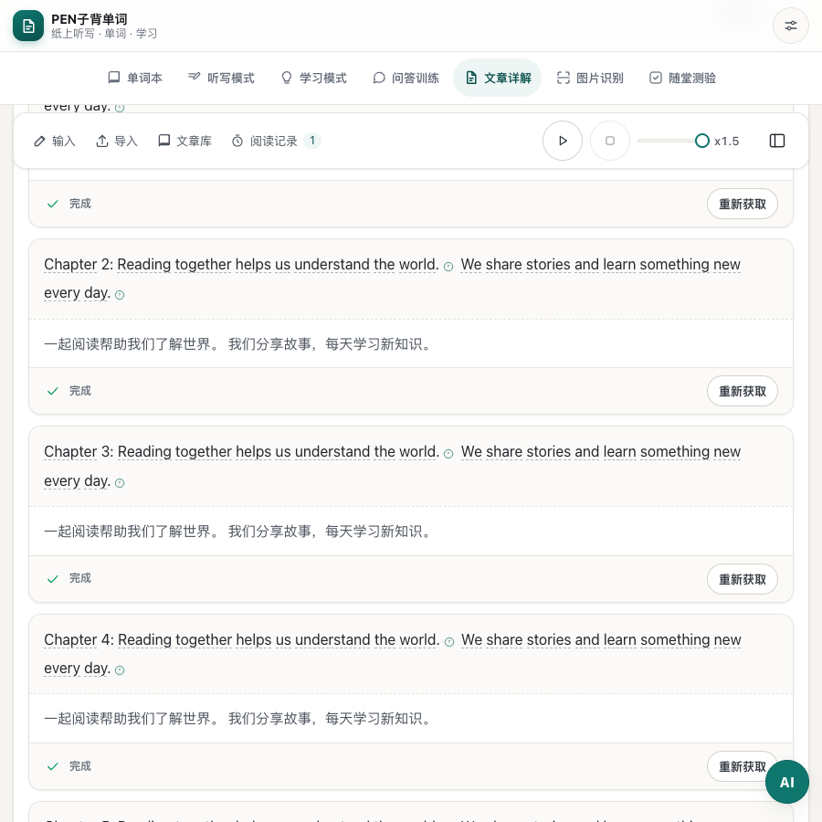
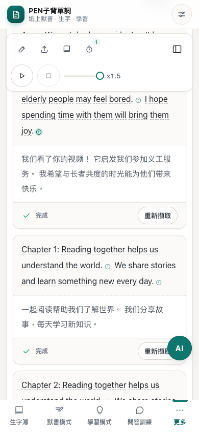

# 文章工具列語速滑軌精簡驗證

日期：2026-10-27（Asia/Shanghai）。測試地址：<http://127.0.0.1:8313/#a>。

將頂部懸浮工具列的語速下拉選單改為 80px 精簡滑軌，右側顯示目前倍速。沿用 x0.5、x0.75、x1.0、x1.25、x1.5 五檔語速，拖動時即時更新共用狀態、倍速文字及側欄選中按鈕；側欄選擇亦同步回滑軌。保留鍵盤操作、翻譯後的輔助標籤及目前倍速的 aria-valuetext，移除可見的重複「語速」標籤。

`tests/article-reading-layout.cjs` 106/106 通過，涵蓋 zh-CN／zh-HK、375 至 1440px 視窗、200% 文字、雙向語速同步、鍵盤調整、播放狀態、輸入面板及收合記憶。已檢視桌面與手機截圖，滑軌及倍速顯示完整，工具列沒有新增溢出。瀏覽器驗證使用隔離資料及語音／AI／同步 mock；本次沒有修改既有語速換算或驗證真實語音服務。

JavaScript 語法、`git diff --check` 及資源版本映射檢查通過，版本為 `b9a150c55dd0`（85 個模組）。沿用現有雙語標籤，沒有新增翻譯鍵；兩份字典各 2033 鍵，鍵集合及插值參數一致。i18n 稽核仍列出既有 `phonetics.` 動態鍵片段及疑似硬編碼文字。

桌面滑軌：

香港繁體手機滑軌：

