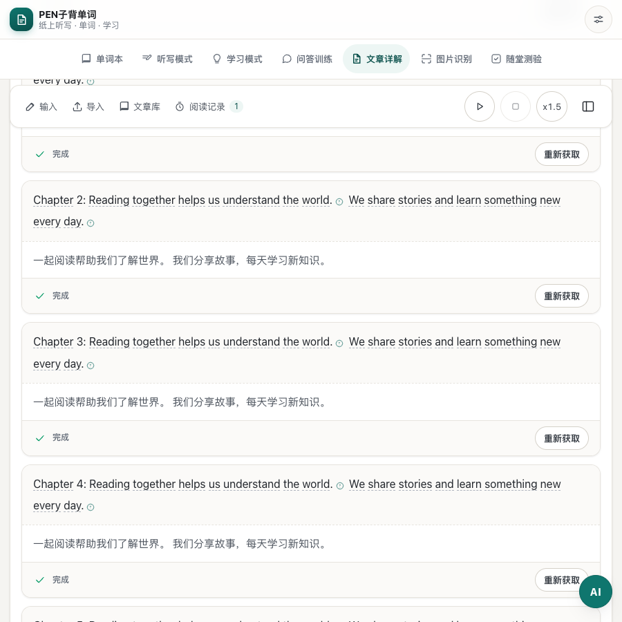
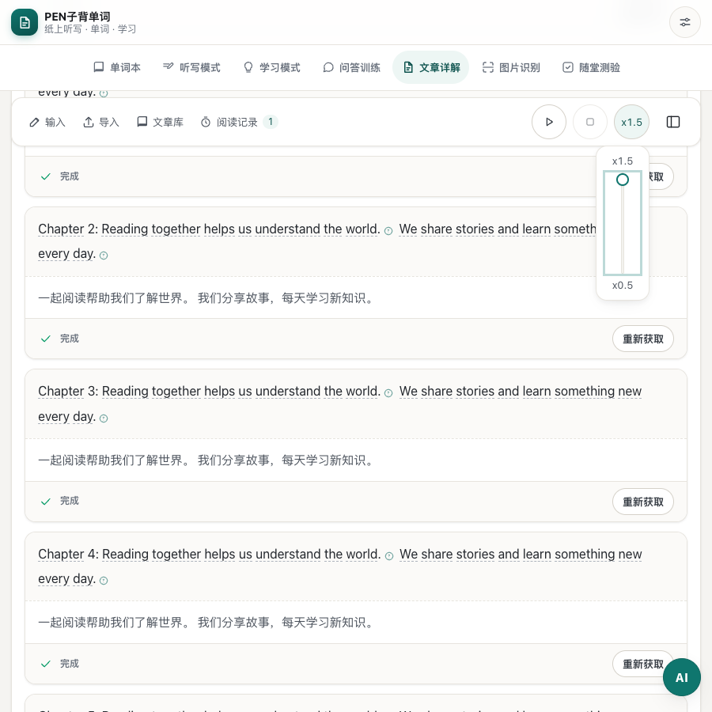
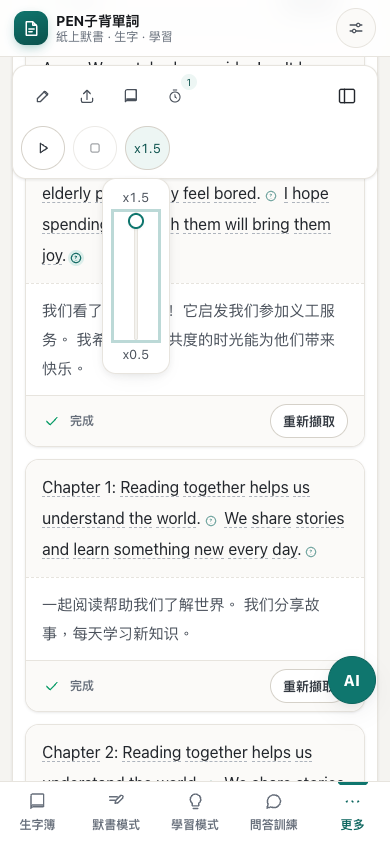

# 文章倍速按鈕與可收合直向滑軌驗證

日期：2026-10-27（Asia/Shanghai）。測試地址：<http://127.0.0.1:8313/#a>。

頂部朗讀控制預設僅顯示目前倍速按鈕。點擊倍速後，在按鈕下方展開直向滑軌，向上加速、向下減速，保留 x0.5 至 x1.5 五檔選項及側欄雙向同步。滑軌以浮層顯示，展開時不擠壓工具列。點擊外部、再次點擊倍速、焦點移出或按 Escape 可收起；Escape 將焦點還原至倍速按鈕。展開側欄時亦會關閉滑軌。

新增 `article.adjustSpeed` 的 zh-CN／zh-HK 文案，按鈕提供目前倍速的輔助名稱及展開狀態，滑軌提供雙語標籤、直向方向及目前倍速。沒有新增儲存欄位或修改語音換算。

`tests/article-reading-layout.cjs` 130/130 通過，涵蓋兩種介面語言、真實滑鼠上下拖動、鍵盤調整、外部點擊及 Escape 收起、側欄同步、375 至 1440px 視窗、200% 文字、面板邊界及原有輸入／播放流程。已檢視桌面收合、展開及香港繁體手機截圖。語音、AI 及同步使用 mock，本次未驗證真實語音服務。

JavaScript 語法、`git diff --check` 及資源版本映射檢查通過，版本為 `58feafcda064`（85 個模組）。雙語字典各 2034 鍵，鍵集合及插值參數一致；i18n 稽核仍列出既有 `phonetics.` 動態鍵片段及疑似硬編碼文字。

收合後：

點擊展開：

手機顯示：

