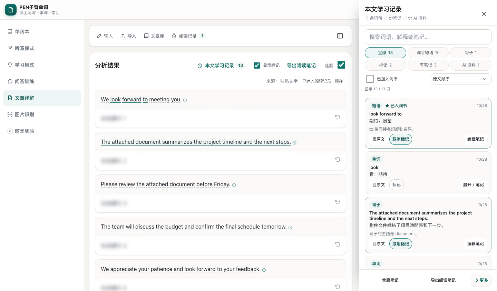
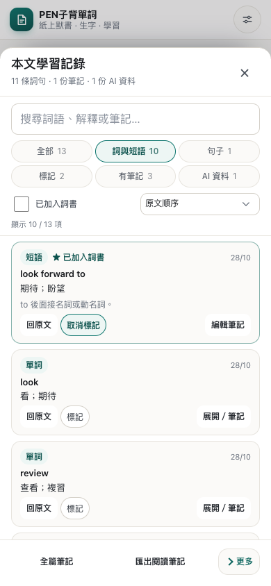

# 文章學習記錄側欄修復驗證報告

- 日期：2026-10-28
- 範圍：文章詳解「本文學習記錄」的桌面側欄、平板抽屜、手機底部面板、詞句筆記、全篇筆記及 AI 文件。
- 實作：主代理；獨立檢查：使用者指定的 DeepSeek Harness。
- 驗收素材：[20261028073750578_reading-sidebar-final](assets/20261028073750578_reading-sidebar-final/)。
- 機器可讀結果：[verification-summary.json](assets/20261028073750578_reading-sidebar-final/verification-summary.json)。
- 本機資源版本：`f10d68388cda`，89 個模組；已通過 release map 一致性檢查。
- 交付形式：目前工作區中的程式、回歸測試與文件；未執行提交、推送或部署。

## 1. 驗收結論與狀態

主要修復及主代理回歸已完成。側欄由常駐編輯表單改為緊湊記錄清單，增加搜尋及排序，修正計數、刪除復原、讀取失敗與平板版面；保留原有自動儲存、詞書整合、原文標記與同步寫入流程。

雙語側欄的 **26 組完整互動回歸全部通過**。DeepSeek 第二輪確認第一輪的 3 個必修及 4 組體驗問題均已修復，並補出兩個焦點問題；主代理重現、修正並加入回歸後，DeepSeek 最後定向複驗的 **9 個案例、131 條斷言亦全部通過**，沒有未處理的可重現缺陷。本次本機修復與獨立複驗已完成。

## 2. 可見改善與實測數據

同一組合成資料包含 11 條詞句、1 份全篇筆記、1 份 AI 文件及 1 個詞書關聯；修復前後採相同資料語意比對。

| 項目 | 修復前 | 修復後 |
| --- | --- | --- |
| 全部計數 | 徽章 12、實際 13 張卡 | 徽章及清單同為 13 |
| 有筆記計數 | 徽章 2、實際 3 張卡 | 個別筆記與全篇筆記合計 3 |
| 已加入詞書 | 1 條詞句外仍出現 2 份文件 | 只保留 1 條已入詞書的詞句 |
| 預設卡片 | 常駐輸入框及多項操作，首張約 344px | 摘要約 124–163px；展開後才顯示編輯及次要工具 |
| 390×844 工具區 | 約 153px | 67px，單行三個入口 |
| 320×844 工具區 | 約 199px | 67px |
| 390×844 首屏 | 約 1 張完整卡片 | 詞與短語視圖可完整顯示 3 張短卡；混合視圖含長句時第 3 張部分可見 |
| 六類篩選 | 後面的條件需橫向捲動 | 兩行三列，320px 仍全部可見 |
| 1024px 版面 | 兩側欄把正文壓到約 44px | 明確改用模態抽屜，關閉後繼續閱讀 |
| 桌面對照 | 定位會關閉記錄面板 | ≥1200px 並排，定位保留面板；1440px 正文 762px、1200px 正文 522px |
| 手機對照 | 定位後難返回原清單位置 | 提供返回剛才記錄的入口，恢復條件、展開項與捲動 |
| 讀取失敗 | 看似沒有資料 | 顯示錯誤及重試；計數用「—」表示未取得資料 |

尺寸結果：[layout-measurements.json](assets/20261028073750578_reading-sidebar-final/layout-measurements.json)。兩種介面語言均量測 320／390／834／1024／1200／1440px，沒有整頁橫向溢出。桌面並排與小螢幕模態分別驗證，不把被模態遮罩覆蓋的正文視為可同時閱讀的區域。

### 桌面與手機截圖

修復前：[手機原版](../research/assets/20261028013602221/touch-mobile-390-zh-CN.png)、[1024px 正文被壓窄](../research/assets/20261028013602221/layout-1024-zh-CN.png)。

修復後桌面：



修復後香港繁體手機短詞條視圖：



更多證據：[320px](assets/20261028073750578_reading-sidebar-final/zh-HK-clean-320.png)、[834px](assets/20261028073750578_reading-sidebar-final/zh-HK-clean-834.png)、[更多選單](assets/20261028073750578_reading-sidebar-final/zh-HK-menu-390.png)、[讀取失敗](assets/20261028073750578_reading-sidebar-final/zh-HK-read-error.png)。`*-clean-*` 與 `*-words-*` 為新建隔離 context 的版面截圖；完整流程截圖可能保留該流程產生的暫時提示。

## 3. 修復內容與資料保障

### 清單、計數及操作

- 新增純視圖模組 `features/article/reading-view.js`，以同一集合計算清單與篩選徽章，避免不同入口使用不同統計。
- 搜尋引用、原句、解釋、筆記及文件標題／內容；提供原文順序、最近查閱、最近修改排序。沒有查閱時間的文件不再以修改時間冒充最近查閱。
- 卡片預設顯示摘要、標記、詞書狀態及時間；按需展開筆記和次要操作。六類篩選與搜尋欄不隨清單重建。
- 底部保留全篇筆記、匯出、更多三個入口；全文及對話範圍統一在匯出對話框選擇。帳戶備份入口預勾完整備份，實際下載合法 `bdc-full-backup` JSON。
- AI 文件沿用安全 Markdown 解析，來源詞句可直接開啟；來源訊息可切到已有助手對話，不自動傳送問題。

### 刪除、撤銷及明確恢復

- 詞句、AI 文件及全篇筆記均先確認；成功後在面板提供撤銷。
- 撤銷在同一持久交易中核對最新 `deletedAt`，保留最新內容與 revision，沿用 outbox；不只恢復 DOM。另一分頁已有較新刪除時拒絕舊撤銷。
- 主動重新查閱，或明確標記、寫筆記、加入詞書，可恢復相同 occurrence；背景保存及刪除前已開始的舊回應不能自行清除刪除標記。
- 相同位置的舊隨機 ID 也會被沿用，保留原筆記，避免另建穩定 ID 造成重複。
- IndexedDB 與 localStorage 後備模式均驗證實體及 outbox 的恢復。沒有新增持久化欄位或改同步協議。

### 草稿、錯誤及非同步操作

- 保留 500ms 防抖、失焦保存、關閉／匯出前保存；失敗不關面板、不丟草稿，提供重試。
- 保存中再編輯會排隊保存最新值；舊清理計時器不會刪除新的草稿。等待後重新取得狀態節點，避免把結果寫到已卸載的卡片。
- 明確區分載入中、真正空白、篩選無結果與讀取失敗。舊文章載入結果不會覆蓋目前文章。
- 刪除、匯出、全篇筆記、AI 生成與來源跳轉在非同步邊界核對文章及帳戶範圍。舊彈窗結果不會關掉後來開啟的新彈窗。

### 響應式、雙語及鍵盤

- ≥1200px 為非模態側欄，暫時讓正文取得可讀空間；<1200px 為模態抽屜，≤767px 為底部面板。
- 模態時背景 inert、限制 Tab、支援 Escape 及關閉後焦點歸還；使用 visualViewport 更新可用高度。
- 共用 `#app-modal` 在初始化時移到 body，修正被閱讀面板覆蓋的堆疊層問題；主對話框及 options 對話框均補鍵盤與焦點還原。
- 新增 31 個成對翻譯鍵；簡體及香港繁體共用一套邏輯。介面切換保留筆記草稿、選取範圍、篩選及閱讀位置，不轉換文章、使用者筆記或歷史 AI 內容。

## 4. DeepSeek 意見及處理

第一輪：[獨立修復複核](20261028023050498_DeepSeek文章學習記錄側欄修復複核.md)。第二輪：[二次複驗](20261028072437416_DeepSeek文章學習記錄側欄二次複驗.md)，共 84 項，82 pass、0 fail、2 個焦點觀察記錄。

| 意見 | 實際處理 | 驗證 |
| --- | --- | --- |
| P1：更多選單被 `details` 裁切 | 局部設為 `overflow:visible` | DeepSeek 五種寬度真實點擊確認通過 |
| P2：手機／平板子彈窗在面板之下 | 將共用主彈窗掛到 body，補 Escape、Tab、焦點還原 | DeepSeek 五種寬度輸入／保存、AI 範圍及關閉通過；共用設定／管理流程亦回歸 |
| P3：JSON 備份入口下載 Markdown | 對話框使用 `initial.fullBackup` | DeepSeek 1440／390／320 直接確認均下載合法 JSON；一般匯出仍為 Markdown |
| O1：重試成功仍顯示保存中 | await 後重新取得節點並還焦點 | 第二輪確認「已保存／已儲存」及 store 正確 |
| O2：未查閱文件排在最近查閱最前 | 只按 `lastViewedAt` 排 | 第二輪確認文件排在已查閱詞句之後 |
| O3：讀取錯誤時徽章顯示 0 | 未 ready 顯示「—」 | 注入失敗、重試恢復數字通過 |
| O4：選單與 options 焦點 | 外點／Escape 收起選單，彈窗關閉還焦點 | 第二輪確認通過 |
| N1：收起工具的隱藏按鈕誤入 Tab 環 | 排除收起 `details` 內容，檢查 tabIndex 及實際可見性 | 主代理先重現失敗，修後雙語 390／1024 正反回繞通過 |
| N2：鼠標按重試前 blur 先重建按鈕 | 同項重試按鈕接收焦點時，由 click 統一保存 | 主代理先重現按住鼠標時按鈕消失，修後雙語 1440／390 按住 100ms、放開與保存焦點通過 |

N1／N2 的[最後獨立複驗](20261028075540353_DeepSeek文章學習記錄側欄焦點最終複驗.md)已通過：9 個案例、131 條斷言，失敗與 pageerror 均為 0。收起及展開工具的 Tab／Shift+Tab 正反回繞均正確；雙語桌面／手機真實鼠標按住重試 140ms，按鈕不被替換，放開後焦點回到同一 textarea，每次只保存一次；鍵盤重試亦無退化。原始結果：[n1n2-final-observations.json](assets/20261028075008798_deepseek-sidebar-focus-final/n1n2-final-observations.json)。文件刪除確認標題仍採通用「刪除學習記錄」，內文明確列出文件名；更細的類型標題屬可選文案，本次未擴充。

## 5. 驗證結果

所有瀏覽器驗證使用隔離 context 及合成資料；私有設定被攔截，外部請求阻斷，AI 成功路徑使用 mock 供應商。

| 驗證 | 結果與範圍 |
| --- | --- |
| AI worker／units／sync regressions＋reading protocol／reliability／view | 87／87 通過，含舊 revision tombstone 衝突規則 |
| 最終 view＋restore fallback／deleted records／partial restore | 17／17 通過，其中新增後備撤銷亦通過；與上列含部分重複，不相加當作獨立總數 |
| `reading-panel-improvements.cjs` | 26／26 通過，兩種語言各 13 組；含搜尋、計數、草稿重試、鼠標競態、鍵盤環、刪除撤銷、舊回應、跨分頁墓碑、JSON、來源對話及 mock AI 整理 |
| `reading-draft-reliability.cjs` | 5／5 通過，最後焦點修正後重跑 |
| `reading-files.cjs` | 全套通過，含手機、香港繁體、備份、遷移及帳戶隔離 |
| `reading-marks.cjs` | 統一標記核心全套通過，含重複詞句、並發筆記及舊回應 |
| `locale-panel-state.cjs` | 全套通過，最後焦點修正後重跑；草稿、游標、捲動及助手串流狀態保留 |
| `reading-panel-scope-refresh.cjs` | 44／44 通過 |
| `article-reading-layout.cjs` | 200 項通過 |
| `ai-review-regressions.mjs` | 29／29 通過 |
| `admin-users.cjs` | 54／54 通過（mock 帳戶） |
| `settings-autosave.cjs` | 18／18 通過 |
| `audit-i18n.mjs` | 執行完成；兩語各 2085 鍵、鍵差 0、插值差 0；保留全站既有候選說明，見下文 |
| `audit-flows.cjs` | 執行完成；high 0、medium 0、low 11，見下文 |
| `test-floating-statusbar.html` | 桌面與手機尺寸的偵測、設定保存／重載、暫停／繼續、移除均通過，pageerror 0 |
| 靜態檢查 | 產品及測試 JavaScript 語法、`git diff --check`、release map `--check` 通過 |

日誌：[logs](assets/20261028073750578_reading-sidebar-final/logs/)。側欄逐組結果：[results.json](assets/20261028073750578_reading-sidebar-final/results.json)。浮動頁實測：[floating-statusbar.json](assets/20261028073750578_reading-sidebar-final/floating-statusbar.json)。

雙語 audit 不是全站零問題聲明：工具仍列出動態 `phonetics.` 引用候選 1 項、疑似硬編碼候選 667 項；未將其他模組全部候選納入本次側欄修復。[原始日誌](assets/20261028073750578_reading-sidebar-final/logs/audit-i18n.txt)。

全站流程 audit 的 11 項 low 均為隔離環境未配置 AI 模型、或主動阻斷語音請求所產生的 console error；沒有把它們刪去或宣稱全站零發現。[原始發現](assets/20261028073750578_reading-sidebar-final/audit-flows.json)。

### 主要重跑命令

```bash
node --test tests/ai-worker.test.mjs tests/ai-units.test.mjs tests/ai-sync-regressions.test.mjs tests/reading-protocol.test.mjs tests/reading-reliability.test.mjs tests/reading-view.test.mjs
node --test tests/reading-view.test.mjs tests/reading-restore-fallback.test.mjs tests/reading-restore-deleted-records.test.mjs tests/reading-restore-partial.test.mjs
PORT=8313 PLAYWRIGHT_MODULE=<path-to-playwright> node tests/reading-panel-improvements.cjs
PORT=8313 PLAYWRIGHT_MODULE=<path-to-playwright> node tests/reading-draft-reliability.cjs
PORT=8313 PLAYWRIGHT_MODULE=<path-to-playwright> node tests/locale-panel-state.cjs
node tests/audit-i18n.mjs
node scripts/update-release-map.mjs --check
```

既有全站腳本本輪以隔離設定及外部網路攔截執行。`PLAYWRIGHT_MODULE` 指向本機可用的 playwright-core，未新增 npm 工作流。

## 6. 變更邊界與實測限制

- 主要產品變更在 `features/article/reading-panel.js`、新增 `reading-view.js`、`modules/reading-actions.js`、`modules/reading-store.js`、`modules/ui.js`、`styles.css` 及兩份 locale；`index.html` 由 release map 腳本更新。
- 沒有新增理解狀態、分享、跨文章索引或完整聊天管理副本；沒有改私人設定或正式帳戶。
- 沒有使用正式雲端同步或真實 AI 供應商。本機 IndexedDB、後備儲存、outbox、revision 及帳戶隔離有測試，不能替代正式環境端到端驗證。
- visualViewport 已接入，桌面瀏覽器各尺寸流程通過；未以真機軟鍵盤及螢幕閱讀器驗證，不宣稱涵蓋所有裝置。
- 手機混合清單含長句時第 3 張可能只部分可見；「至少三張」的實測對象是一般短詞條視圖。

## 7. 相關文件

- [最初整合評估](../research/20261028014811635_文章學習記錄側欄優化整合評估報告.md)
- [DeepSeek 初始獨立評估](../research/20261028014059796_DeepSeek文章學習記錄側欄獨立評估.md)
- [實施計劃與進度](../plan/20261028015414216_文章學習記錄側欄修復實施計劃.md)
- [DeepSeek 第一輪修復複核](20261028023050498_DeepSeek文章學習記錄側欄修復複核.md)
- [DeepSeek 第二輪複驗](20261028072437416_DeepSeek文章學習記錄側欄二次複驗.md)
- [DeepSeek 焦點最終複驗](20261028075540353_DeepSeek文章學習記錄側欄焦點最終複驗.md)
