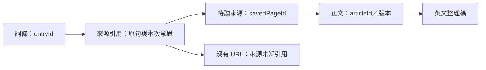
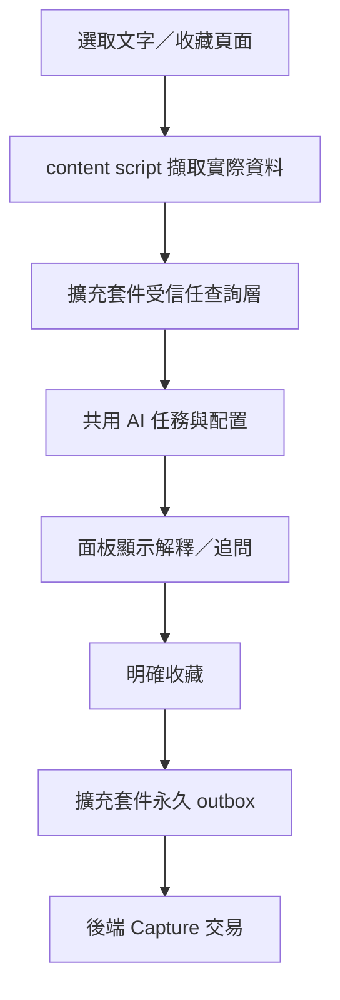

# BDC 跨平台即時查詞、AI 問答與文章收藏：A 方案完整報告

- 文件版本：1.0
- 編制日期：2026-11-02（Asia/Hong_Kong）
- 方案狀態：依使用者已接受的建議，整理為完整的產品與技術方案；尚未實作或部署。
- A 方案口徑：桌面擴充套件獨立查詞，不要求先開 BDC 分頁；Android 首期採 PWA 分享接收；共用 AI 任務、詞書、來源及文章收藏能力。Android 原生選字入口屬後續可選增強。
- 程式碼依據：前一輪核對基準為 HEAD `1dda21a`。本輪沿用 2026-11-01 的源碼、官方文件及純函式探查結果，並確認本任務沒有修改應用程式；沒有重新聲稱已完成擴充套件安裝或 Android 實機測試。
- 參考調研：[跨平台完整調研報告](../research/20261101150944285_BDC跨平台即時查詞與文章收藏完整調研報告.md)。本文件本身完整描述選定方案，毋須先閱讀歷次訪談。

## 1. 方案目標與範圍

讓使用者在閱讀其他網站時即時查懂單詞、片語與句子，必要時繼續問 AI；將值得保留的詞、原句及文章帶回 BDC，形成後續閱讀、整理、復習與測驗的學習資料。

A 方案包括三個協作部分：

| 部分 | 主要責任 |
| --- | --- |
| 桌面 Chrome／Edge 擴充套件 | 原網頁取詞、附近語境、即時解釋與追問、選詞書收藏、收藏網址及啟動整篇導入 |
| Android PWA 分享入口 | 接收來源 App 分享的文字／網址，提供手機查詢、追問、選詞書及收藏 |
| BDC 主站與共用服務 | 帳戶、AI 配置、詞書與來源、待讀列表、正文保存、英文整理稿、閱讀分析、同步及備份 |

查詢與永久收藏分開。使用者可以只查懂就繼續閱讀，也可以明確加入學習資料。

### 1.1 首期交付範圍

- 單詞語境釋義、片語解釋、句子翻譯／結構解析及自由追問。
- 擴充套件連結帳戶後可獨立執行 AI，不依賴已開啟的 BDC 分頁。
- 預設詞書、臨時改選其他詞書、新建詞書及明確修改預設。
- 收藏詞時保存原詞、有效釋義、可取得的原句與來源；有 URL 時聯動待讀收藏。
- 收藏目前頁面／連結 URL，以及使用者明確啟動的整篇正文導入。
- 在 BDC 產生英文學習稿，保留取得的原始內容。
- Android PWA 安裝與系統分享接收、手機查詢／收藏及離線暫存。
- 逐項保存、重試去重、帳戶隔離、來源展示、跨裝置同步及完整備份。

### 1.2 後續可選增強

原生 Android `ACTION_PROCESS_TEXT` 選字入口、Firefox Android／Safari 適配、當前分頁正文快照、批量提取生詞、截圖 OCR 快速查詞，以及全自動背景抓取／清理，依實際需求追加。

Android 首期依靠「分享給 BDC」。PWA 本身不會在所有 App 的選字工具列增加原生「BDC 查詞」項目，這項能力由後續 Android App 承擔。

## 2. 已確認的產品規則

| 規則 | A 方案採用的行為 |
| --- | --- |
| 查詢位置 | 桌面留在原網頁面板；手機進入分享接收的查詞界面 |
| 保存時機 | 明確點加入詞書／收藏才永久寫入學習資料，普通查詢作當次會話及快取 |
| 語境範圍 | 預設選取內容與附近句子／段落，按需要擴大到全文 |
| AI 配置 | 跟隨 BDC 相應任務模型、供應商及語言規則 |
| 加詞聯動文章 | 有來源 URL 時同步建立或沿用待讀記錄 |
| 加詞時的最低文章保證 | 先保留 URL、標題及當次引用；正文可稍後導入 |
| 整篇保存 | 明確導入正文，與批量提詞及整篇 AI 分析分開操作 |
| 混合語言頁面 | 提取已有的英文正文／例句形成學習稿，保留原始文本作對照 |
| 詞書歸屬 | 可使用預設或其他詞書；來源關聯不因目標詞書不同而丟失 |
| 臨時選擇 | 本頁閱讀會話沿用，新頁回到預設；明確操作才改預設 |
| 同詞多義 | 同一本詞書追加來源及當次語境釋義，保留已有主釋義與使用者編輯 |
| BDC 分頁 | 擴充套件正式功能無須先打開 BDC 分頁 |
| Android 首期 | 已安裝 PWA 的系統分享接收；原生選字工具列列為後續可選增強 |
| Android 缺少來源 | 允許查詢／收藏，來源標示未知，不借用上一次網頁地址 |

網址用來歸組同一來源，正文另存內容版本。同一網址的頁面更新，不表示舊引用自動適用於新正文。

## 3. 使用者操作流程

### 3.1 桌面查詞與收藏

1. 在網頁選取單詞或片語，使用右鍵「用 BDC 解釋」或擴充套件入口。
2. 擷取選取內容、原句、附近短語境、頁面標題及 URL；無法取得的欄位保持空白。
3. 面板先顯示簡短釋義、詞性與音標，可展開解析或繼續問 AI。
4. 目標按鈕顯示目前詞書，點一下保存。旁邊箭嘴可改選詞書或新建。
5. 保存成功時回覆實際目標，並顯示來源 URL 已加入／沿用待讀。
6. 使用者可繼續閱讀，不必先完成整篇正文抓取。

選取整句時，主動作切換為句子翻譯／解析。收藏句子解釋可採明確筆記入口，避免把長句當作普通單詞塞進詞書。

### 3.2 桌面收藏文章

- 目前頁面：擴充套件彈窗按「收藏此頁」。
- 未打開的連結：右鍵「收藏此連結到 BDC」，以目標 `linkUrl` 保存。
- 希望保存正文：按「整篇導入 BDC」，在 BDC 完成抓取、預覽及正式保存。

連結收藏的標題可能只有連結文字或網域；不能把搜尋結果頁的標題當成目標文章標題。正文導入後可補正。

### 3.3 Android PWA 查詢

```text
來源 App／瀏覽器選取文字或打開文章
    → 分享
    → 選擇已安裝的 BDC PWA
    → 檢查收到的文字／網址
    → 查詞、解析句子、問 AI 或收藏網址
    → 選擇詞書並明確加入
```

純文字預設顯示適合的查詢主按鈕；網址顯示收藏與導入選項。混合分享先顯示可辨識的文字及 URL，讓使用者修正。

分享是系統交接，不保證傳入原句和網址。首次分享只收到 `charge`，應顯示通用釋義；若收到整句，再提供本句意思。

### 3.4 回 BDC 學習

從待讀列表打開來源，可選開原網頁或導入正文。導入後可產生英文學習稿、使用文章詳解、檢視本篇已收藏的詞，亦可從原本的預設／自訂詞書復習。

## 4. 界面設計

### 4.1 桌面面板示意

```text
charge  /tʃɑːdʒ/  v. 收費

原句：They charge £10 for admission.
譯文：他們收取 10 英鎊入場費。
來源：Museum visitor guide

[ ＋ 加入「我的生詞」 ] [ ▾ ]
[ 詳細解析 ] [ 繼續問 AI ]
[ 收藏網址 ] [ 整篇導入 BDC ]
```

詞書選單包含預設詞書、其他可用詞書、已建立的文章詞書、新建詞書及「設為預設」。一次保存一個目標詞書，來源關聯同時建立。

本頁選了「工作英語」後，這次閱讀會話繼續使用它；換到新文件／新網址後回到預設。網站目前開啟哪本詞書，不應意外改變擴充套件的目標。

### 4.2 手機接收頁示意

```text
分享到 BDC

收到的內容：
They charge £10 for admission.

來源網址：未提供  [補充]

[解釋選中內容] [問 AI]

目標詞書：我的生詞  ▾
[加入詞書]
```

有 URL 時另顯示待讀狀態；沒有 URL 時保存實際引用，完成提示不宣稱已保存文章。

### 4.3 BDC 內的呈現

- 詞書列表維持簡短的單詞、音標與釋義。
- 詞條詳情增加來源區，可回看原句、當次意思、原句譯文及原網址。
- 待讀列表顯示網址、標題、收藏時間、已讀／未讀、正文狀態及操作入口。
- 文章內顯示「本篇已收藏的詞」，可彙總存於不同詞書的詞條。
- 所有動態文案、錯誤及 aria 名稱同時完成 `zh-CN`／`zh-HK`；使用者原文不隨 UI 語言轉換。

## 5. 需要保存的資料

| 實體 | 必要內容 | 與現有能力的關係 |
| --- | --- | --- |
| 詞條 `vocabularyEntry` | 詞／片語、音標、詞性、主釋義、目標詞書、時間及同步資訊 | 沿用既有詞條 |
| 來源引用 | 原句、附近語境、當次釋義、原句譯文、quote、前後文、可選 URL／來源 ID | 擴充目前來源契約及界面 |
| 待讀來源 `savedPage` | 穩定 ID、原始 URL、URL key、標題、收藏／閱讀狀態、文章關聯及 revision | 新增獨立小資源 |
| 正文 `article` | 穩定文章 ID、原文、來源、內容版本及分析狀態 | 沿用文章 store 與同步 |
| 整理稿 | 英文學習稿、來源正文版本、模式、生成時間 | 可利用文章文稿體系，需補選用／展示流程 |
| 查詢會話／快取 | 當次問題、語境及結果，與正式學習記錄分開 | 重用共用查詢能力，按明確保存規則處理 |
| 待傳操作／回執 | 帳戶範圍、request ID、目標、payload、提交及確認狀態 | 各平台永久佇列與後端冪等 |

### 5.1 收藏到預設詞書的實例

`charge` 初次加入時可保存主釋義「收費」，來源附 `They charge £10 for admission.`。後來遇到 `Remember to charge the battery.`，在同一詞書追加「充電」這次來源與解釋。

主釋義及使用者編輯保留，展開來源可看各次用法；不讓新文章的意思覆蓋舊語境。同一來源同一引用的重送則去重。

原句是實際引用，與 AI 生成例句分開顯示。音標或譯文暫缺不阻礙收藏；AI 錯誤提示不保存成真實釋義。

### 5.2 身份與關聯



詞書是復習集合，文章是來源群組。同一篇來源可關聯不同詞書的詞，不必自動複製到第二本文章詞書。需要獨立默寫時，再明確建立或選用文章專屬詞書。

## 6. 查詞方法與 AI 配置

### 6.1 任務映射

| 操作 | 跟隨的常規 BDC 設定 | 既有入口 |
| --- | --- | --- |
| 單詞句中意思 | 查詞／單詞分析 `wordAnalysis` | `analyzeWordInSentence()` |
| 片語 | 查詞／單詞分析 `wordAnalysis` | `analyzeSelection()` |
| 句子翻譯與結構 | 文章詳解 `articleAnalysis` | `analyzeSentence()` |
| 段落／整篇翻譯 | 文章詳解 `articleAnalysis` | `analyzeParagraph()` 等 |
| 自由追問 | AI 助手 `assistant` | 助手上下文與串流能力 |
| 文章整理 | 文章 AI 清理 `articleCleanup` | 清理入口；英文提取另增明確模式 |

現有文章中點單詞，通常實際沿用「查詞／單詞分析」，並不是把所有請求都交給「文章詳解」模型。`articleWordTranslation` 等較細映射若存在仍依既有解析器優先處理。

### 6.2 查詢策略

1. 根據實際收到的內容識別詞、片語或句子，允許使用者切換任務。
2. 優先檢查相符的有效快取，再發起 AI 請求。
3. 有原句時解釋句中意思；沒有原句時標示通用釋義。
4. 首次只提供短釋義、詞性、音標及必要說明；詳解與追問按需要執行。
5. 收藏時保存已展示的有效結果，不為同一次收藏重新生成另一個意思。

快取需區分帳戶、供應商／模型、詞與原句、語境、語言及提示版本。原句不同即使單詞相同，也不能假定釋義相同。

現有單詞函式主要接收 word＋sentence；為符合附近段落語境的需求，須同步擴充共用函式、提示及快取鍵。句子與片語入口已有 context。

第一版以語境 AI 為主要釋義來源。將來需要權威音標、常見義及詞典出處時，可再接字典型資料；AI 生成內容不冒稱來自某本詞典。

### 6.3 共享 AI 能力，不依賴已開 BDC 分頁

擴充套件自行完成帳戶連結、任務配置載入及請求；PWA 在自己的查詞頁初始化相同能力。共用邏輯包括模型解析、提示／schema、結果檢查及協議適配。

現有網站 UI 及儲存有 DOM／origin 依賴，需抽離環境適配，不能直接把整個文章頁函式搬進背景程式。既有文章查詞還會自動保存部分閱讀記錄，擴充套件則依已確認的明確收藏時機落盤。

## 7. AI 配置與憑證取得

| 配置來源 | A 方案處理方式 |
| --- | --- |
| 管理員發布的 catalog | 登入後沿用既有任務與供應商；按權限取得必要憑證，共享 Key 僅留受信任環境記憶體 |
| 已同步的個人供應商／Key | 沿用帳戶配置與憑證同步，驗證帳戶及供應商綁定 |
| 只在網站本機的個人 Key | 經明確連結／匯入提供給擴充套件；不能假定另一個 origin 或手機已擁有 |
| 區域網／本機供應商 | 客戶端必須實際可達；手機 localhost 指手機本身，需正確區網地址及瀏覽器允許 |

配置以已發布或已同步版本為準。尚未上傳的網站本機修改不會瞬間出現在擴充套件或另一部手機。

預設延用現有客戶端直連 AI 的架構。現有 Cloudflare Worker 不代理 AI；本方案不假定同步端點已是 AI 網關。若日後增加服務端任務代理，須另外處理串流、取消、模型範圍與配額，也無法直接訪問使用者電腦的 localhost。

PWA 與 BDC 同 origin 時可共用該瀏覽器環境中的帳戶儲存規則，仍須實測安裝、瀏覽器個人資料與登入狀態；不承諾不同瀏覽器或不同裝置自動共享本機 Key。

## 8. 待讀來源、URL 去重及正文身份

現有文章模型拒絕空正文，所以先收藏 URL 應使用獨立 `savedPage` 資源。正文取得後才建立或沿用 `articleId`。

建議待讀資源有自己的本機 store、outbox、後端資料與 cursor。現有閱讀 store 遇未知 entity type 會回報錯誤，直接新增類型到舊 change stream 可能阻礙舊版同步；共用收藏接口不要求共用所有同步串流。

URL 處理採保守規則：

- 保留原始回訪 URL，只接受 http／https，拒絕夾帶帳密。
- 基本主機、預設 port 等按標準解析；已確認追蹤參數可只從查重鍵移除。
- 保留有意義的 query 及 hash 路由，不任意改順序或合併 HTTP／HTTPS。
- canonical／轉址後 URL 作補充，初次收藏不任意跨站合併。
- 同 URL 歸組來源，正文以內容版本判定變更。

同一帳戶 URL key 提供業務去重，request ID 提供重送去重。重複收藏不清掉已讀狀態，也不自動覆蓋正文。

## 9. 文章保存與英文整理

狀態須清楚分開：已收藏網址、已保存正文、已整理、已分析。抓取或分析失敗不撤銷此前成功保存的詞及 URL。

URL 導入可重用既有抽取服務，但它目前只回傳內容，仍須正式保存到使用者帳戶。來源白名單、反爬、登入及動態內容會影響抓取成功率。

第一版由使用者在 BDC 明確啟動抓取及保存，不把全自動後端工作平台作為前提。整篇導入不自動把每個單詞加入詞書，也不等同啟動整篇 AI 分析。

混合語言內容提供明確「英文學習稿」模式：提取已有英文正文／例句；原始文本與整理結果分開保存。現有清理提示要求保留原始語言，新增模式需要自己的任務規則。

整理稿可評估沿用既有 `articleDocument` 文稿體系，保留來源版本與模式。選用整理稿作閱讀正文，需新增界面及位置對照。刪段、重排之後按 quote／原句重新確認 anchor，不能套用原 DOM offset。

## 10. Android PWA 的具體實作設計

### 10.1 建議的接收區域

為減少對主站導航和快取的影響，可新增獨立查詞區域，路徑僅作提案：

```text
/lookup/                     手機查詞首頁與分享接收界面
/lookup/share                Web Share Target 接收路由
/lookup/manifest.webmanifest  可安裝 PWA 資訊
/lookup/sw.js                限定查詞區域的 service worker
```

manifest 的 `start_url`、`scope` 與分享接收 action 應保持一致。主站仍可由明確連結開啟。查詞區域載入共用服務，避免每次手機查詞都初始化整個 SPA 的所有功能模組。

### 10.2 分享接收順序

建議採 POST＋service worker 接收：

1. 使用者先安裝已符合條件的 HTTPS PWA。
2. 系統向註冊的分享 action 交付 title、text、url 等實際欄位。
3. service worker 驗證格式及大小，將接收內容寫入短期 `shareInbox`。
4. 用 303 導向查詞頁，只帶交接 ID，不把整段文字塞進 query。
5. 查詞頁載入待處理內容並顯示文字／URL 預覽，處理登入或帳戶選擇。
6. 使用者啟動查詢或明確收藏；消費成功後清理短期接收記錄。

`shareInbox` 是接收暫存，不等於加入詞書或待讀。登入跳轉、頁面重開或網路失敗不應令剛分享的內容無提示消失；未消費記錄應有過期清理機制。

Android 的 URL 常在 text 裡，不能只讀取 url 欄位。多個 URL 或混合廣告文字應顯示預覽，保留使用者修正機會。

### 10.3 PWA 能力邊界

- 首期提供「分享 → BDC」，以及手動貼上後查詢。
- PWA 須安裝及受瀏覽器支援，普通網頁不自動成為系統分享目標。
- 不自動註冊原生 `ACTION_PROCESS_TEXT`，也不保證讀取來源 App 全文。
- 分享 URL 不附帶來源 App 的登入 cookie 或已載入正文。
- 離線可查看已緩存結果與保存收藏待傳；新的 AI 解釋仍需可達供應商。

### 10.4 快取與更新

service worker 只按明確清單快取查詞頁所需靜態資源；AI、登入、憑證及同步回應走相應資料層，不納入一般靜態 Cache Storage。

控制頁面版本與其 JS／提示資源應一致，避免舊頁面搭配新版契約。更新提示前確認未提交收藏已落盤；不以強制重載丟失當次輸入。

背景補傳屬可用時的增強，首期保證重新打開及前景恢復時補傳，不承諾所有手機瀏覽器在關閉後持續執行長 AI 任務。

## 11. 桌面擴充套件設計



Chrome／Edge 使用 MV3。文字選取可先由 `contextMenus.selectionText` 取得；附近語境在使用者操作後透過 `activeTab + scripting` 臨時擷取。

content script 只傳選取內容與來源；帳戶 session、AI 憑證及供應商請求在受信任界面／背景處理。後端請求需正確 host permission，並通過服務自己的 Origin 檢查。

MV3 背景可能停止，待傳資料保存在擴充套件自己的 IndexedDB。面板顯示資料與請求快照綁定，切換單詞、頁面或帳戶後，舊回應不得覆蓋目前結果。

## 12. 共用輸入與後端契約

### 12.1 查詢與收藏分開

- `LookupInput`：任務、選取內容、可選原句／語境、語境範圍、可選來源，用於解釋或追問。
- `CaptureInput`：request ID、收藏種類、目標詞書、詞條資料、已展示的有效結果與可選來源。

不同平台只把實際收到的資料轉換成同一格式，不用平台 Intent 或 DOM 物件作後端契約。

### 12.2 擬新增接口

以下名稱均為方案提案，尚未存在：

| 接口 | 職責 |
| --- | --- |
| `POST /captures` | 保存詞或網址；有 URL 的加詞同時建立／關聯待讀來源 |
| `GET /vocabulary/books` | 取得可用目標詞書及必要名稱／狀態 |
| `GET /saved-pages` | 列表及增量 cursor |
| `PATCH /saved-pages/:id` | 標題、閱讀／歸檔等修改，校驗 revision |
| `DELETE /saved-pages/:id` | 取消收藏並保留同步刪除記錄 |
| 客戶端連結／配置接口 | 作用域、可撤銷連結、任務配置及配置版本 |

正文保存沿用既有 `/articles` 系列；詞條同步沿用 `/reading` 系列。既有 `/articles/import` 是舊資料遷移用途，不能當成已存在的 URL 抓取接口。

### 12.3 保存回應

回執應指出詞條 ID、目標詞書、來源是否追加、待讀是否建立／沿用、revision 及 request ID。只確認本機保存時顯示待傳；收到伺服器確認後才顯示已同步。

## 13. 保存一致性與衝突

有 URL 的加詞需要確認詞條、來源與待讀關聯三部分都完成。資料在同一資料庫時使用交易提交；跨服務時需要可恢復協調及明確部分結果，不能只成功一半便宣稱全部完成。

| 競爭／失敗 | 處理規則 |
| --- | --- |
| 同一次請求重送 | 相同 ID＋相同內容返回原回執；同 ID 換內容則拒絕 |
| 同詞再次收藏 | 本詞書內沿用詞條並追加新來源 |
| 多裝置同時收藏 | 後端原子查重／唯一映射，必要時重新讀取、合併及有限重試 |
| 來源追加競爭 | 不用舊的整個 sources 陣列覆蓋其他裝置新增引用 |
| 目標詞書刪除 | 顯示重新選擇，不靜默轉存到其他詞書 |
| 取消收藏後收到舊重送 | 按 revision／操作身份處理，不靜默復活 |
| 明確重新收藏 | 作為新操作，恢復或建立正確狀態 |
| 並行導入文章 | 來源與 article 映射需原子認領或可恢復冪等流程 |

現有來源陣列有數量限制，超限不能靜默裁掉剛收藏的來源。首期應回報明確狀態並保留可重試資料；若實際來源量大，再採獨立引用資源及分頁，避免無限擴大詞條。

## 14. 帳戶、授權與同步

第一方客戶端經 BDC 登入後明確連結，以一次性資料換取可撤銷 session。現有 session 並無僅收藏 scope，需在認證及路由層實作相應能力限制，不能只加一個名稱就宣稱權限已收窄。

永久待傳操作固定 endpoint、帳戶、目標及 request ID。切換帳戶後，原操作保持原歸屬並暫停，不能自動派給後登入的人。

Android 接收暫存最初可能尚未有帳戶；明確查詢／收藏前確認當前身份，再產生相應作用域的操作。只保存本機 Key 的設定亦需遵守帳戶切換清理。

同步分成既有閱讀 cursor、既有文章 cursor 與新增待讀 cursor。主站前景／焦點檢查要涵蓋這些變更；目前主要看快照 `/version` 的機制需擴充，才能及時看到外部收藏。

本機完整備份、還原及變更簽章須包含待讀來源、引用與正文關聯。新增雲端表但漏掉本機備份，不算完整交付。

## 15. 實作模組與現有能力

| 區域 | 主要工作 |
| --- | --- |
| [modules/api.js](../../modules/api.js) | 復用 AI 任務；拆出執行環境依賴，補單詞段落語境 |
| [modules/ai-models.js](../../modules/ai-models.js) | 沿用任務選模次序、配置來源與協議適配 |
| [modules/ai-profile-storage.js](../../modules/ai-profile-storage.js)、[ai-catalog.js](../../modules/ai-catalog.js) | 客戶端配置及憑證取得、版本更新與帳戶範圍 |
| [modules/vocab.js](../../modules/vocab.js) | 任意目標詞書、有效結果保存及來源追加 |
| [shared/reading-protocol.mjs](../../shared/reading-protocol.mjs) | 擴充 URL、標題、來源 ID、逐來源釋義／譯文等白名單與限制 |
| [modules/reading-store.js](../../modules/reading-store.js) | 詞條與 outbox 永久保存、來源合併與回執 |
| [modules/article-store.js](../../modules/article-store.js) | 正文保存、來源映射、原文版本及重定位 |
| [modules/prompts/import.js](../../modules/prompts/import.js) | 新增明確英文學習稿規則，保留原始內容 |
| [modules/permanent-db.js](../../modules/permanent-db.js) | 待讀 store／outbox／狀態的版本遷移 |
| [modules/local-backup.js](../../modules/local-backup.js) | 新增資料完整匯出還原與簽章 |
| [features/vocabulary/vocabulary.js](../../features/vocabulary/vocabulary.js)、[learning.js](../../features/learning/learning.js) | 詞條來源明細及回訪入口 |
| [features/article/article.js](../../features/article/article.js) | 待讀列表、明確正文導入、整理稿及本篇已收藏詞 |
| [features/assistant/word-chat.js](../../features/assistant/word-chat.js) | 復用追問交互，適配外部來源會話 |
| [cloudflare-worker/src/worker.js](../../cloudflare-worker/src/worker.js) 及共用 handler | 新收藏／配置接口、授權、交易及 cursor |
| [selfhost/server.mjs](../../selfhost/server.mjs) | 若納入交付，接上共用收藏 handler／遷移並核對能力差異 |
| 新增 `extension/`、`lookup/` | 平台入口、共用視圖、PWA 安裝與分享接收 |
| locales | 靜態與動態雙語文案、錯誤及 aria 名稱 |

本專案沒有根目錄 bundler，不必為第一版更換整個技術棧。新增工具鏈若有必要，限定在相應子目錄並保留既有模組邊界。

## 16. 分期交付與完成標準

| 階段 | 交付物 | 完成標準 |
| --- | --- | --- |
| 0：共用契約與獨立 AI 驗證 | 查詢／收藏格式、來源模型、帳戶連結、配置載入及共用任務層 | BDC 分頁未開仍可完成一次受控查詞，清楚處理本機 Key 缺失 |
| 1：桌面最小閉環 | 右鍵／面板、單詞／句子解釋、追問、目標詞書、加詞聯動待讀 | 查懂→加入→回主站看見詞與來源，離線重送不重複 |
| 2：文章學習閉環 | 待讀列表、正文導入、原文版本、英文整理稿、來源詳情 | 從收藏到正文再到學習，失敗時既有收藏保留 |
| 3：Android A 方案 | 手機查詞區、PWA 安裝、POST 分享接收、暫存與恢復 | Android 可分享文字／URL 到 BDC，查詢及收藏沿用相同規則 |
| 4：可選增強 | 原生選字 App、Firefox／Safari、正文快照、批量提詞等 | 按使用需求另列相容性及驗收範圍 |

手機查詞界面的開發可與前期共用服務並行；PWA 安裝及系統分享需在正式 HTTPS 及實際手機驗證。全自動背景文章處理不阻擋首期閉環。

主要投入在獨立 AI 配置接入、跨資源保存一致性、來源展示、同步與帳戶隔離；右鍵和分享入口本身只是其中一部分。本方案以工作範圍與里程碑估算，沒有把未實作原型換算成固定工期承諾。

## 17. 驗收標準

### 17.1 功能與界面

- 單詞、片語、句子與自由問題使用正確任務及對應模型設定。
- 有原句時顯示語境釋義；沒有時顯示通用釋義範圍。
- 查詢不直接增加永久學習資料，收藏保存剛才看到的有效結果。
- 預設／其他／新建詞書均可選；臨時選擇與預設設定按規則生效。
- 來源區可看原句、當次意思及可用回訪入口。
- `zh-CN`／`zh-HK` 的動態載入、完成、錯誤及無障礙名稱一致可用。

### 17.2 資料與同步

- 同詞不同原句追加來源；重送同一引用不重複。
- 有 URL 的加詞確認詞條與待讀聯動；沒有 URL 的分享不錯配其他文章。
- 帳戶切換、401、詞書刪除及舊離線操作均保持正確作用域。
- 抓取／AI 失敗不撤銷已成功收藏。
- 重複文章導入、回應遺失與兩裝置競爭不產生不必要副本。
- 已開主站回前景後能看到外部收藏；新資源不阻擋舊版串流。
- 完整備份還原包含詞條、待讀、引用、正文及整理關聯。

### 17.3 Android PWA

- 在目標 Android Chrome／支援瀏覽器實機可安裝並出現在分享清單。
- 測試只傳文字、只傳 URL、文字混 URL、空標題、多 URL 及長文本。
- 首次接收、登入跳轉、取消返回、離線、背景回收與重新開啟不丟失未處理分享。
- 當網頁未安裝或瀏覽器不支援時，有明確的手動貼上後備入口。
- 不把 PWA 分享能力描述為已支援所有 App 的原生選字工具列。

### 17.4 實作後可沿用的既有檢查

以下是未來實作驗證入口，並非本次已執行通過：

```bash
node --test tests/ai-worker.test.mjs tests/ai-units.test.mjs tests/ai-sync-regressions.test.mjs
node --test tests/articles-protocol.test.mjs tests/article-import-progress.test.mjs
node tests/audit-i18n.mjs
```

另須按改動執行既有詞書／文章／設定 Playwright 流程，以及新增有價值的收藏冪等、混合離線佇列、PWA 分享及跨帳戶測試；Android 實機結果不能由桌面模擬取代。

## 18. 主要限制及對應行為

| 限制 | 產品行為 |
| --- | --- |
| 分享只有單詞，沒有原句 | 通用釋義，可補上下文 |
| 分享沒有 URL | 保存未知來源引用，不建立假文章 |
| 私人／登入頁無法服務端抓取 | 保留 URL，提供貼正文或未來分頁快照入口 |
| AI 暫不可用 | 允許保存詞與來源，提示待補釋義及重試 |
| 個人 Key 只在另一個裝置 | 明確連結／匯入或選用已可用供應商 |
| PWA 分享接收不支援 | 手動貼上；原生入口列可選後續 |
| 手機背景暫停 | 已落盤資料於前景恢復，狀態保持真實 |
| 來源陣列超限 | 明確回報，不靜默裁掉來源 |
| 正文被 AI 整理或改版 | 保留原始版本，重新確認引用位置 |

## 19. 已有證據與本次工作範圍

前一輪已核對的關鍵結果：

| 核對項 | 結果及影響 |
| --- | --- |
| URL-only article | 既有文章契約拒絕，需獨立待讀資源 |
| 正文存在、analysis 為空 | 可以保存，支援先保存正文再分析 |
| `savedPage` 閱讀類型 | 目前不存在，直接加入舊串流需處理協議相容 |
| 外部來源額外欄位 | URL、標題、來源 ID、逐來源釋義／譯文目前會被白名單移除 |
| AI 執行邊界 | Worker 不代理 AI；客戶端 profile／catalog 與憑證有明確範圍 |
| PWA 分享 | 官方支援已安裝 PWA 接收分享；本專案尚未實作 |
| Android Firefox 菜單 | 官方文件及 BCD 顯示不支援桌面 menus，不能原樣移植 |

原始探查摘要見[verification.json](../research/assets/20261101150944285/verification.json)。本次只整理選定方案、檢查本機引用與報告一致性，沒有改動產品程式，也沒有把未來驗收項目標記為已通過。

## 20. 參考資料與後續使用方式

### 20.1 專案調研依據

- [跨平台完整調研報告](../research/20261101150944285_BDC跨平台即時查詞與文章收藏完整調研報告.md)：平台比較、詳細源碼核對及調研歷程。
- [AI 查詞與設定復用](../research/20261101040411228_擴充套件查詞品質與AI設定復用設計訪談.md)：實際任務選模次序及獨立執行要求。
- [詞條內容與詞書選擇](../research/20261101035140872_詞條保存內容與目標詞書選擇設計訪談.md)：保存欄位、來源展示及選擇方式。

### 20.2 官方依據

以下內容於 2026-11-01 已實際核對，本報告沿用該次調研：

1. Chrome Web Share Target：<https://developer.chrome.com/docs/capabilities/web-apis/web-share-target>。
2. MDN manifest `share_target`：<https://developer.mozilla.org/en-US/docs/Web/Progressive_web_apps/Manifest/Reference/share_target>。
3. Android 接收分享：<https://developer.android.com/develop/ui/compose/sharing/receive>。
4. Android `ACTION_PROCESS_TEXT`：<https://developer.android.com/reference/android/content/Intent#ACTION_PROCESS_TEXT>。
5. Mozilla Android 差異：<https://extensionworkshop.com/documentation/develop/differences-between-desktop-and-android-extensions/>。
6. MDN BCD menus：<https://github.com/mdn/browser-compat-data/blob/main/webextensions/api/menus.json>。
7. Chrome activeTab／跨來源請求／背景生命週期：<https://developer.chrome.com/docs/extensions/develop/concepts/activeTab>；<https://developer.chrome.com/docs/extensions/develop/concepts/network-requests>；<https://developer.chrome.com/docs/extensions/develop/concepts/service-workers/lifecycle>。
8. Mozilla Readability：<https://github.com/mozilla/readability>。

本報告可作為後續需求拆分、技術設計及驗收基線。實作任務應按第 16 節里程碑拆分，保留第 2 節產品規則及第 17 節驗收標準；新增原生 App 或自動化功能時另列增量範圍。
