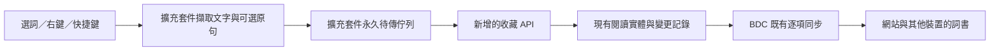

# 瀏覽器擴充套件取詞加入詞書方案調研

> 2026-11-01 補充：單詞與文章網址收藏的整體設計已整理至[整體方案調研](./20261101032534399_瀏覽器擴充套件單詞與文章網址收藏整體方案調研.md)。本篇保留單詞專題的詳細核對；共用收藏入口、網址資料模型及同步取捨以整體方案為準。

- 調研日期：2026-11-01（Asia/Hong_Kong）
- 原始需求：在其他網站閱讀時，把選取的單詞或片語加入 BDC 詞書。
- 程式碼基準：本機工作區，HEAD `1dda21a`。
- 調研方式：閱讀現有儲存、收藏、認證及同步程式，核對 Chrome／Mozilla／Apple 官方文件，並以 Node 執行來源欄位正規化探查。本次未製作或安裝擴充套件，亦未驗證正式環境後端的部署版本。

## 1. 建議結論

適合這個專案的形態是「輕量取詞擴充套件 + 現有 BDC 網站與詞書」。先支援桌面 Chrome／Edge，使用「選取文字 → 右鍵加入 BDC」及可選快捷鍵；收藏單詞時同時保留原句、來源網址與頁面標題。

接入方式可按使用目標選擇：

1. **快速試用：擴充套件打開 BDC 的單詞接收頁面。** 網站沿用自己的登入、儲存及 AI 能力，適合個人試用、未登入使用及純本機詞書。需要新增單詞接收協議，現有 URL 導入功能不能直接完成。
2. **持續使用：擴充套件呼叫一個小型收藏 API。** 擴充套件有自己的待上傳佇列，網站關閉時仍能收藏；後端把資料寫入現有逐項閱讀資料體系，網站及其他裝置沿用既有同步載入。這是正式版本的優先方向。

現有程式已具備大部分底層能力，但仍需處理四項接縫：外部網頁來源欄位、伺服器端同詞去重、擴充套件專用授權，以及外部寫入後的網站更新偵測。

## 2. 現有專案實際具備甚麼

### 2.1 詞書權威儲存已遷至 IndexedDB

[modules/reading-store.js](../../modules/reading-store.js) 的檔頭及 `upsertVocabularyBook()`、`upsertVocabularyEntry()`、`addVocabularyEntryWithLink()` 明確把永久實體與待同步 outbox 一起保存，成功後才回報。

[modules/permanent-db.js](../../modules/permanent-db.js) 使用 `bdc-articles` 資料庫，包含 `vocab_books`、`vocab_entries`、`vocab_links` 及 `reading_outbox`。資料按 endpoint／帳戶範圍隔離；IndexedDB 不可用時才使用明確的 localStorage 後備。

[modules/storage.js](../../modules/storage.js) 第 182 行起的 `saveVocabularyBooks()` 會先保存永久層，再寫 `localStorage.vocabularyBooks` 相容視圖。第 226 行起的 `loadVocabularyBooks()` 在遷移完成後以永久層為準。

**含義：** 擴充套件自行修改網站的 `localStorage.vocabularyBooks` 不能視為有效接入。即使透過 BDC 網頁寫入，也應呼叫既有儲存服務，讓 outbox、帳戶隔離及 UI 事件一併生效。擴充套件自己的 origin 也與網站不同，不能在背景程式直接打開網站那一份 IndexedDB。

### 2.2 已有「先收藏，再補解釋」的功能

[modules/vocab.js](../../modules/vocab.js) 提供：

| 能力 | 目前入口 | 對擴充套件的價值 |
| --- | --- | --- |
| 大小寫／空白／首尾標點正規化 | `normalizeWordKey()`、`cleanDisplayText()`，第 38、50 行起 | 可以沿用同詞判定規則，保留顯示用大小寫及片語 |
| 收藏到預設詞書 | `addWordToDefaultBook()`，第 277 行起 | 網站接收方案可參考其保存流程 |
| 收藏到文章詞書並保留來源 | `addWordToCurrentArticleBook()`，第 329 行起 | 已有「相同詞條追加不同語境」的產品方向 |
| 語境釋義及音標補全 | `ensureWordDetails()`，第 79 行起 | 收藏可先完成，AI 較慢或離線不影響保存 |

有兩個實作邊界：

- 預設詞書入口目前只接受預設書；文章入口依賴當前文章狀態。擴充套件若要指定任意詞書，宜抽出明確接收 `bookId` 的共用收藏服務。
- `modules/vocab.js` 匯入 UI、DOM、網站狀態及 AI 模組。它不能直接作為擴充套件 service worker 的純函式套件；可把正規化及去重規則抽至 `shared/`，網站收藏流程與後端共用。

### 2.3 已有可重用的逐項同步 API

[cloudflare-worker/src/reading.js](../../cloudflare-worker/src/reading.js) 已提供：

| 現有接口 | 功能 |
| --- | --- |
| `GET /reading/capabilities` | 回報功能、容量限制、目前 cursor 及舊快照遷移狀態 |
| `GET /reading/changes?cursor=...` | 依伺服器序號取得增量事件 |
| `POST /reading/batch` | 按指定 entity ID 批量讀取實體 |
| `POST /reading/mutations` | 按 revision 寫入實體，使用 mutation ID 處理冪等重送 |

[shared/reading-protocol.mjs](../../shared/reading-protocol.mjs) 已把 `vocabularyBook`、`vocabularyEntry`、`vocabularyLink` 納入實體契約。[modules/reading-sync.js](../../modules/reading-sync.js) 已實作網站的推送、拉取及衝突處理。

[selfhost/server.mjs](../../selfhost/server.mjs) 亦掛載同一份閱讀 API handler，因此可共同支援 Cloudflare D1、SQLite 及 PostgreSQL 後端。部署環境仍須確認已套用對應遷移並回報閱讀 API 能力。

**含義：** 後端不必再建一套獨立生詞資料庫。正式收藏接口應沿用現有實體、revision、change cursor 及冪等記錄。

### 2.4 URL 導入目前處理整本詞書

[features/vocabulary/vocabulary.js](../../features/vocabulary/vocabulary.js) 的 `handleVocabularyQueryParams()`（第 202 行起）處理 `wordlist`／`wordlistId` 及 `wordlistUrl`／`wordlistURL`，用途是提示導入預設或遠端 JSON 詞書。

目前沒有接收「單詞 + 指定詞書 + 原句 + 來源網址」的入口。把每個新詞包裝成一份遠端詞書，會引入命名、覆蓋及檔案託管等額外問題，接收單詞宜另訂協議。

## 3. 接入方法比較

| 方法 | 使用體驗 | 網站關閉時 | 改動量 | 適用場景 |
| --- | --- | --- | --- | --- |
| 書籤小工具／使用者腳本 → BDC 接收頁面 | 選詞後按書籤或腳本按鈕，到 BDC 確認 | 可打開網站後接收 | 小 | 先驗證取詞需求；使用者腳本需另裝管理器，書籤小工具可能受網站 CSP 限制 |
| MV3 擴充套件 → BDC 接收頁面 | 右鍵或快捷鍵送到 BDC，網站完成保存 | 可打開網站後接收 | 小至中 | 最快做出可用版本；沿用網站登入及本機詞書 |
| 擴充套件 → 已開啟的 BDC 分頁橋接 | 可在原網站連續操作，BDC 分頁負責寫入 | 沒有接收分頁時要打開網站或保留待送 | 中 | 重視本機詞書、希望擴充套件不持有後端令牌 |
| **擴充套件 → 收藏 API → 既有逐項同步** | **在原網站連續收藏，有明確上傳狀態** | **可先保存於擴充套件，連網後上傳** | **中** | **長期使用及跨裝置同步的優先選擇** |

網站接收方案與 API 方案可以共用取詞資料格式，日後切換傳輸方式時保留選詞、語境及 UI 程式。

### 3.1 網站接收方案怎樣落地

可新增一個獨立 capture 路由，接收包含版本、request ID、單詞及來源的短小 JSON。使用 URL 時把資料放在 fragment，接收後盡快移除 fragment；fragment 不會隨一般 HTTP 請求送到伺服器，但仍可能出現在瀏覽歷史及被頁面程式讀取，因此只傳需要的內容。

BDC 應在讀取 fragment 後先保留待處理資料，待登入／帳戶範圍及永久儲存初始化完成，再讓使用者選擇或確認目標詞書。以 request ID 避免重新整理重複新增。

若採用已開分頁橋接，可使用「擴充套件背景程式 → BDC 專用 content script → 頁面訊息處理器 → 收藏服務」。訊息必須限制類型、來源及大小，網站完成永久保存後才回覆成功。擴充套件不能僅因 `tabs.create()` 成功就顯示已收藏。

Chrome 的 `externally_connectable` 可讓網站聯絡擴充套件，但 MDN 說明 Firefox 不支援這種網頁呼叫；若要跨瀏覽器，不宜把它當作唯一橋接方式。[6]

## 4. 建議的正式版本

### 4.1 操作設計

首次使用在擴充套件設定 BDC 網站／同步端點，連結帳戶，並選定預設詞書。此設定由使用者明確選擇 `bookId`，避免依賴網站當時開啟的文章或以翻譯後書名辨認目標。

日常操作：

1. 在網頁選取單詞或片語。
2. 右鍵選「加入 BDC 單詞本」，或使用快捷鍵。
3. 擴充套件先完成本機持久化，再上傳收藏。
4. 顯示「已加入某詞書」、「已在詞書，已補充來源」或「已保存在此裝置，等待上傳」。
5. 點擊擴充套件圖示可切換詞書、檢視待上傳項目及打開 BDC。

原句及附近短語境可以選擇一起保存，後續有助於解釋多義詞。同一詞在不同文章出現時追加來源。第一版保留選取的原詞形；`running` 是否歸入 `run` 應另作明確選項，避免自動詞形還原改變使用者收藏內容。

### 4.2 資料流



佇列屬擴充套件自己的暫存，不作為第二套完整詞書。離線時可以持續收集；跨裝置可見需要後端恢復連線並接受寫入。

### 4.3 收藏 API 保持很小

建議新增下列業務接口；**這些接口名稱是提案，目前尚不存在**：

| 提議接口 | 職責 |
| --- | --- |
| `GET /vocabulary/books` | 列出目前帳戶可收藏的詞書 ID、名稱等必要資料 |
| `POST /vocabulary/captures` | 在指定詞書加入單詞／片語，或對已有詞條追加來源 |

收藏請求概念如下，對外格式可與底層 mutation 格式分開：

```json
{
  "requestId": "capture_2b4a7d15-69be-48c9-a028-d7296c571c15",
  "bookId": "existing-book-id",
  "word": "take for granted",
  "source": {
    "sourceType": "web",
    "sourceUrl": "https://example.org/article",
    "pageTitle": "Example article",
    "sentence": "We should not take clean water for granted.",
    "anchor": {
      "start": -1,
      "end": -1,
      "quote": "take for granted",
      "prefix": "We should not ",
      "suffix": "."
    }
  }
}
```

這是擬議收藏請求，不可直接當作現有 `vocabularyEntry` patch 傳送；後端須把它映射為 `source: 'browser-extension'`、`sources[]` 等正式欄位。

伺服器從授權取得擁有人、確認詞書存在且未刪除，並在同一交易中完成詞條或來源更新、change 記錄及冪等回執。回應明確區分新增、已有詞條及新增來源，提供 `entryId`／`bookId`／revision 等必要結果。

這兩個接口可避免擴充套件為了選詞書而重播整個 `/reading/changes`，或自行承擔所有閱讀實體的同步與衝突管理。現有 `/reading/mutations` 可以用來製作原型，但它沒有「按詞查重並追加來源」的業務保證，也沒有專供擴充套件列出詞書的讀取接口。

實作時宜將既有閱讀 API 的交易寫入能力抽為後端共用服務，讓收藏接口及通用 mutation 路由一起使用；只呼叫內部資料庫寫入而不產生 change／revision 會令網站漏收更新。

## 5. 源碼核對發現的必要接縫

### 5.1 外部網頁來源網址與標題目前會被丟棄

[shared/reading-protocol.mjs](../../shared/reading-protocol.mjs) 第 209 行起會重新建立 `sources[]` 項目，只保留：

`sentence`、`context`、`articleId`、`contentVersion`、`anchor`、`addedAt`。

本次以 Node 呼叫 `normalizeReadingPatch('vocabularyEntry', ...)`，傳入示例 `sourceUrl`、`pageTitle`、`sourceType`，確認三者均未保留；示例詞條本身則能通過通用 mutation 驗證。

因此要為 `sources[]` 明確增加外部來源欄位、長度限制及僅允許 http／https 的網址規則。來源去重亦要把外部網址納入，不能只比對目前的 `articleId + sentence + anchor`。同一句內容出現在兩個不同網站，應能保留兩個來源。

現有詞書層級的 `sourceUrl` 無法表達同一詞書內來自多個網站的詞條。外部網頁尚未導入 BDC 時，亦不應偽造一個內部 `articleId`。

外部網頁的全文位置不一定穩定；第一版可保存選取文字及 prefix／suffix，將絕對位置設為未知。跨來源 iframe 取不到語境或遇受限頁面時，允許只收藏可取得的選取文字；頁面標題、原句及來源 URL 不應成為收藏成功的必要條件。

[features/vocabulary/vocabulary.js](../../features/vocabulary/vocabulary.js) 的 `buildWordItem()` 目前主要顯示單詞、音標、釋義及播放按鈕。若產品需要直接回到原網頁，網站端還須補上來源檢視入口。

### 5.2 傳輸重送去重與同詞去重是兩回事

目前後端的 `mutationId` 可避免同一次 mutation 因斷線重送而重複套用，但不同 entity ID 的同詞仍可各自建立。前端 `normalizeWordKey()` 查重也不能替兩個裝置的同時新增提供原子保證。

正式收藏接口應同時處理：

- **同一次收藏重送：** 同一 request ID 與相同內容回傳原有結果；同 ID 換內容則拒絕。
- **不同收藏操作遇到同詞：** 按擁有人、`bookId`、正規化單詞定位既有詞條，追加來源，不覆蓋使用者原有釋義、例句及編輯。

可用收藏專用索引或唯一約束支援第二項，保留既有 `entryId`；舊資料需要先建立對照，現有重複詞不可在遷移時無提示刪除。

第一版建議在同一本詞書內去重；不同詞書保留各自收藏。來源追加遇 revision 競爭時需要重新讀取、合併及有限重試，不能以整個舊 `sources[]` 覆蓋其他裝置的新來源。

### 5.3 現有配對登入可以參考，權限範圍需要新增

[cloudflare-worker/src/device-pairing.js](../../cloudflare-worker/src/device-pairing.js) 已有一次性配對碼換 180 天 session 的流程；當前新碼預設 16 字元，預設有效期為 7 天，管理員可選其他期限。這比 README 仍提及的舊 10 分鐘描述更新，以程式碼為準。

不過：

- 現有配對碼由管理員為非管理員帳戶發出；一般使用者尚無自行授權擴充套件的完整流程。
- 現有 `user_sessions`／`authenticate()` 沒有僅限收藏的 scope，session 可以存取該帳戶其他受保護接口。
- selfhost 已支援閱讀 API，但目前認證以通行碼為主，不能假定與 Cloudflare 的 `/pair` 或密碼登入完全一致。

建議正式版本在已登入 BDC 網站明確授權「讀取詞書清單、加入詞條及追加來源」，使用一次性代碼換取可獨立撤銷的擴充套件令牌。伺服器須在認證及路由層實際執行權限限制；只在回應加上 scope 字串沒有作用。

網站橋接試用版可完全由網站使用既有 session。直接連線原型亦能採用既有獨立登入，但不應把這種 session 描述成「僅收藏權限」。

### 5.4 直接寫入成功後，要讓已開網站知道有新詞

[modules/sync-cloudflare.js](../../modules/sync-cloudflare.js) 第 903 行起的 `subscribeSnapshotChanges()`，目前在前景／返回焦點時主要查 `GET /version` 的快照版本，再觸發網站同步。

[cloudflare-worker/src/reading.js](../../cloudflare-worker/src/reading.js) 的一般逐項 mutation 會推進 reading cursor；快照版本的原子遞增則用於首次關閉舊快照閘門。因此，擴充套件只寫閱讀實體時，已開啟的 BDC 分頁未必會因原有 `/version` 輪詢而立即載入新詞。重新開啟登入會話或手動同步可觸發閱讀同步，但使用體驗不應依賴這一步。

建議讓網站在返回前景及可見時的適度輪詢一併比較 reading cursor；可以利用既有 `/reading/capabilities` 的 cursor，或在版本接口新增獨立的閱讀版本資訊。發現更新後沿用 `syncReading()`。亦可向已開 BDC 分頁發送一次提示作加速，但跨裝置仍應由後端 cursor 偵測提供保證。

## 6. 擴充套件端技術選擇

### 6.1 右鍵選詞是合適的第一個入口

Chrome `contextMenus` 支援只在 `selection` 情境顯示，點擊事件直接提供 `selectionText`。[1] 單純保存選取文字的版本不需要在所有網站長期注入監聽器。

如要取得原句，可在使用者右鍵、點擴充套件圖示或觸發快捷鍵後，使用 `activeTab + scripting` 在該分頁臨時執行取詞程式。[2][5] 先取得選取範圍附近的句子，限制長度；避免為找一個單詞抽取整頁內容。

建議權限按功能拆分：

| 權限／機制 | 用途 |
| --- | --- |
| `contextMenus` | 選詞後的右鍵收藏 |
| `storage` | 設定、登入狀態等必要資料 |
| `activeTab`、`scripting` | 在使用者操作後讀取選取範圍與附近語境；只存 `selectionText` 時可簡化 |
| 後端的 host permission | 由背景程式呼叫所選 BDC 同步服務；自訂服務可在設定時要求可選權限 |
| `alarms` | 若提供自動補傳，用事件喚醒背景程式重試 |
| manifest 的 `commands` | 宣告快捷鍵，並處理快捷鍵衝突或未分配的情況 |

後端網路請求應由擴充套件背景程式送出。Chrome 官方說明，content script 的跨來源 fetch 仍受網頁來源限制，而具 host permission 的擴充套件背景可進行跨來源請求。[3]

### 6.2 MV3 背景程式會停止，待傳資料必須持久化

Chrome 通常在 service worker 閒置約 30 秒後終止它，全域變數會消失；不能把待傳單詞只放在記憶體。[4]

建議把 captures 存於擴充套件自己的 IndexedDB，以交易保存每筆待傳項目，設定則用 `storage.local`。先成功入列，再嘗試網路傳送；收到伺服器的永久保存回執後才標記完成。瀏覽器重啟、下一次收藏及可選 alarm 均可觸發補傳。

每筆 capture 固定記錄 endpoint、帳戶及目標詞書。切換帳戶後暫停不屬於目前帳戶的佇列，不能把上一個帳戶未上傳的詞自動送往新帳戶。詞書被刪除時，讓使用者重新選擇目標並產生新的有效操作。

`storage.sync` 適合少量跨瀏覽器偏好，其約 100 KB 容量及瀏覽器帳戶同步語意不適合作為 BDC 詞書同步。令牌亦不應跟隨它同步；Chromium 可透過 `setAccessLevel()` 限制 content script 存取本機儲存區。[7]

### 6.3 host permission 與後端 Origin 檢查都要處理

[cloudflare-worker/src/http.js](../../cloudflare-worker/src/http.js) 及 Worker 入口除了設定 CORS header，亦會在收到不在白名單的 `Origin` 時回傳 403。selfhost 有相同類型的檢查。

因此「擴充套件有 host permission」不能保證通過伺服器自己的來源檢查。Chromium 的固定擴充套件 origin 可在部署時明確配置；Firefox 的 `moz-extension` origin 需按實際安裝行為核對，不應假設所有安裝共用固定 origin。

正式收藏路由須定義擴充套件請求的來源政策及 scoped Bearer 驗證，保留其他網站接口原有的來源限制。這部分需要用實際瀏覽器驗證請求 header，不能僅以一般網頁 fetch 或 curl 推論。

### 6.4 保持獨立目錄及簡單工具鏈

這個專案沒有根目錄 bundler，第一個 Chrome／Edge 版本可用原生 JavaScript、ES Modules 及 MV3 manifest，放在獨立 `extension/` 目錄。純規則放 `shared/`，網站 DOM、AI 設定及完整 SPA 初始化留在網站執行。

若確定同時維護多個瀏覽器，再評估 WXT 等多目標工具；它是可選的開發工具，不是收藏功能的前提。跨瀏覽器需分開處理 manifest、背景程式及 store 發布流程，不能只換 API namespace。[8]

介面必須遵守專案現有 `zh-CN`／`zh-HK` 規範，包括右鍵選單、離線狀態、重複提示、帳戶失效及動態按鈕。不要為兩個 locale 複製功能邏輯，也不要轉換選取的原文及教材內容。

## 7. AI、浮窗與側邊欄的取捨

收藏功能可以不使用 AI。語境及原文先保存，使用者回到 BDC 後可透過既有缺失資料補全功能取得釋義及音標。

特別注意：後端收到 capture 並不會自動執行瀏覽器中的 `ensureWordDetails()`。如果正式版本承諾收藏後自動補全，需要另外設計網站接收後的補全排程或後端任務；第一版可以明確採用「先收藏，回網站補全」。這能沿用現有 AI 供應商邊界，擴充套件只持有收藏所需權限。

| 入口 | 優點 | 成本及限制 | 建議 |
| --- | --- | --- | --- |
| 右鍵／快捷鍵 | 明確、干擾少，權限可按操作取得 | 比選詞後立刻按浮窗多一步 | 第一版 |
| 划詞浮窗 | 連續閱讀時操作快，可展示原句 | 長期監聽選取、網站樣式衝突、Shadow DOM／iframe／拖曳等處理較多 | 需求驗證後加入，按網站選擇啟用 |
| 瀏覽器側邊欄 | 可持續看釋義、切換詞書及查看待傳項目 | 各瀏覽器側欄 API 不一致；Chrome `sidePanel` 需額外權限及使用者手勢規則 | 需要即時解釋時再加入 [9] |

## 8. 瀏覽器及手機支援

| 平台 | 建議 |
| --- | --- |
| 桌面 Chrome／Edge | 第一目標，MV3 取詞及背景收藏流程可大量共用；上架及安裝仍按各平台處理 |
| 桌面 Firefox | 第二目標，核心取詞與 API 可共用，但需調整背景程式及網頁橋接。官方文件目前說明 Firefox 仍以 background scripts 為主，不能直接假設 Chrome service worker manifest 可用 [6][8] |
| macOS Safari | 可重用 WebExtension 的大部分 HTML／CSS／JS，另需處理 Apple 的打包、API 相容及發布流程 [10] |
| iPhone／iPad Safari | Safari Web Extensions 可行，但觸控入口、文字選取及權限體驗需單獨設計，桌面右鍵操作不能直接沿用 [10] |
| Android Firefox | 官方支援擴充套件開發，但需核對各 API 的 Android 相容性及另作觸控測試 [11] |
| 手機 Chrome | 不作為一般桌面 Chrome 擴充套件的直接運行目標。Google 文件的手機「Add to Desktop」是安裝至電腦，並非在手機執行；其他行動瀏覽器須逐一評估 [12] |

若手機收藏是主要需求，宜另研究分享入口／捷徑，把選取文字或網址送到同一套 capture 協議；網址分享不一定帶有選取單詞及原句，能力須分開界定。

## 9. 建議投入順序與驗證範圍

先確認要驗證的產品假設：使用者是否經常需要在別的網頁收藏詞語，以及收藏時是否需要切換詞書／保存語境。

快速試用可先完成網站單詞接收協議與桌面右鍵入口。若已確定要連續收藏及跨裝置使用，直接投入收藏 API、專用授權及永久待傳佇列較合適。浮窗、即時 AI 解釋、Firefox 及 Safari 可在核心流程穩定後追加。

改動量主要由後端支援範圍與授權要求決定：

| 範圍 | 相對投入 | 主要工作 |
| --- | --- | --- |
| 接收頁面試用 | 小至中 | 接收協議、任意詞書收藏服務、選詞入口、來源欄位、雙語 |
| Chrome／Edge 正式收藏 | 中 | 收藏業務 API、原子去重、專用授權、離線佇列、網站閱讀更新偵測 |
| 同時覆蓋 Cloudflare 及 selfhost | 增加 | 共用寫入服務、兩種認證差異、SQLite／PostgreSQL 驗證及部署遷移 |
| 即時浮窗解釋與多瀏覽器 | 另行投入 | 網頁相容性、AI 執行位置、瀏覽器 manifest 及發布適配 |

後續實作至少需實際驗證：同一本詞書重複收藏、不同來源追加、兩裝置同時收藏、斷網後重啟補傳、伺服器已保存但回應丟失、帳戶切換、目標詞書刪除、來源 URL 往返保存、已有 BDC 分頁返回前景後收到新詞，以及兩種介面語言。這些項目是實作驗收範圍，本次調研未執行。

## 10. 官方參考資料

以下文件於本次調研實際讀取；瀏覽器相容性仍需按實作時的最低版本及實機結果確認。

1. Chrome `contextMenus`：選取文字及右鍵入口。<https://developer.chrome.com/docs/extensions/reference/api/contextMenus>
2. Chrome `activeTab`：右鍵／快捷鍵等使用者操作可取得暫時頁面權限。<https://developer.chrome.com/docs/extensions/develop/concepts/activeTab>
3. Chrome 跨來源請求：背景與 content script 的網路權限差異。<https://developer.chrome.com/docs/extensions/develop/concepts/network-requests>
4. Chrome service worker 生命週期：停止條件及持久化要求。<https://developer.chrome.com/docs/extensions/develop/concepts/service-workers/lifecycle>
5. Chrome content scripts：隔離環境、程式化注入及頁面橋接。<https://developer.chrome.com/docs/extensions/develop/concepts/content-scripts>
6. MDN `externally_connectable`：網頁聯絡擴充套件的瀏覽器差異。<https://developer.mozilla.org/en-US/docs/Mozilla/Add-ons/WebExtensions/manifest.json/externally_connectable>
7. Chrome Storage API：本機／會話／瀏覽器同步儲存及存取限制。<https://developer.chrome.com/docs/extensions/reference/api/storage>
8. MDN 跨瀏覽器擴充套件及背景程式設定。<https://developer.mozilla.org/en-US/docs/Mozilla/Add-ons/WebExtensions/Build_a_cross_browser_extension>；<https://developer.mozilla.org/en-US/docs/Mozilla/Add-ons/WebExtensions/manifest.json/background>
9. Chrome `sidePanel`：側邊欄 API、版本及開啟規則。<https://developer.chrome.com/docs/extensions/reference/api/sidePanel>
10. Apple Safari Web Extensions：macOS／iOS 平台、重用及打包。<https://developer.apple.com/documentation/safariservices/safari-web-extensions>（實際讀取其官方文件 JSON：<https://developer.apple.com/tutorials/data/documentation/safariservices/safari-web-extensions.json>）
11. Mozilla Firefox for Android 擴充套件開發。<https://extensionworkshop.com/documentation/develop/developing-extensions-for-firefox-for-android/>
12. Google 安裝及管理擴充套件：手機 Add to Desktop 的實際含義。<https://support.google.com/chrome_webstore/answer/2664769?hl=en>
13. MDN `scripting.executeScript()`：注入權限、frame 及各瀏覽器結果差異。<https://developer.mozilla.org/en-US/docs/Mozilla/Add-ons/WebExtensions/API/scripting/executeScript>
