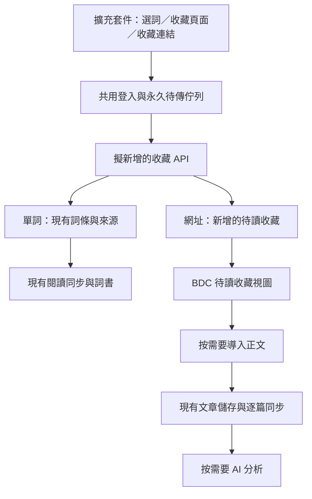

# 瀏覽器擴充套件：單詞與文章網址收藏整體方案調研

> 後續討論：使用者另提出原網頁即時 AI 詳解／追問，以及加入單詞本時聯動收藏文章來源。這會調整本篇部分保存觸發建議，最新澄清見[設計訪談](./20261101034326128_網頁即時AI詳解與來源聯動收藏設計訪談.md)，尚待使用者確認。

- 調研日期：2026-11-01（Asia/Hong_Kong）
- 需求範圍：在其他網站收藏單詞／片語，以及收藏目前頁面或連結指向的文章網址。
- 程式碼基準：BDC 本機工作區，HEAD `1dda21a`；另唯讀核對本機 `article-import-service` 的抽取服務實作。
- 前篇：[單詞收藏專題調研](./20261101031400870_瀏覽器擴充套件取詞加入詞書方案調研.md)。本篇整合兩種收藏，整體資料流與接口取捨以本篇為準。
- 驗證範圍：源碼、官方文件及純函式探查；未製作擴充套件、未測試正式環境部署，未修改應用程式。

## 1. 整體建議

建議把擴充套件定位為 BDC 的閱讀收藏入口，第一版同時支援「加入詞書」與「收藏文章網址」。兩者共用登入、離線待傳佇列、收藏回執及設定；保存後分別進入詞書與文章的待讀收藏。

文章處理分成三步，使用者可停在任何一步：

1. **收藏網址：** 保存網址、可取得的標題及收藏時間，完成後即可回到閱讀。
2. **導入正文：** 在 BDC 按需要抓取正文，建立正式文章，保留與網址收藏的關聯。
3. **AI 分析：** 對已保存的正文翻譯、解析單詞及句子，沿用現有文章學習能力。

收藏網址的成功不依賴抓取服務或 AI。抓取失敗、沒有設定 AI 或來源網站暫時不可用時，收藏仍然可用。

正式接入仍優先採用擴充套件直接呼叫收藏 API；快速試用可以先使用 BDC 接收頁面。網址收藏本身不需要抽取 DOM，比完整正文擷取更適合與取詞一同列入第一版。

## 2. 擴充套件與網站應如何使用

### 2.1 擴充套件入口

| 使用情境 | 建議操作 | 保存內容 |
| --- | --- | --- |
| 選取單詞／片語 | 右鍵「加入 BDC 單詞本」或快捷鍵 | 原詞、目標詞書、可選原句及來源網址 |
| 正在閱讀一篇文章 | 點擴充套件圖示，在彈窗按「收藏此頁」 | 目前分頁網址、標題及收藏時間 |
| 在搜尋結果／文章列表看到連結 | 右鍵「收藏此連結到 BDC」 | 連結目標網址及可取得的連結文字 |
| 希望立即開始學習 | 收藏成功後選「在 BDC 打開」 | 打開這筆收藏，讓使用者選擇導入正文 |

Chrome `contextMenus` 提供 `selectionText`、`pageUrl`、`linkUrl` 及 `frameUrl`。[外部資料 1] 要按使用者操作區分目的：

- 收藏連結時，目標是 `linkUrl`；目前分頁只作為發現來源。
- 連結尚未打開時，`tab.title` 是目前頁面的標題，不能當成目標文章標題。可先用連結文字或主機名稱，待導入時補正。
- 同時有選取文字及連結時，以使用者點擊的選單項目決定收藏種類，避免靠文字長度猜測。

本功能操作 BDC 的收藏資料，不需要讀取使用者整個瀏覽器書籤庫，因此核心版本無須申請 `bookmarks` 權限。

### 2.2 BDC 內的去向

建議在文章模組增加「待讀收藏」視圖，與已導入的文章在同一模組內切換。初版提供標題／網域搜尋、按收藏時間排序、開啟原網頁、導入正文、已讀／未讀、取消收藏即可。

已導入的收藏顯示「在 BDC 閱讀」，直接開啟既有 `#a/<articleId>`。網址尚未導入時，不應讓人以為正文已離線保存；介面分別顯示「已收藏網址」及「已保存正文」。

背景收藏完成後更新列表與數量；使用者按「在 BDC 打開」才切換閱讀上下文。現有 `applyImportedArticle()` 會取消目前分析並替換編輯內容，新的收藏接收流程應在使用者明確打開該收藏時才進入導入步驟。

剛收藏的單詞立即進入選定詞書，原網頁來源可回訪。僅收藏單詞不必自動把每個來源網址都加入待讀清單；只有明確點擊文章收藏時才增加可見收藏，避免清單充滿查過單詞的頁面。

## 3. 現有程式可重用的能力與缺口

| 核對位置 | 已有能力／實際限制 | 對方案的影響 |
| --- | --- | --- |
| [modules/vocab.js](../../modules/vocab.js) | 詞語正規化、預設／文章詞書收藏、先保存再補 AI | 抽出可指定 `bookId` 的收藏服務，共用規則 |
| [modules/reading-store.js](../../modules/reading-store.js) | 詞書、詞條及來源關聯的永久保存與 outbox | 取詞沿用現有逐項閱讀資料體系 |
| [shared/article-protocol.mjs](../../shared/article-protocol.mjs) 第 147 行起 | `normalizeArticleDocument()` 拒絕空正文，分析可以為 `null` | 網址收藏需要自己的記錄；有正文而未分析的文章則已可保存 |
| [modules/article-store.js](../../modules/article-store.js) 第 1722 行起 | `saveArticle()` 亦要求正文非空；已有穩定 ID、版本及正文變更重定位 | 正文取得後沿用正式文章保存流程 |
| [features/article/article.js](../../features/article/article.js) 第 251、3948 行起 | 匯入目前主要替換編輯上下文並保存草稿 | 不能把「套用到輸入框」當成正式文章已完成跨裝置保存 |
| 同檔第 329、3294 行起 | 分析時按當前文章或本機相同來源 URL 沿用 ID，並先存正文 | 可保留既有文章身份，但需要把正式保存與 AI 啟動拆開供導入使用 |
| [cloudflare-worker/src/articles.js](../../cloudflare-worker/src/articles.js) | 文章逐篇 CRUD、增量、容量、revision 衝突及部分重送判定 | 正文沿用 `/articles`；目前無按 URL 原子去重的收藏接口 |
| [modules/api.js](../../modules/api.js) 第 1428 行起 | 已設定抽取端點時優先取得 Markdown，另有後備取用流程 | 網站可重用既有抓取服務，部分後備分支仍可能呼叫 AI |
| [modules/article-route.js](../../modules/article-route.js) | 已有按文章 ID 直達的私人路由 | 導入完成後可以直接開啟同一篇 BDC 文章 |

本次純函式探查確認：只傳 `title + sourceUrl` 被判定為 `invalid_article`；加入非空正文並令 `analysis: null` 後可以通過。這代表「先保存正文，稍後分析」可直接建立在現有資料模型上，而「只存網址」需要補模型。

### 3.1 既有抽取服務已存在

本機另有 `/Users/linus/CODE/article-import-service`。唯讀核對其 [extract.js](/Users/linus/CODE/article-import-service/src/routes/extract.js) 及 [content-parser.js](/Users/linus/CODE/article-import-service/src/lib/content-parser.js)，已實作 `fetch → Readability → Markdown`，可回傳標題、作者、正文、發布時間及最終來源網址；不必重建整套文章抽取服務。

但這個服務與 BDC 同步後端是不同責任：它回傳內容，不會自動把內容存入指定帳戶的 BDC 文章。其 [fetcher.js](/Users/linus/CODE/article-import-service/src/lib/fetcher.js) 仍有來源主機白名單，不能把任意網站網址收藏等同於任意網站皆能成功抽取。開放更廣來源之前，亦須核對轉址與 DNS／私網檢查，而不是只放寬白名單。

## 4. 共用入口，按資料種類保存

以下命名均為設計提案，尚不存在：

| 提議接口 | 職責及權限 |
| --- | --- |
| `POST /captures` | 依 `kind: word / article_url` 保存收藏；接受客戶端 request ID |
| `GET /vocabulary/books` | 擴充套件讀取可選詞書清單 |
| `GET /saved-pages` | 網站／擴充套件讀取網址收藏及其增量 |
| `PATCH /saved-pages/:id`、`DELETE /saved-pages/:id` | 網站管理標題、閱讀狀態及取消收藏；使用 revision 與刪除記錄 |

`word` 分支寫入既有詞條及閱讀 change；`article_url` 分支寫入網址收藏及其 change。對外共用收藏請求及回執格式，內部仍分別驗證長度、權限及去重鍵。

單純收藏網址時，`POST /captures` 只完成保存，不等待外部網頁回應。這使同一套待傳佇列可以可靠處理兩種小型請求。

正文導入初版可由 BDC 頁面協調現有抓取服務與文章儲存，無須先建一個後端工作平台。若後續要求關閉網站後仍自動抓取，再另外增加持久化工作佇列、進度、取消及重試機制。

## 5. 網址收藏如何建模

### 5.1 建議增加獨立的 `savedPage` 小資源

最小資料包括：

| 欄位 | 用途 |
| --- | --- |
| `id`、擁有人範圍 | 收藏的穩定身份，與 URL／標題變更分開 |
| `originalUrl`、`urlKey`、正規化版本 | 保留可回訪網址及同帳戶內查重所用的鍵 |
| `title`、`discoveredFromUrl`（可選） | 顯示標題；由連結收藏時記錄來自哪一頁 |
| `linkedArticleId`（可空） | 正文導入完成後關聯現有文章 |
| `createdAt`、`lastCollectedAt`、`updatedAt` | 區分首次收藏、再次收藏及狀態修改 |
| `readAt`、`archivedAt`（可選） | 使用者閱讀及歸檔狀態 |
| `revision`、`deletedAt` | 多裝置修改與刪除同步 |

擁有人由伺服器認證取得，不接受客戶端指定其他帳戶。抓取工作的錯誤及進度可以另行保存；「抓取失敗」不應覆蓋這筆收藏的已讀狀態，AI 分析失敗亦不改變網址已保存的事實。

普通右鍵重複收藏預設沿用既有記錄並更新最近收藏時間；不自動把已讀改成未讀、不重新抓取正文。若已取消收藏後重新點擊收藏，視為使用者明確重新收藏，可恢復同一身份；舊的離線重送則不能把較新的刪除無提示復活。

### 5.2 為何建議使用獨立同步資源

| 選擇 | 好處 | 需要承擔的改動 |
| --- | --- | --- |
| 讓既有 article 接受空正文 | 表面上可沿用文章列表 | 改文章契約、渲染、容量計數、匯出及所有假設正文存在的路徑，舊客戶端也可能誤處理 |
| 把 `savedPage` 加進現有 reading entity types | 可共用現有 mutation 引擎 | 需升級類型、IndexedDB、備份及客戶端協商，不能直接推送給舊前端 |
| **獨立 `savedPage` 資源、變更游標及本機 store** | **語意清楚，可與舊文章／詞書同步並行** | **增加小型儲存／同步模組，重用既有帳戶、交易及 outbox 慣例** |

建議第三種。原因有具體程式碼依據：[shared/reading-protocol.mjs](../../shared/reading-protocol.mjs) 目前沒有 `savedPage`；[modules/reading-store.js](../../modules/reading-store.js) 第 2232 行起，遇到無法對應 store 的 entity type 會回報 `invalid_entity_type`。直接把新類型寫進同一 change stream，舊版網站可能卡住整頁閱讀同步。

未來若要整合為同一閱讀協議，需要先設計客戶端能力協商／分版本串流及游標處理，再加入新類型。共用擴充套件收藏入口本身，不要求三種資料使用同一條同步串流。

### 5.3 帳戶、備份及查更新也要一同補齊

新資源需跟現有資料一樣按 endpoint／帳戶隔離，在 IndexedDB 成功保存實體及 outbox 後才顯示成功；加入登入切換、401、訪客匯入及清除帳戶視圖流程。

[modules/local-backup.js](../../modules/local-backup.js) 目前另外匯出文章及閱讀資料，新收藏資源必須加入完整備份、還原及變更簽章，不能只有雲端表而缺少本機救援。

網站目前的前景輪詢主要看快照 `/version`。整合後應一起檢查閱讀 cursor、文章 cursor 及收藏 cursor，必要時擴充輕量版本回應；網站返回前景後應能看到擴充套件剛保存的詞及網址。各資料仍由各自同步模組拉取，擴充套件通知已開網站可作為加速手段。

## 6. 網址查重及文章身份

同一帳戶內以 `urlKey` 對網址收藏提供伺服器唯一保證；不同帳戶各自收藏。request ID 則處理「同一次保存因網路重送」，兩者用途不同。

網址規則應採保守策略：

- 保留原始 URL，驗證 http／https，拒絕夾帶使用者名稱／密碼的 URL。
- 可沿用 URL parser 的主機名稱大小寫、預設 port 等基本標準化。
- 已確認的追蹤參數可從查重鍵移除；原始回訪網址仍保留。不要任意移除查詢參數、改變 query 順序或 HTTP／HTTPS。
- 不要一律移除 fragment：普通段落 anchor 與 `#/article/123` 這類前端路由的含義不同。未知網站預設保留，再按網站規則收斂。
- `rel=canonical`、轉址後 URL 作為後續補充訊息；不為了收藏去追蹤全部轉址，亦不單憑跨網域 canonical 自動合併。

正式導入文章時，先檢查 `linkedArticleId`，再按同帳戶已確認的 URL 對照檢查已有文章。已有文章則直接關聯；無記錄才建立穩定 `articleId`。需要原子認領或唯一映射，避免兩個裝置同時導入裂成兩篇。

重新抓取已有正文應是明確操作，不能因再次收藏就覆蓋現有文章及學習位置。來源改版或重新抽取後，沿用既有正文版本及重定位機制；需要保留獨立副本時才建立新文章 ID。

## 7. 收藏單詞與收藏文章怎樣互相連接

詞條來源至少保存 `sourceUrl`、頁面標題、原句、選取文字及前後文；如果該網址已明確收藏，可額外保存 `savedPageId`。收藏取消後，詞條自己的來源文字及 URL 仍應保留。

目前 `sources[]` 正規化會移除 `sourceUrl`、`pageTitle` 及 `savedPageId`，本次再次以純函式探查確認；這些欄位需要加入 [shared/reading-protocol.mjs](../../shared/reading-protocol.mjs) 的白名單與容量限制，來源查重也需包含外部 URL。

一個典型流程：

1. 在某網頁收藏 `serendipity` 到預設詞書，保留原句及網址。
2. 稍後按「收藏此頁」，產生網址收藏；不重複建立詞條。
3. 回到 BDC 導入正文，該收藏取得 `linkedArticleId`。
4. 按同帳戶來源 URL 找到既有收藏詞，使用 quote、原句及 prefix／suffix 嘗試定位。
5. 只有唯一匹配時才建立正式文章位置關聯；存在歧義時保留外部來源及位置未知狀態。

不要把瀏覽器 DOM 的文字 offset 直接當成 Markdown 正文的 offset，兩者文字結構往往不同。也不必自動把既有詞搬去文章專屬詞書；先保留原詞書歸屬，透過來源關聯在文章中呈現已收藏單詞。

因此三種身份保持明確：詞條 `entryId`、網址收藏 `savedPageId`、正文 `articleId`。它們可以互相關聯，不需要在初次取詞時就先建立完整文章。

## 8. 正文取得方式與可預期體驗

| 方法 | 可重用能力 | 適用情況 | 限制及建議 |
| --- | --- | --- | --- |
| **只收藏 URL，回 BDC 導入** | 既有 `modules/api.js`、抽取服務及文章儲存 | **第一版預設** | 網站變動或需登入時可能失敗，但收藏仍保留 |
| 收藏後由伺服器自動抓正文 | 既有抽取服務 | 批量處理公開文章 | 另需持久化工作、重試、認證及結果保存；現有抽取接口本身不是背景工作系統 |
| **從當前分頁保存已載入正文** | 擴充套件臨時注入 + Readability | 登入後可讀或由 JavaScript 呈現的內容 | 作為後續「連正文一起保存」選項；只能取得使用者目前實際載入的內容 |
| 保存整頁 HTML／MHTML | 瀏覽器頁面封存能力 | 完整網頁封存 | 體積及渲染成本較高，對目前學習流程收益有限，暫不列入 |

從當前分頁抽正文有實際價值，但它是比網址收藏多一層的功能。應以 `document.cloneNode(true)` 交給 Readability，避免它修改正在閱讀的頁面；Readability 官方亦明確說明它不負責清除所有危險 HTML，輸出仍需按既有 Markdown／HTML 渲染邊界處理。[外部資料 2]

抽取後只保存文章正文與必要來源，不需傳送整頁 script、表單、cookie 或所有 iframe。圖片若只保存遠端連結，不能宣稱圖片已離線封存。文件太長、不是文章、PDF 或抽取失敗時，保留已保存的網址並提供回原頁／手動貼文入口。

若產品承諾「收藏不使用 AI」，不能不加區別地呼叫現有整條 URL 匯入管線：`fetchArticleViaWorker()` 在沒有 Markdown、只有 HTML／text 時仍可能走 AI 抽取，後備流程亦有第三方服務。應提供明確的純抽取模式，或只在使用者選擇後清理；網址保存本身永遠不進入這條重處理流程。

## 9. 共用權限與離線行為

桌面 Chrome／Edge 第一版仍可維持 MV3、原生 JavaScript 及獨立 `extension/` 目錄。右鍵文字／連結、當前頁收藏、設定及待傳狀態可以共用一個彈窗。

基本權限是 `contextMenus`、`storage` 與所選收藏後端的 host permission；使用者按圖示取得目前分頁資料或擷取原句時使用 `activeTab`，實際注入時加 `scripting`。自動補傳可用 `alarms`。無須一開始在所有網站長期注入取詞浮窗。

兩種收藏都要先存擴充套件自己的永久佇列，記錄 endpoint、帳戶、kind、request ID 及 payload，再嘗試上傳；背景 service worker 停止或瀏覽器重啟後可繼續。不同種類有各自項目狀態，文章抓取不能擋住之後的單詞上傳。

授權建議是「讀取詞書清單、收藏單詞及網址、讀取必要收藏狀態」。網站端的全文閱讀、AI 金鑰、批量刪除及後端任意 URL 代理不需要授予基本擴充套件。現有 session 沒有這種 scope，正式版仍須補專用授權與路由層驗證；網站橋接試用版則可由網站沿用既有 session。

若同時有離線的再次收藏及另一台裝置的較新刪除，需按實體 revision／預期狀態處理衝突；不能把收到的所有 capture 都當成使用者最新意圖。

## 10. 手機與其他入口

有了共用收藏協議，之後手機分享文章網址、瀏覽器書籤小工具及手動貼上 URL 都可接入相同資料模型。網址分享通常比手機取詞容易，值得優先列為行動端延伸。

Android 可另評估已安裝 PWA 的 `share_target`；這是「接收系統分享」，與 `navigator.share()` 的向外分享不同，並非所有瀏覽器皆支援。會改動收藏資料的直接分享接收應處理 POST，純靜態伺服器可能需要 service worker 或接收後端配合。[外部資料 3]

iPhone／iPad 可評估 Safari 擴充套件或捷徑接收分享網址。兩者仍需獨立驗證安裝及登入體驗，不能把桌面 Chrome 擴充套件視為通用手機入口。

## 11. 建議分期與相對投入

| 階段 | 範圍 | 建議結果 |
| --- | --- | --- |
| **第一版：兩種收藏一起完成** | 右鍵取詞、收藏當前頁／連結、預設詞書、共用登入與待傳佇列、網址收藏列表、來源與 URL 去重 | **日常可連續收藏，BDC 能看到詞及待讀網址；不依賴 AI** |
| **第二版：接通閱讀閉環** | 待讀收藏按需導入正文、導入後直接閱讀、與既有文章／收藏詞關聯、明確失敗重試 | **收藏 → 閱讀 → 學詞；沿用現有 AI 分析** |
| 第三版：提高成功率及多端體驗 | 當前分頁正文保存、可選自動導入、Firefox／Safari、手機分享 | 視使用頻率投入，分開驗證平台差異 |

若第一版要更快試用，可讓兩種 capture 都打開 BDC 接收頁面，先使用網站 session 及本機儲存。網站頁面須確實保存 `savedPage` 後才回覆成功；只替使用者填入現有 URL 匯入框仍不等於完成網址收藏。

增加「收藏文章網址」的擴充套件 UI 成本較低，主要新增投入在 BDC 的網址收藏資源、本機持久化、同步、備份及列表。若再要求自動抓正文，才進一步增加抽取、工作佇列及內容版本處理。因此宜把網址收藏放進第一版，把正文與 AI 的自動化獨立估算。

## 12. 實作驗證範圍與本次確認

後續實作需要驗證：

- 收藏目前頁及收藏連結分別保存正確目標；未取得目標標題也能成功。
- 同帳戶重複 URL、追蹤參數、query 識別文章及 hash 路由的查重結果符合規則。
- 單詞與 URL 混合離線收藏，重啟後補傳；伺服器已保存但回應丟失時不重複新增。
- 帳戶切換、401、詞書刪除、取消收藏後的舊重送及明確重新收藏。
- 抽取服務失敗、無 AI、需登入頁面與非文章頁，均保留網址收藏。
- 導入到既有文章及兩裝置並行導入不產生不必要副本；正文更新不誤改舊學習位置。
- 新收藏在已開 BDC 分頁返回前景後可見，且不阻礙舊版詞書／文章同步。
- 完整備份及還原包含網址收藏與文章關聯；`zh-CN`／`zh-HK` 動態狀態一致。

本次實際執行的純函式探查結果：

| 探查 | 結果 |
| --- | --- |
| 網址及標題、無正文可否作為文章 | 否，`invalid_article` |
| 有正文、無 AI 分析可否作為文章 | 可以 |
| `savedPage` 是否已是 reading entity type | 否 |
| 詞條來源是否保留 `sourceUrl`／`pageTitle`／`savedPageId` | 目前均被正規化移除 |

以上為模型與程式行為核對，不代表已完成擴充套件端的安裝或端到端驗證。

## 13. 參考資料

前篇已列出 Chrome MV3、網路權限、儲存、跨瀏覽器與 Safari 的官方資料。本次新增／再核對：

1. Chrome `contextMenus`，選取文字、頁面及連結 URL。<https://developer.chrome.com/docs/extensions/reference/api/contextMenus>
2. Mozilla Readability，DOM clone、抽取結果及 HTML 處理邊界。<https://github.com/mozilla/readability>；實際讀取 <https://raw.githubusercontent.com/mozilla/readability/main/README.md>
3. MDN `share_target`，安裝 PWA 後接收分享、POST 與瀏覽器支援限制。<https://developer.mozilla.org/en-US/docs/Web/Progressive_web_apps/Manifest/Reference/share_target>
4. Chrome `action`，擴充套件工具列與彈窗入口。<https://developer.chrome.com/docs/extensions/reference/api/action>
5. 本專案既有 [文章導入服務源碼歸位調研](./20261015122623290_文章導入服務源碼歸位與Docker方案.md)，並以上文連結的本機服務程式核對實際能力。
