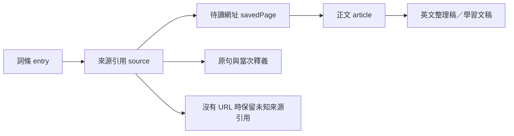
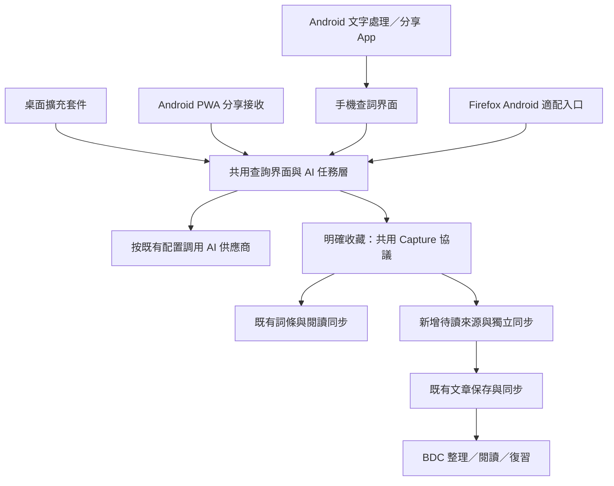

# BDC 桌面與 Android 即時查詞、AI 問答及文章收藏完整調研報告

> 使用者已接受 A 建議，正式方案與交付基線見 [A 方案完整報告](../report/20261102013247144_BDC跨平台查詞與文章收藏A方案完整報告.md)：桌面獨立查詞、Android PWA 分享接收先行；原生 Android 選字入口屬可選增強。本篇保留平台比較與調研證據。

- 日期：2026-11-01（Asia/Hong_Kong）
- 程式碼基準：BDC 本機工作區 HEAD `1dda21a`；文章抽取能力另唯讀核對本機 `article-import-service`。
- 任務：整合前述設計討論，評估桌面瀏覽器及 Android 的通用入口，形成可供產品及技術評審的完整方案。
- 工作範圍：源碼調研、官方文件／相容性資料核對、既有資料契約純函式探查及方案編制。未修改應用程式、未製作擴充套件或 APK，未進行 Android 實機測試或核對正式部署版本。
- 本報告整合並更新前五篇調研／訪談。前述已確認需求保留；Android 路線及具體技術拆分屬本報告建議，並非已實作功能。

## 1. 建議結論

建議將功能定位為 BDC 的「閱讀中查詢與收藏入口」：桌面擴充套件負責網頁內的單詞、片語、句子解釋及追問；Android 透過系統選中文字與分享入口接入；BDC 負責長期詞書、待讀收藏、文章正文、AI 整理及學習。

核心應共用「查詢輸入格式、AI 任務層、明確收藏規則及來源關聯」，各平台按能力提供不同入口。

推薦順序：

1. 建立共用查詢／收藏能力與輕量查詞界面，完成桌面 Chrome／Edge 擴充套件；不依賴事先開啟 BDC 分頁。
2. 將同一查詞界面適配手機，加入可安裝 PWA 的系統分享接收，讓 Android 先能分享文字或網址到 BDC。
3. 增加薄型 Android 伴隨 App，支援系統 `ACTION_PROCESS_TEXT` 與 `ACTION_SEND`，提高跨瀏覽器、跨 App 的方便程度。
4. 視實際使用增加 Firefox Android 適配、當前分頁正文快照、批量提詞等功能。

Android 的通用入口以「文字處理／分享」為主；瀏覽器擴充套件提供更完整的網頁語境。兩者互補。

## 2. 已確認需求與本報告採用的基線

| 項目 | 已確認方向 |
| --- | --- |
| 即時解釋位置 | 原網頁的擴充套件面板，可看解釋及繼續問 AI |
| 保存觸發 | 一般查詢作當次會話／快取；明確點加入詞書或收藏才永久保存 |
| 加詞聯動文章 | 有來源 URL 時，加入詞書同時建立或沿用該 URL 的待讀收藏 |
| 最低文章保存保證 | 加詞時先保存 URL、標題及當次原句；正文稍後按需要導入 |
| 混合語言內容 | 在 BDC 提取已有的英文正文／例句作學習稿，保留取得的原始文本 |
| 預設語境 | 選取內容＋附近句子／段落，需要時再擴大到全文 |
| 整篇加入 | 第一版優先保存整篇正文供閱讀詳解；批量提詞另設明確入口 |
| 詞書選擇 | 有預設詞書，可改選其他詞書及新建詞書 |
| 臨時詞書 | 本頁閱讀會話沿用臨時選擇，新網頁回到預設；明確操作才修改預設 |
| AI 配置 | 預設跟隨 BDC 既有任務模型及供應商規則 |
| BDC 分頁關閉 | 使用者已接受建議：擴充套件仍應可查詞／問 AI，無須先開 BDC 分頁 |
| Android | 希望日後方便查詞；本報告評估通用入口及其限制 |

「有來源 URL」是跨平台的重要條件：Android 系統可能只交付選取文字。取得不到網址時仍應允許收藏詞，但來源記為未知，不虛構一篇文章，也不自動借用上一個網頁的 URL。

## 3. Android 通用方法比較

| 方案 | 操作方式 | 跨 App／瀏覽器能力 | 可取得的語境 | 投入與建議 |
| --- | --- | --- | --- | --- |
| **薄型 Android App：文字處理＋分享** | 選中文字後選 BDC 查詞；或分享文字／網址到 BDC | **較通用，但取決於來源 App 是否提供相應入口** | 通常至少選取文字；原句、URL、全文均不保證 | **長期優先的通用入口**，原生部分只負責接收、展示與本機待傳 |
| **已安裝 PWA：Web Share Target** | 在系統分享清單選 BDC | 支援 PWA 分享接收的瀏覽器／系統環境；可接其他 App 的分享 | 來源 App 實際交付的文字／網址／標題 | **較低投入的 Android 起點**，可共用網站登入及手機界面 |
| Firefox Android 擴充套件 | 擴充套件選單或適配後的頁面按鈕／浮層 | 主要限 Firefox 內的頁面 | 有權限時較易取得選取內容、附近正文及頁面 URL | 適合作為網頁內增強，不能直接照搬桌面右鍵／側欄 |
| 手動複製到 BDC 手機頁面 | 貼上單詞、句子或網址 | 大部分允許複製及開網頁的環境 | 使用者貼上的內容 | 保留為相容性後備入口 |
| 截圖分享後 OCR | 分享截圖，辨識後選字 | 可用於無法選字的內容，仍受截圖能力限制 | 圖片可見內容，未必有來源 URL | 可沿用既有 OCR，列後續增強 |

### 3.1 為何不把桌面 Chrome 插件當成 Android 通用方案

Google 的常規 Chrome 擴充套件安裝文件仍以桌面為目標；手機頁面的「Add to Desktop」是把擴充套件安裝到電腦，並非在手機執行。[外部 6]

個別 Android 瀏覽器可能提供自己的擴充套件能力，須逐一驗證。通用方案不應要求使用者更換為某個特定瀏覽器。

### 3.2 Android `ACTION_PROCESS_TEXT`

Android 官方 `Intent` 文件確認，`ACTION_PROCESS_TEXT` 自 API 23 提供，用於處理一段文字，內容從 `EXTRA_PROCESS_TEXT` 取得，並有 `EXTRA_PROCESS_TEXT_READONLY` 指示。[外部 1]

可設計成：

```text
來源 App 選取文字
    → 文字選擇工具列／更多選項
    → BDC 查詞
    → 顯示簡短解釋、繼續問 AI、選詞書並收藏
    → 返回原 App
```

App 需註冊相應 activity／intent filter，收到內容後以唯讀查詢為主。部分 App 使用自訂選取工具列、文字不可選或不公開外部處理入口，因此不能承諾所有 App 都會出現 BDC。

此協議提供的是待處理文字，不保證原句、網頁地址或來源 App 的全文。若使用者只選一個詞，就以「沒有原句」處理；希望語境釋義時可擴選整句或補充文字。

### 3.3 Android `ACTION_SEND`

標準系統分享透過 `ACTION_SEND` 及例如 `text/plain` 的 MIME type 傳送內容，接收方從 `EXTRA_TEXT` 等取得資料。[外部 2]

適合兩種操作：

- 分享選取文字，打開 BDC 查詞／句子解析。
- 分享文章網址，進入待讀收藏；需要時再導入正文。

網址常混在文字裡，附帶標題也不一定準確。接收界面應呈現實際收到的內容，若有多個網址讓使用者選擇；不能假定每個分享都有獨立 URL 欄位。

### 3.4 PWA 可以先做甚麼

Chrome 官方示範已安裝的 PWA 在 Android 接收其他 App 的分享，透過 manifest 的 `share_target` 指定接收頁及欄位。[外部 3]

它適合先提供「分享給 BDC → 查詢／收藏」。但有三個範圍限制：

1. 使用者須安裝符合條件的 PWA，普通網站不會自動成為系統分享目標。
2. `share_target` 接收分享，不會自行註冊原生 `ACTION_PROCESS_TEXT` 的選字處理項目。
3. API 支援受瀏覽器影響；MDN 將其列為支援有限的能力。[外部 4]

本專案目前未發現 web app manifest 的連結或 service worker 註冊。只有平台能力偵測不等於已具備 PWA，需增加 manifest、接收路由、安裝條件及 service worker。

若 GET 只預填接收頁，後續由使用者明確查詢／收藏即可。若接收請求直接改動收藏，官方建議使用 POST；前端頁面不能直接讀取導航 POST body，可由 service worker 或接收後端處理，再導向查詞界面。[外部 3、4]

新增 service worker 宜先限定於接收與查詞頁的範圍，避免將全站 AI 回應或私人同步資料誤納入靜態離線快取。離線時保存明確的待傳資料，而非把所有網路回應當作離線資料。

### 3.5 Firefox Android 的具體差異

官方 Android 差異文件說明，Firefox Android 不支援桌面 `menus`、`commands`、`sidebarAction` 等入口；擴充套件 action 位於瀏覽器選單，popup 以覆蓋界面呈現。[外部 5]

本次另核對 MDN Browser Compatibility Data 的 `webextensions.api.menus`，`firefox_android.version_added` 為 `false`，與上述文件一致。[外部 9]

因此可共用 AI、資料及部分 content script，仍要重做觸控入口。背景程式及 MV3 支援亦須按 Android 版本驗證，不能把桌面 manifest 原樣發布。

## 4. 各入口實際可保證的資料

| 入口 | 選取文字 | 原句／附近段落 | 來源 URL | 已登入頁面的目前正文 |
| --- | --- | --- | --- | --- |
| 桌面擴充套件＋使用者授權 | 可取得時保存 | 通常可擷取，受頁面結構及 frame 限制 | 通常可取得 | 額外實作當前分頁抽取後才具備 |
| Android 原生文字處理 | 通常有 | 只有使用者一起選取或另補充才有 | 不保證 | 不具備跨 App 讀全文能力 |
| Android 系統分享／PWA 接收 | 依分享內容 | 依分享內容 | 常在分享文字中，但不保證 | 一般只分享連結，不含登入後正文 |
| Firefox Android 擴充套件 | 視觸控入口及頁面支援 | 有權限及適配時可取 | 通常可取 | 額外實作及適配後才可取 |
| BDC 手動貼上 | 貼上的內容 | 貼上的內容 | 使用者貼上時才有 | 可貼正文，但不自動取得 |

建議查詢輸入明確記錄 `selection_only`、`sentence`、`paragraph` 或 `article` 這類語境範圍，界面據此顯示「本句意思」或「通用釋義」。只有一個詞時不能宣稱已分析整篇文章。

## 5. 整體使用流程

### 5.1 桌面：原網頁即時查懂

1. 選取單詞、片語或句子，右鍵或使用擴充套件入口。
2. 取得當次選取內容、原句、附近短語境及來源。
3. 先展示簡短語境解釋，需要時展開解析或問 AI。
4. 使用者明確點「加入某詞書」後，保存已展示的有效解釋、原句及來源，並聯動待讀 URL。
5. 點「整篇導入 BDC」才取得並保存正文；後續在 BDC 整理英文學習稿與分析。

### 5.2 Android：選字／分享後查詢

1. 使用來源 App 支援的文字處理或分享入口。
2. BDC 接收界面辨識收到的是文字、網址，還是兩者都有。
3. 按實際語境執行單詞、句子解釋或準備收藏文章。
4. 選詞書並明確收藏；缺 URL 時仍保存詞條與實際引用，來源顯示未知並可補充。
5. 有 URL 時建立／沿用待讀來源，之後從 BDC 導入正文。

這保留同一套收藏規則，也讓不同平台的資料差異可見。

## 6. 詞書選擇與界面設計

詞書歸屬決定在哪裡復習；來源記錄在哪個文章／原句遇到。兩者分開保存。

建議擴充套件或手機查詞界面：

```text
charge  /tʃɑːdʒ/  v. 收費
原句：They charge £10 for admission.
譯文：他們收取 10 英鎊入場費。

[ ＋ 加入「我的生詞」 ] [ ▾ ]
[ 詳細解析 ] [ 繼續問 AI ]
[ 收藏網址／整篇導入 BDC ]
```

目標選單列出預設詞書、其他可用詞書、已存在的文章詞書，以及「新建詞書」「設為預設」。主按鈕及成功提示均顯示真正的目標。

`defaultBookId` 應按 endpoint／帳戶保存，使用穩定 ID。當前網頁臨時目標與網站當時開啟的學習詞書分開；同一分頁換 URL／文件時重設為預設，多分頁各有自己的臨時選擇。

Android 跨 App 的接收會話未必有可識別的原網頁，預設每次從預設詞書開始；在同一次查詢會話中可沿用臨時選擇。若未來要按來源 App 記憶，是額外可選行為。

以上是設計示意，實作須同時提供 `zh-CN`／`zh-HK` 文案及無障礙名稱。

## 7. 單詞加入後究竟保存甚麼

| 資料層 | 內容 | 用途 |
| --- | --- | --- |
| 詞條 | 原詞／片語、音標、詞性、簡短主釋義、目標詞書及時間 | 列表、朗讀、復習及測驗 |
| 當次來源 | 原句、附近語境、當次釋義、已取得的原句譯文 | 回看當時用法；同詞多義分別保存 |
| 來源身份 | URL、頁面標題、待讀來源 ID；未知時允許空白 | 文章歸組與回訪 |
| 定位 | quote、prefix／suffix；導入後的文章 ID、內容版本及已確認位置 | 從文章回到已收藏詞 |
| AI 來源資訊 | 任務、模型標識、語言、提示版本、生成時間等必要資料 | 判斷結果來自何次解釋與是否需要更新 |
| 同步資訊 | 實體 ID、revision、待傳及刪除狀態 | 重試、衝突及多裝置一致性 |

同一本詞書已有 `charge`，新文章出現「充電」時，追加新原句及該來源釋義，保留使用者編輯過的主釋義。同一個詞不同來源不互相覆蓋。

原句是實際引用，應與 AI 生成例句分開顯示。音標或譯文暫缺不阻礙收藏。失敗訊息不作為有效釋義保存。

完整正文由文章資源保存，詞條保存關聯；完整聊天不默認塞進詞義欄。按已確認規則，普通查詢只作會話／快取；若提供「保存這次解釋／筆記」，保存範圍應由按鈕明示。

## 8. 單詞、待讀來源與正式文章的關係



三個穩定身份分別是 `entryId`、`savedPageId`、`articleId`。選擇其他詞書仍保留來源；同一篇文章可彙總分散在不同詞書的收藏詞。

典型次序是先收藏單詞與 URL，之後導入文章，再按來源 URL、原句與 quote 嘗試定位。只有唯一匹配時才建立確切位置；找不到或有歧義時保留引用，標示位置未知。

文章專屬詞書是可選的復習集合；「本篇已收藏的詞」可按來源彙總，無須自動複製所有詞到第二本詞書。

## 9. 為何待讀 URL 需要獨立資源

現有 [shared/article-protocol.mjs](../../shared/article-protocol.mjs) 及 [modules/article-store.js](../../modules/article-store.js) 要求正文非空，不能直接用網址當作一篇正常文章。本次純函式探查再次確認：

| 探查 | 實際結果 |
| --- | --- |
| 只有標題及 URL 可否保存為 article | 否，`invalid_article` |
| 有正文、`analysis: null` 可否保存 | 可以 |
| `savedPage` 是否已是 reading entity type | 否 |
| 來源白名單是否保留 URL、標題、來源 ID、語境釋義、原句譯文 | 目前會移除這些額外欄位 |

建議增加獨立 `savedPage` 小資源及同步游標，保留原有文章與閱讀同步。

這個取捨也有舊版相容性原因：現有閱讀 store 遇未知 entity type 會回報 `invalid_entity_type`。直接將新收藏類型送進舊閱讀串流，可能卡住舊版同步。若日後整合串流，需要先增加協議能力協商。

最小 `savedPage` 欄位：穩定 ID、原始 URL、保守正規化的 URL key、標題、首次／最近收藏時間、`linkedArticleId`、已讀／歸檔、revision 及刪除時間。擁有人由認證取得。

## 10. URL 歸組、去重與重新導入

同一帳戶以 URL key 查找收藏，同一次請求以 request ID 防止重送；兩者分別處理「同詞／同頁再次收藏」與「網路重送」。

URL 規則：

- 保留實際回訪用 URL，只接受 http／https，拒絕內含帳密的地址。
- 主機大小寫及預設 port 等按標準解析；追蹤參數只在確認規則下從查重鍵移除。
- 不任意刪除 query、改 query 順序、合併 HTTP／HTTPS，亦不全域移除 fragment。`#/article/123` 可能是頁面身份的一部分。
- canonical 與最終轉址 URL 作後續補充，不在初次收藏時任意跨站合併。
- URL 相同表示同一來源群組，不代表每次正文相同；正文另保存版本。

再次收藏普通 URL 預設沿用記錄，保留已讀狀態與已有正文。重新抓正文、恢復已取消收藏及重跑整理均是明確操作。

導入前先檢查 `linkedArticleId`，再核對同帳戶既有文章映射；建立文章與完成映射要有原子認領或可恢復的冪等流程。兩裝置同時導入不應無提示裂成兩篇；回應遺失後也不應盲目再建另一篇。

## 11. 文章導入、英文整理與分析

三項狀態分開顯示：

1. **已收藏網址**：可回訪，正文尚未保存。
2. **已保存正文**：可在 BDC 閱讀，尚未必整理或分析。
3. **已整理／已分析**：各自有結果及所依據的正文版本。

項目讀過與否、正文抓取是否成功、AI 分析是否成功是不同維度。AI 失敗不撤銷 URL 收藏，抓取失敗不抹掉已收藏詞。

本機 `article-import-service` 已有 Readability＋Markdown 抽取；[modules/api.js](../../modules/api.js) 亦有 URL 導入與後備能力。這個服務只回傳內容，不會自動保存到 BDC 帳戶；來源主機白名單與網站反爬也影響任意 URL 的抽取成功率。

第一版整篇保存可由 BDC 協調取得正文並調用既有文章 store，不必要求先做全自動背景工作平台。若要關閉網站後仍抓取，才增加持久化工作、重試與進度服務。

對登入後或動態載入頁面，日後可增加「保存目前分頁正文」。Readability 應處理 DOM clone，輸出按既有安全 Markdown 邊界渲染；它不是完整 HTML 清理器。[外部 8] 系統分享一個 URL 並不附帶登入 cookie 或已載入全文。

### 11.1 英文整理稿

已確認的目標是提取已有英文正文／例句，不隱含把所有中文自動翻成英文。

現有 [modules/prompts/import.js](../../modules/prompts/import.js) 的清理要求保留原始語言，新增功能須有明確「英文學習稿」模式。原始文本與整理結果分開保存；保留產生時間、來源版本及處理模式。

可評估沿用現有文章文稿 `articleDocument` 保存 AI 整理稿，文章原文／版本層保留原始正文。讓整理稿成為閱讀正文仍需補界面、選用狀態與位置更新流程，不能宣稱現有系統已完整具備。

篩選後段落及順序可能改變，詞語 anchor 要依 quote／原句重新確認，不能沿用瀏覽器 DOM offset。再次整理亦不自動覆蓋使用者筆記或舊版本引用。

## 12. 查詞品質與 AI 設定復用

| 查詢任務 | 常規界面設定 | 現有入口 |
| --- | --- | --- |
| 單詞句中意思 | 查詞／單詞分析 `wordAnalysis` | `analyzeWordInSentence()` |
| 片語 | 查詞／單詞分析 `wordAnalysis` | `analyzeSelection()` |
| 句子翻譯及結構 | 文章詳解 `articleAnalysis` | `analyzeSentence()` |
| 段落／整篇翻譯 | 文章詳解 `articleAnalysis` | `analyzeParagraph()` 等 |
| 連續追問 | AI 助手 `assistant` | 既有助手提示與串流 |
| 文章整理 | 文章 AI 清理 `articleCleanup` | 清理／抽取能力；英文篩選另增模式 |

現有程式還支援 `articleWordTranslation` 等更細任務映射，應沿用 [modules/ai-models.js](../../modules/ai-models.js) 的解析器。候選任務的明確設定、個人預設及管理員任務預設有既定次序，不另寫一套模型猜測規則。

查詞以原句語境優先：`charge` 在收費句及電池句分別返回收費與充電；沒有原句時顯示通用釋義。首輪簡短回覆，詳細分析與自由追問按需要展開，保存時使用已展示的有效結果。

現有單詞入口主要只有 word＋sentence。要正式使用附近段落，應把 context 同步加入共用函式、提示與快取鍵。片語及句子入口已支援 context。

快取須區分帳戶／作用域、供應商及模型、選取內容、原句與語境、語言和提示版本；快取是效能機制，不自動變成永久學習記錄。

## 13. BDC 關閉時的獨立 AI 執行

使用者已接受擴充套件不依賴預先開啟的 BDC 分頁。因此「網站分頁替插件跑 AI」只適合作為原型或可選橋接，不能作正式能力的唯一依賴。

建議先延用專案現有的客戶端直連 AI 架構：

- 抽出不依賴網站 DOM 的任務選模、提示／schema、結果檢查及協議適配。
- 網站保留 `modules/api.js` 作功能入口；擴充套件有自己的受信任執行環境，完成帳戶連結、配置載入及請求。
- 手機 PWA／查詞頁可在自己的頁面初始化相同任務層；薄型 Android App 先復用手機查詞界面，避免在 Kotlin 複製所有 AI 任務邏輯。
- 既有文章 UI 查詞會順帶保存閱讀記錄，擴充套件應共用純分析能力，按已確認的明確收藏規則保存。

### 13.1 配置與 Key 的真實邊界

| AI 來源 | 可共用方式 | 實際限制 |
| --- | --- | --- |
| 管理員發布的 catalog | 客戶端登入後載入任務／供應商並按既有授權取得必要憑證 | 共享 Key 按現有原則僅留受信任環境記憶體，還須擴充客戶端授權 |
| 已明確雲端同步的個人供應商 | 沿用供應商定義、任務配置與既有憑證同步能力 | 需要正確帳戶及綁定驗證，不能只有模型名稱 |
| 只保存在網站本機的 Key | 明確連結／匯入至這個第一方客戶端，或使用可選網站橋接 | 不會憑空出現在另一個 origin 或另一部手機 |
| 本機／區域網供應商 | 在可達的客戶端按同一協議直連 | 手機 `localhost` 是手機本身，需正確區網地址；仍受 HTTPS／本地網路權限等影響 |

「跟隨 BDC」表示共用同一套配置來源與規則，不等於各裝置無需登入或授權就擁有同一個 Key。其他客戶端以已發布／已同步的配置版本為準；尚未上傳的網站本機修改不會自動出現在另一個 origin。配置取得與版本更新也須納入客戶端連結流程。

現有 Cloudflare Worker 明確不代理 AI，不能把同步端點當作已存在的 AI 任務網關。若日後增加服務端 `AI task gateway`，它是另一項工程：需要任務／模型允許範圍、串流、取消、配額及遠端可達性。可按需要增加，非本報告預設依賴；雲端網關亦不能直接訪問使用者電腦的 localhost。

## 14. 共用架構與資料契約



共用兩種輸入，職責分明：

- **LookupInput**：選取內容、任務、可選原句／語境、可選來源、語境範圍。用於解釋或追問，預設不永久寫入學習資料。
- **CaptureInput**：帳戶已綁定的 request ID、目標詞書、選取內容、已取得的有效解釋、可選來源及收藏種類。只有明確收藏才送出。

平台接收器只負責把實際取得的資料轉成同一結構。不要把平台專屬的原生 Intent 或瀏覽器 DOM 狀態當成後端契約，也不需把所有功能硬塞進單一接口。

### 14.1 擬新增的服務接口

以下是提案名稱，現在尚不存在：

| 接口 | 職責 |
| --- | --- |
| `POST /captures` | 明確保存詞條／網址；有 URL 的加詞同時建立或關聯待讀來源 |
| `GET /vocabulary/books` | 取得可用目標詞書的必要 metadata |
| `GET /saved-pages` | 待讀來源列表與獨立 cursor 增量 |
| `PATCH /saved-pages/:id`、`DELETE /saved-pages/:id` | 修改閱讀狀態、標題、歸檔或取消收藏，處理 revision／刪除記錄 |
| 客戶端授權及配置接口 | 第一方客戶端連結、能力／作用域、任務與供應商非秘密配置；憑證仍依明確權限取得 |

文章正文沿用 `/articles` 系列，詞條同步沿用 `/reading` 系列。現有 `/articles/import` 是舊快照遷移用途，不等於「從 URL 抓文章」服務。

## 15. 保存一致性、重試與同步

`POST /captures` 的業務結果應包含：詞條保存狀態、目標詞書、待讀關聯、是否新增來源及可再次使用的回執。

有 URL 的加詞需要同時確認詞條、來源及待讀記錄。若資料同在一個後端資料庫，可交易提交；若流程跨多個服務，須有可恢復的協調及明確部分狀態，不能兩個請求只成功一個就顯示全部完成。

同詞去重以帳戶＋詞書＋正規化詞為基礎，來源按 URL／原句／quote 等判斷。保留既有 entry ID，舊資料建立對照時不無提示刪除重複詞。

每筆待傳操作固定 endpoint、帳戶、目標及 request ID：

- 寫入永久佇列成功後才顯示已保存在此裝置。
- 收到伺服器回執後才顯示已同步。
- 回應遺失時重送原請求，不產生新的收藏身份。
- 切換帳戶後暫停原帳戶操作，不能轉送到新帳戶。
- 目標詞書已刪除時讓使用者重新選擇。
- 舊離線重送不能把其他裝置較新的刪除靜默復活；明確重新收藏則按新操作處理。

Chrome MV3 背景會停止，使用擴充套件自己的 IndexedDB 保存佇列。Android App 可用本機持久化加 WorkManager 補傳；它遵守系統排程及省電限制，不保證任意時刻立即執行。[外部 7] PWA 沒有前景時亦不承諾即時長時間 AI 工作；下次開啟／合適背景能力恢復傳輸。

離線可查看已取得的快取與保存收藏，新的 AI 解釋仍需要可達的供應商；本方案沒有承諾手機離線運行大型模型。

網站目前前景／焦點輪詢主要看快照 `/version`，需要一併偵測閱讀、文章及待讀 cursor。新詞／新 URL 在 BDC 返回前景後應可見，不依賴使用者修改其他資料才觸發同步。

## 16. 授權、儲存與部署邊界

第一方擴充套件／App 建議經由 BDC 登入後明確連結，以一次性授權資料換取可撤銷的客戶端 session。現有配對機制可參考，但目前 session 無僅收藏的 scope，不能直接宣稱已具備最小權限。

分開授予收藏、讀取必要詞書與來源、讀取 AI 配置／按政策取得憑證等能力，伺服器逐路由執行限制。內容腳本只傳選取資料及必要請求，不持有網站 session 或供應商 Key。

具 host permission 的擴充套件網路能力不會繞過後端自己的 Origin 403 檢查，部署需核對 Chrome extension origin、Firefox 安裝差異及正式網站來源。原生 App 沒有瀏覽器 CORS 也仍須正常 Bearer 認證。

selfhost 已掛載文章與閱讀 API，但 AI catalog／雲端憑證、密碼／配對登入與 Cloudflare 並非完全相同。建議第一個完整參考部署採 Cloudflare；若同時支援 selfhost，需把收藏 handler／遷移及認證能力作共同驗收，不能只依賴舊 README 的快照描述。

PWA 安裝與分享接收需要符合瀏覽器條件的正式 HTTPS 部署；單純 `http://區網IP` 不應視為已具備可靠 PWA 能力。

## 17. Android 薄型 App 如何保持投入可控

建議原生部分只做四件事：接收文字處理／分享、保留待處理內容、打開手機查詞界面、返回來源 App。

先復用手機網頁界面，可選 Custom Tab；若需要更完整的一體化體驗，再評估受控 WebView 或原生結果界面。這些方式的登入儲存不同：WebView 不能假設自動繼承瀏覽器的 cookie、localStorage 或個人 Key；Custom Tab 是否可沿用，取決於實際使用的瀏覽器及帳戶狀態，必須實測。

輸入應先落本機再導航，避免頁面載入失敗或登入跳轉丟失。長正文不用完整 query URL 傳遞；可以使用短期交接記錄或受控資料通道，敏感文字亦不需要出現在普通伺服器存取紀錄中。

查詞活動以系統選取／分享啟動，通常即可完成核心流程。全域剪貼簿監聽、常駐浮窗及其他 App 全文擷取不作為第一版前提。

## 18. 模組改動範圍

| 區域 | 主要工作 |
| --- | --- |
| 共用純邏輯 | 選取任務、提示／schema、來源格式、詞／URL 正規化、請求及回執契約 |
| `modules/api.js`／AI 模型與協議層 | 抽出執行環境依賴、補單詞段落語境及快取鍵；保留既有網站入口 |
| 新增輕量查詞頁／共用視圖 | 僅初始化查詞所需帳戶、AI、界面與保存服務，避免直接啟動完整 SPA 九個模組 |
| `extension/` | Manifest、右鍵／action／快捷鍵、臨時取詞、面板、帳戶連結及待傳佇列 |
| 詞書與來源 | 任意目標詞書、補來源欄位及語境釋義、重複來源合併、來源詳情界面 |
| 新增待讀資源 | 後端表／handler／cursor、本機 store／outbox、閱讀狀態與列表 |
| 文章模組 | 從收藏導入、顯式保存正文、來源映射、英文整理稿及已收藏詞彙總 |
| 同步與備份 | 比較各 cursor、帳戶切換、完整匯出還原包含待讀及來源關聯 |
| PWA | manifest、安裝入口、share target、接收頁及限定範圍 service worker |
| Android App | Intent 接收、交接、前景查詢及永久待傳，視需要採 WorkManager |
| locales | 所有按鈕、狀態、錯誤、動態界面及 aria 文案同時完成兩種語言 |

專案無根目錄 bundler，不必為第一個桌面版本引入大型框架。若多瀏覽器維護成本提高，再評估獨立擴充套件工具鏈。Android 外殼也不要求把整個 BDC 重寫成原生 App。

## 19. 分期、交付物與相對複雜度

| 階段 | 交付物 | 相對投入／主要依賴 |
| --- | --- | --- |
| 0：契約與能力驗證 | 查詢／收藏輸入、來源模型、客戶端連結原型、關鍵資料探查 | 中；先確認不同 AI 憑證來源的獨立執行 |
| 1：桌面與 BDC 閉環 | 原網頁詞句解釋／追問、任意詞書收藏＋待讀 URL、獨立 AI、正文導入、來源詳情 | 中至較大；涉及多層保存及同步，不只是插件 UI |
| 2：Android PWA 入口 | 手機查詞頁、分享接收、離線暫存、相同詞書與來源規則 | 小至中增量，取決於安裝／登入及部署條件 |
| 3：Android 通用入口 | `PROCESS_TEXT`＋`SEND` 薄型 App、返回流程、交接及補傳 | 中；來源 App／手機系統相容性是主要驗證量 |
| 4：增強 | 當前分頁正文快照、批量提詞預覽、Firefox Android／Safari 適配等 | 按需求分開安排 |

已確認的英文整理稿可跟隨 BDC 文章處理一起交付，先採使用者明確啟動；全自動背景抓取與清理另行安排。若時程有限，最先驗證「查懂 → 加詞及來源 → 回 BDC 看見」的完整小流程，再擴大 UI 與自動化。

本報告以工程範圍及相對投入評估，尚未實作各平台原型，未據此給固定工期承諾。

## 20. 驗收矩陣

| 場景 | 應有結果 |
| --- | --- |
| 同詞不同原句 | 顯示對應語境釋義，來源各自保留 |
| 沒有原句的 Android 選詞 | 顯示通用釋義狀態，可補上下文，不假裝有全文 |
| 有 URL 的收藏詞 | 詞條與待讀來源均有確認結果，文章可彙總該詞 |
| 沒有 URL 的收藏詞 | 可保存，來源未知，不錯配最近網頁 |
| 換詞書及換頁 | 本頁臨時選擇有效，新頁回到預設 |
| 重複點擊／回應遺失 | 重用有效結果及原 request ID，不重複建詞或來源 |
| 離線、背景停止、重啟 | 已落盤操作可恢復，狀態區分待傳與同步完成 |
| 切換帳戶／401 | 原帳戶操作不污染新帳戶，私人配置及視圖按範圍處理 |
| 網址取消收藏後收到舊重送 | 不靜默復活；明確重新收藏可恢復 |
| 文章抓取／AI 失敗 | 已收藏 URL 與詞條保留，正文／分析狀態真實 |
| 已登入頁面分享 URL | 不承諾服務端可取得登入後全文，提供其他導入方式 |
| 混合語言整理 | 已有英文提取成稿，原始文本可對照，anchor 不錯套 |
| 網站已開啟後收到外部收藏 | 返回前景或適度輪詢後可見 |
| 舊版客戶端 | 新待讀資源不阻擋舊詞書／文章串流 |
| 備份及還原 | 詞條、待讀、來源、正文與整理關聯完整 |
| 語言切換 | 靜態、動態及錯誤路徑在 `zh-CN`／`zh-HK` 一致可用 |

Android 實機至少覆蓋常用瀏覽器中的文字選取與網址分享、一個採自訂選取工具列的閱讀 App、只分享文字、只分享 URL、文字混多 URL、不可選字內容、登入／取消返回、手機背景回收與離線重啟。API 文件支持不能取代這些實際操作結果。

## 21. 本次證據與驗證範圍

本次完成：

- 核對既有詞條、來源白名單、文章非空正文契約、永久 store、AI 選模及提示規則。
- 確認目前 Worker 不代理 AI；個人 profile 及 managed catalog 的憑證邊界仍須由各客戶端正確處理。
- 確認未發現已註冊的 PWA 分享接收或 Android 原生入口。
- 以既有純函式重現 URL-only article 被拒絕、無分析正文可保存、來源額外欄位被移除等行為。
- 實際讀取 Android Intent／分享／WorkManager、Chrome PWA 分享接收及 Mozilla Android 差異資料；以 BCD 再核對 Android Firefox menus 不支援。
- 檢查報告及相關本機來源連結；本次沒有應用程式修改，沒有執行整套功能回歸或 Android 實機驗證。

具體探查摘要見[verification.json](./assets/20261101150944285/verification.json)。後續實作需執行專案既有 AI／同步測試、雙語 audit、相關文章與詞書瀏覽器流程，再增加有價值的收藏／重試／跨版本測試；不把本報告列出的驗收項目當成已通過。

## 22. 主要程式碼索引

| 檔案 | 本方案相關能力 |
| --- | --- |
| [modules/api.js](../../modules/api.js) | 查詞、句子／片語解析、串流、文章取得與清理 |
| [modules/ai-models.js](../../modules/ai-models.js) | 任務模型、供應商解析及發現 |
| [modules/ai-profile-storage.js](../../modules/ai-profile-storage.js) | 帳戶／裝置 profile、個人設定及憑證狀態 |
| [modules/ai-catalog.js](../../modules/ai-catalog.js) | 管理員任務預設及記憶體共享憑證 |
| [modules/prompts/article.js](../../modules/prompts/article.js)、[import.js](../../modules/prompts/import.js) | 共用語境解釋與清理提示 |
| [modules/vocab.js](../../modules/vocab.js) | 預設／文章詞書收藏與補全 |
| [modules/reading-store.js](../../modules/reading-store.js)、[reading-sync.js](../../modules/reading-sync.js) | 詞書／學習記錄永久保存及逐項同步 |
| [modules/article-store.js](../../modules/article-store.js)、[article-sync.js](../../modules/article-sync.js) | 文章保存、版本、正文載入及同步 |
| [shared/reading-protocol.mjs](../../shared/reading-protocol.mjs)、[article-protocol.mjs](../../shared/article-protocol.mjs) | 共用白名單、實體及文章契約 |
| [modules/local-backup.js](../../modules/local-backup.js)、[permanent-db.js](../../modules/permanent-db.js) | 完整備份、還原及永久資料庫 |
| [features/article/article.js](../../features/article/article.js) | 原網頁匯入、詳解、來源上下文及閱讀流程 |
| [features/assistant/word-chat.js](../../features/assistant/word-chat.js) | 詞語追問界面及固定語境 |
| [cloudflare-worker/src/worker.js](../../cloudflare-worker/src/worker.js) | 認證及接口邊界 |
| [cloudflare-worker/src/reading.js](../../cloudflare-worker/src/reading.js)、[articles.js](../../cloudflare-worker/src/articles.js) | 共用交易、revision、change 與冪等能力 |
| [selfhost/server.mjs](../../selfhost/server.mjs) | 自建後端及其能力差異 |
| [article-import-service extract.js](/Users/linus/CODE/article-import-service/src/routes/extract.js) | 已存在的正文抽取服務，另有部署與來源限制 |

## 23. 外部官方資料

以下於 2026-11-01 實際讀取。相容性以實作時的目標版本及實機結果為最終依據。

1. **Android Intent：`ACTION_PROCESS_TEXT`、`EXTRA_PROCESS_TEXT`**。<https://developer.android.com/reference/android/content/Intent#ACTION_PROCESS_TEXT>；另核對 AOSP 原始碼 <https://raw.githubusercontent.com/aosp-mirror/platform_frameworks_base/master/core/java/android/content/Intent.java>。
2. **Android 接收其他 App 分享**。目前官方指南為 <https://developer.android.com/develop/ui/compose/sharing/receive>；原連結 <https://developer.android.com/training/sharing/receive> 會轉址至該頁。
3. **Chrome：Web Share Target 接收分享**。<https://developer.chrome.com/docs/capabilities/web-apis/web-share-target>。包含安裝條件、GET／POST、service worker 及 Android URL 可能位於 text 欄位的說明。
4. **MDN：manifest `share_target`**。<https://developer.mozilla.org/en-US/docs/Web/Progressive_web_apps/Manifest/Reference/share_target>。
5. **Mozilla：桌面及 Android 擴充套件差異與開發**。<https://extensionworkshop.com/documentation/develop/differences-between-desktop-and-android-extensions/>；<https://extensionworkshop.com/documentation/develop/developing-extensions-for-firefox-for-android/>。
6. **Google：安裝及管理擴充套件**。<https://support.google.com/chrome_webstore/answer/2664769?hl=en>。
7. **Android：持久化背景工作／WorkManager**。<https://developer.android.com/develop/background-work/background-tasks/persistent>。
8. **Mozilla Readability**。<https://github.com/mozilla/readability>；實際讀取 README <https://raw.githubusercontent.com/mozilla/readability/main/README.md>。
9. **MDN Browser Compatibility Data：menus**。<https://github.com/mdn/browser-compat-data/blob/main/webextensions/api/menus.json>；實際讀取 <https://raw.githubusercontent.com/mdn/browser-compat-data/main/webextensions/api/menus.json>。
10. **Chrome 擴充套件：activeTab、網路請求及背景生命週期**。<https://developer.chrome.com/docs/extensions/develop/concepts/activeTab>；<https://developer.chrome.com/docs/extensions/develop/concepts/network-requests>；<https://developer.chrome.com/docs/extensions/develop/concepts/service-workers/lifecycle>。能力核對沿用本次系列前篇已實際讀取的官方資料。

## 24. 前述調研與決策脈絡

- [最初的單詞收藏調研](./20261101031400870_瀏覽器擴充套件取詞加入詞書方案調研.md)。
- [單詞與文章網址整體調研](./20261101032534399_瀏覽器擴充套件單詞與文章網址收藏整體方案調研.md)。
- [即時 AI 詳解與來源聯動訪談](./20261101034326128_網頁即時AI詳解與來源聯動收藏設計訪談.md)。
- [詞條內容與詞書選擇訪談](./20261101035140872_詞條保存內容與目標詞書選擇設計訪談.md)。
- [AI 查詞及設定復用訪談](./20261101040411228_擴充套件查詞品質與AI設定復用設計訪談.md)。

前篇中尚未確認的 Q8 現已由使用者接受建議：不要求先開 BDC 分頁。早期「只手動收藏文章才進待讀」亦已調整為有來源 URL 的加詞聯動待讀。本報告以這些最新決策為基線；Android 入口能力不足時採明確降級並保留實際取得的資料。
