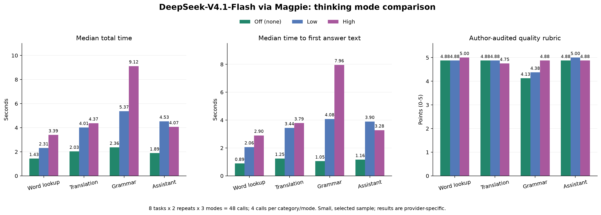

# AI 思考開關：查詞、翻譯、句法與助手的品質及速度實測

日期：2026-11-02，Asia/Shanghai。主對照於本機 12:22–12:25 執行，後續另做預設行為、生成預算與匿名品質評估。這次只新增研究附件，沒有更改 BDC 的模型選擇、供應商或產品請求行為。

## 主要結論

在本機 Magpie 的 `workbuddy/deepseek-v4.1-flash` 接入上，關閉思考明顯縮短等待。高強度的品質收益主要集中在長難句的結構標籤、解釋完整性及詞組對齊細節；普通查詞、段落翻譯與本輪兩道助手題沒有顯示穩定的高強度優勢。

因此建議先採用：查詞及普通翻譯預設關閉；一般助手預設關閉或低檔；明確要求長難句詳解、複雜推導時按需選高檔，並同步處理生成預算。先前僅按功能推測「助手應預設中等」的建議，需要依這次實測收窄：問題的難度比入口叫不叫助手更有判斷價值。

另外發現兩個實作事實：

1. 本次 DeepSeek 省略思考參數的 8 次請求全部產生了網關上報的推理 token，省略參數並非關閉。
2. 目前本機 grok2api 的 `grok-4.20-fast`、`grok-4.3-fast` 都註冊為相同 `FAST` 路徑，`reasoning_effort` 在該路徑主要控制是否輸出思考內容。這兩條路徑不能當作真正開／關推理的因果對照。

## 速度結果

主對照為 8 題 × 關閉／低／高三檔 × 每檔 2 次，共 48 次請求。每個任務類別有 2 題，因此下列每格均有 4 次測量。表中是中位數，單位為秒。

| 任務 | 關閉 `none` | 低 `low` | 高 `high` | 高／關閉的總耗時比 |
| --- | ---: | ---: | ---: | ---: |
| 查詞、句中詞義 | 1.43 | 2.31 | 3.39 | 2.37 倍 |
| 段落翻譯 | 2.03 | 4.01 | 4.37 | 2.16 倍 |
| 長難句、語法分析 | 2.36 | 5.37 | 9.12 | 3.86 倍 |
| 助手問答 | 1.89 | 4.53 | 4.07 | 2.16 倍 |

對使用者更直接的「第一段答案何時出現」如下。角色事件、SSE 心跳及思考內容均不算答案正文。

| 任務 | 關閉：正文首字 | 低：正文首字 | 高：正文首字 |
| --- | ---: | ---: | ---: |
| 查詞、句中詞義 | 0.89 | 2.06 | 2.90 |
| 段落翻譯 | 1.25 | 3.44 | 3.79 |
| 長難句、語法分析 | 1.05 | 4.08 | 7.96 |
| 助手問答 | 1.16 | 3.90 | 3.28 |

這批助手題的高檔略快於低檔，但每檔只有 4 次測量，生成長度亦有波動，不能推論高檔通常更快。檔位也不是固定秒數或固定推理 token 數的保證。



可另開 [SVG 圖表](assets/20261102121456495/comparison.svg) 或下載 [CSV 數據](assets/20261102121456495/comparison.csv)。

## 品質結果

先寫每題的 5 分要點，再把 48 份答案的模型、檔位、時間及輪次標籤移除，交由另一個模型 `codex/gpt-6-sol` 評估。執行代理再閱讀匿名原文、核對扣分及漏判，留下逐項修正。這是匿名模型評分加作者覆核，沒有獨立的人類評審，分數是診斷量尺，不能換算成普遍正確率。

| 任務 | 關閉平均分／5 | 低平均分／5 | 高平均分／5 | 觀察 |
| --- | ---: | ---: | ---: | --- |
| 查詞、句中詞義 | 4.88 | 4.88 | 5.00 | 詞義基本相同，高檔改善了少量語法角色標籤 |
| 段落翻譯 | 4.88 | 4.88 | 4.75 | 沒有穩定改善，高檔仍有數量邊界不精確 |
| 長難句、語法分析 | 4.13 | 4.38 | 4.88 | 高檔的結構解說與詞組對齊較完整 |
| 助手問答 | 4.88 | 5.00 | 4.88 | 這批題目以低檔已足夠，高檔沒有穩定優勢 |

高檔對關閉的 16 組「同題、同輪」配對中：5 組分數較高、10 組相同、1 組較低。其中 4 組提升來自兩道句法題的兩輪測量。這些是同題重複生成，不是 16 道互相獨立的新題目。

### 查 bank：答案完全相同

三檔各跑兩次，6 份主測答案全部相同：

```json
{"phonetic":"/bæŋk/","pos":"noun","meaning":"银行"}
```

這類查詢增加思考主要增加等待，沒有增加本題答案資訊。另一道句中詞義題的 sanction 在各檔都理解為「批准／認可」，高檔的收益是較少把非謂語的角色標籤寫錯。

### 普通翻譯：高檔仍會改變數量邊界

原文是 `groups of more than four people`，準確門檻是「超過四人的團體」。高檔兩次都譯成「四人以上」，按通常書面定義會包含四人；關閉與低檔則各有一次寫對、一次寫成「四人以上」。

三檔都能保留主幹、數字、研究的非因果限制，以及百分比／百分點的區別。本輪沒有看到用高檔能穩定修復翻譯細節的證據。模型評分器原本漏掉數量邊界，作者覆核後才補入扣分，因此保留了原評分及修正紀錄。

### 長難句：改善集中在結構與對齊

倒裝題：

> Not until the final report had been checked twice did the committee agree to publish it.

各檔都能譯出「檢查兩次之後才同意公布」。部分關閉答案把 `to publish it` 說成「賓語補足語」，或在從句標籤上寫「倒裝」而在解說中又正確指出是主句倒裝；高檔的其中一輪則完整交代主句還原、過去完成被動及 `it` 的指代。高檔另一輪仍漏掉時態解說，並非每次都滿分。

混合條件句題：

> Had Maya not missed the train, she would be attending the interview now.

各檔都能理解過去條件與現在結果。關閉檔兩次、低檔一次在詞組對齊中，將「現在」同時放入 `she would be attending` 及 `now` 的中文對應，形成重複；高檔兩次沒有這個問題。高檔的優勢主要是結構化解說與對齊細節，而三檔都譯出了主要意思。

### 助手題：高檔沒有穩定增加正確資訊

基本題要求解釋 `has been to` 與 `has gone to`，各檔均能完成核心解說及例句。

較複雜的助手題要求核對研究資料：

- 選課組通過率由 60% 升到 72%，即增加 12 個百分點，相對增幅為 20%。
- 對照組由 70% 升到 77%，增加 7 個百分點。
- 變化之差為 5 個百分點；自選分組及未測混雜因素，不能證明這就是課程因果效果。

各檔都能指出不能直接推論因果。高檔一次、關閉檔一次漏寫相對增幅 20%，低檔兩次寫全。這不足以證明低檔普遍更準確，但足以說明不能把所有助手問答一律預設為高檔。

## 生成預算會放大等待

主測統一給 `max_tokens: 8192`，讓各檔有足夠空間完成答案，避免把生成截斷混成一般品質差異。這比部分 BDC 現行上限寬鬆，因此另外按現行查詞 520、句法 1100 的上限做了 8 組補測，並只在 `length` 時模擬共用入口的一次倍增預算重試。

查詞補測的四次請求均一次成功。句法補測則出現一次：

| 同一倒裝題、第 1 輪 | 首次上限 | 首次結果 | 重試上限 | 最終累計耗時 |
| --- | ---: | --- | ---: | ---: |
| 關閉 | 1100 | 成功 | 不需重試 | 2.95 秒 |
| 高 | 1100 | `length` 截斷 | 2200 | 12.03 秒 |

高檔首次用了完整 1100 生成 token，耗時 6.37 秒；重新生成耗時 5.66 秒，最終成功。另一輪同題高檔在 1100 內完成，耗時 6.07 秒。這說明較高思考開銷與有限生成上限的組合，可能額外觸發重試；不能只加思考參數而不檢查預算。

補測是直接請求及重試邏輯模擬，沒有操作瀏覽器，也沒有涵蓋產品所有 fallback、快取及 UI 行為。

## 用量差異

以下是主測每檔 16 次請求的網關上報數字；生成 token 包含推理及正文，不是金額。

| 檔位 | 生成 token 合計 | 其中推理 token | 相對於關閉的生成用量 |
| --- | ---: | ---: | ---: |
| 關閉 | 2,430 | 0 | 1.00 倍 |
| 低 | 9,587 | 7,221 | 3.95 倍 |
| 高 | 12,803 | 10,264 | 5.27 倍 |

高檔增加的用量主要在推理；各檔的正文總量接近。沒有把供應商自有 credit 欄位當作貨幣，也沒有估造費用。快取、配額、不同供應商計費規則都可能改變實際成本。

## 省略參數與 Grok 的兼容性診斷

另外 8 題各測一次完全不傳 `reasoning_effort`：本次 DeepSeek 8/8 都有推理 token。這證實目前 BDC 若使用這條模型路徑並省略思考控制，會沿用開啟思考的預設行為；不能將「沒有設定檔位」當作「沒有思考」。

Grok 診斷則對兩個 fast 路由各測 `default/none/high` 的同一查詞題，共 6 次。答案基本一致，但時間樣本只有每組 1 次，且代理實作顯示它們不是有效的推理開關對照：

- Magpie 目前 grok2api 供應商的 chat endpoint 確認為本機 `http://127.0.0.1:8000/v1`。
- 運行中的 grok2api registry 把 `grok-4.20-fast` 及 `grok-4.3-fast` 都映射至 `ModeId.FAST / Capability.CHAT`。
- router 把 `reasoning_effort` 轉為 `emit_think`；在這個 app-chat 路徑，`emit_think` 控制回傳思考內容，送往上游的 `mode_id` 仍由模型的 FAST 註冊決定。
- 另有 Console 路徑可傳實際的 `reasoning.effort`，但目前 Magpie 列出的不是那些 console 型號。本次沒有更改供應商配置去啟用新型號。

因此本報告的速度倍數及品質比較只用有效的 DeepSeek 主測，不用 Grok 的顯示開關結果推論模型推理收益。模型名稱按網關標示記錄，沒有獨立驗證上游實際權重或品牌型號。

## 建議落點

| BDC 場景 | 這次結果支持的預設方向 | 配套 |
| --- | --- | --- |
| 普通常用義、句中詞義查詢 | 關閉思考 | 使用既有上下文與快取；需要細緻文法時再升級 |
| 普通段落翻譯 | 關閉，或經過額外驗證的低檔 | 先確保數字、否定、條件與 Markdown 保留；高檔不能替代核對 |
| 明確的長難句／語法詳解 | 提供高檔選項 | 接受較長等待，檢查生成預算及重試；三檔的核心譯義已可用 |
| 助手一般解釋與追問 | 關閉或低 | 依問題難度切換，避免固定高檔 |
| 更複雜的多步推導、長對話及跨段推論 | 按需高 | 本輪沒有充分覆蓋，後續可用真實常見問題再測 |

本次 DeepSeek 模型列表列出的檔位是 `none/low/high/max`，沒有 `medium`。因此產品若提供「中」這類統一選項，需要按模型能力對應，不應直接對所有路徑發相同字串。這輪核對了關閉與開啟的有效差異；低／高是發給網關的請求值，未抓包驗證供應商內部如何分配各檔推理預算。

## 方法、驗證與外推限制

- 使用現有 `modules/prompts` 與目前 `zh-CN` 語言規則；查詞還使用目前的 IPA 記法規則。每題的 messages 雜湊固定，相同模型、temperature 0.2 及生成上限，只有思考欄位改變。
- 固定 `workbuddy/deepseek-v4.1-flash` 路由，沒有使用會自動選其他模型的 `auto/...` 路由。串行請求，兩輪反轉各檔先後次序。
- 48/48 主請求成功，36/36 結構化答案是嚴格 JSON。關閉 16/16 的上報推理 token 為 0；低、高各 16/16 均大於 0。
- 沒有用 BDC 快取，也沒有包含瀏覽器渲染、文章批次並發及應用程式排隊。因此測的是實際供應商生成路徑；整篇文章在 UI 的總時間需要另測，不能把本表直接乘上段落數。
- 上游的 prompt cache、網絡波動、帳戶選擇及服務端排隊沒有完全控制。以中位數及交錯次序減少部分影響，但沒有宣稱統計顯著。
- 主測僅 8 個自行撰寫的診斷題，翻譯段落較短，助手題是單輪。沒有覆蓋長篇專業文章、極少見詞、長對話記憶、OCR 或其他模型的普遍表現。
- 評分使用另一模型匿名評審及同一執行代理覆核；原 judge 與覆核分數皆保存。沒有獨立人類評審，不把高分解讀為品質保證。
- 量測工具的 5 個 mock 測試通過：正文首字識別、斷流、HTTP 200 後 SSE 錯誤、生成截斷與 A/B 請求差異。Python 分析另核對 48 筆唯一性、答案雜湊、評分映射，並獨立覆算 JavaScript 中位數，一致。
- 共發出 82 次測試／評審 HTTP 請求：主測48、預設基線8、pilot9、預算補測9、品質評審8。預算補測的一次預期截斷保留在原始資料，重試後完成；沒有隱藏失敗。
- 沒有讀取或保存使用者私人文章／歷史訊息；沒有改動或輸出供應商金鑰。附件只保存答案、時間、上報用量、思考字數與評分，沒有保存推理原文。

## 附件與重跑

- [主測原始答案及時間](assets/20261102121456495/main.jsonl)
- [固定題目、提示詞與請求參數](assets/20261102121456495/main.jsonl.manifest.json)
- [正式評分要點](assets/20261102121456495/rubrics.json)：在閱讀／評分前澄清標題文字可以翻譯，以及基本時態題不要求判斷旅程是否已抵達；messages 與雜湊不變。
- [匿名評審輸入](assets/20261102121456495/blind-packets.json)、[原評分](assets/20261102121456495/judge-scores.json)、[作者覆核](assets/20261102121456495/author-review.json)、[最終評分](assets/20261102121456495/final-scores.json)
- [完整統計](assets/20261102121456495/analysis.json)、[預設基線](assets/20261102121456495/baseline.jsonl)、[預算補測](assets/20261102121456495/budget.jsonl)
- [Grok 路由證據](assets/20261102121456495/grok-route-evidence.json)、[運行容器的靜態原始碼摘錄](assets/20261102121456495/proxy-source-evidence.json)、[模型能力快照](assets/20261102121456495/model-capabilities.json)
- [執行記錄](../report/20261102121456495_AI思考對照測試執行記錄.md)、[測試計劃](../plan/20261102121456495_AI思考開關品質與速度對照計劃.md)

只重算現有資料與圖表，不呼叫模型：

```bash
uv run --no-project --with matplotlib python docs/research/assets/20261102121456495/analyze.py
node --test docs/research/assets/20261102121456495/benchmark.test.mjs
```

重新發出主對照請求，須使用新輸出檔，避免既有完成記錄被跳過：

```bash
node docs/research/assets/20261102121456495/benchmark.mjs \
    --models workbuddy/deepseek-v4.1-flash \
    --modes none,low,high \
    --repeats 2 \
    --label rerun \
    --out /tmp/bdc-reasoning-rerun.jsonl
```

`judge.mjs` 使用已凍結的匿名 packet；`budget.mjs` 重跑會追加新請求。上述真實請求需要本機 Magpie 及相應供應商仍可用。
