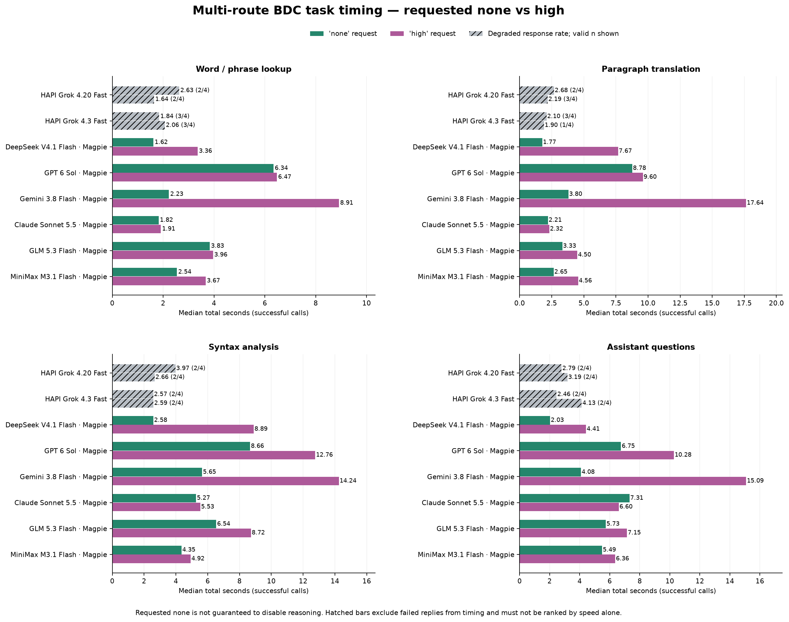
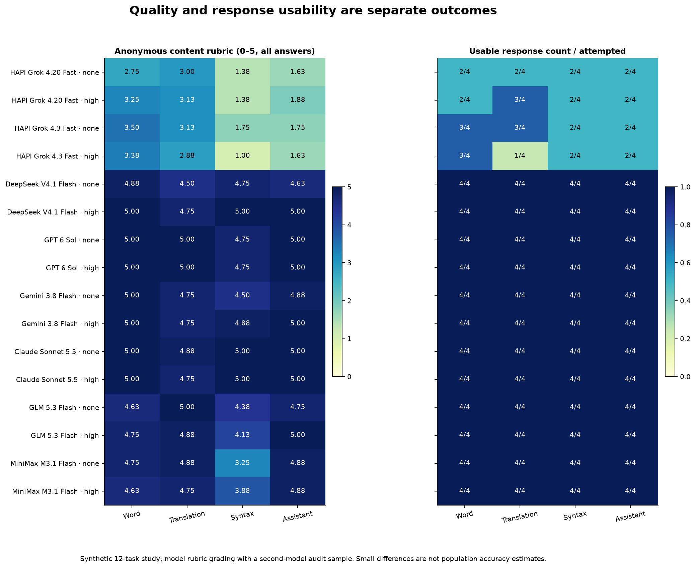

# 多模型與 HAPI Grok 思考控制實測

日期：2026-11-02。狀態：實測、分析及設定規格已完成；未實作產品思考設定，未提交或部署。

## 主要結論

本輪以12道固定題目，完成8條接入的256次正式對照，另做篩查、非流式兼容性、路由核驗及兩種匿名模型評審，共396次生成／評審請求。

1. **思考設定必須依渠道與模型判斷。** Magpie的DeepSeek在本次接入可驗證真正關閉；GPT、Gemini、Claude、GLM及MiniMax的none被網關記為low，不能一律稱為關閉。HAPI的推理計數與文字矛盾，關閉未確認。
2. **六條Magpie接入完整返回192/192；HAPI兩條Grok fast只通過35/64。** HAPI另有12次非流式全部空正文，兩輪健康檢查亦異常。這批結果首先反映渠道可用性，不能推論官方Grok模型本體的能力。
3. **升高思考有明顯時間成本，收益依任務與模型改變。** DeepSeek的句法與複雜助手題有改善；GPT及Claude在最低請求檔位已接近滿分；Gemini高檔在本輪增加較多等待，翻譯沒有平均分提升。GLM與MiniMax並未因升檔而全面改善。
4. **建議提供按功能的思考模式，以及助手單次覆寫。** 選項應分清跟隨服務端、已驗證關閉、最低強度及支援的高檔；思考內容的顯示開關另設。現行產品仍沒有這些控制。

## none請求實際代表甚麼

下表結合模型宣告、主測用量／思考字數，以及計時結束後取得的Magpie自有session路由記錄。`none`和`high`是本研究發出的請求值，不保證等於上游的最終推理檔位。

| 接入 | none的路由核驗 | 主測／篩查觀測 | 可給使用者的標籤 |
| --- | --- | --- | --- |
| Magpie：workbuddy/deepseek-v4.1-flash | 保留none | 本輪16次none推理用量均為0，沒有思考文字；high有正推理證據 | 此接入已驗證關閉 |
| Magpie：codex/gpt-6-sol | 記為low | 已測none沒有觀測到推理，high有推理 | 最低強度，不保證零推理 |
| Magpie：antigravity/gemini-3.8-flash | 記為low；served模型為gemini-3.8-flash-n | 已測none沒有觀測到推理，high有推理 | 最低／特定路由，不僅憑字尾承諾真正關閉 |
| Magpie：antigravity/claude-sonnet-5-5 | 記為low | 困難題仍出現思考文字；部分計數與文字不一致 | 最低強度，仍可能思考 |
| Magpie：workbuddy/glm-5.3-flash | 記為low | none在困難題仍有推理用量或文字 | 最低強度，仍可能思考 |
| Magpie：workbuddy/minimax-m3.1-flash | 記為low | none仍有推理用量 | 最低強度，仍可能思考 |
| HAPI：grok-4.20-fast、grok-4.3-fast | 沒有可核驗的上游檔位記錄 | 多個回覆含思考文字卻上報reasoning_tokens=0，且渠道回覆異常 | 關閉未確認 |

沒有觀測到思考輸出，不足以證明模型沒有進行內部推理。尤其本輪GPT及Gemini的樣本雖為零用量，網關已把none轉為low，設定介面應如實呈現此限制。以上不是對這些模型官方API的永久能力判定。

省略思考欄位只表示跟隨服務端。上一輪DeepSeek省略欄位的8次基線全部產生推理用量；本輪HAPI省略欄位的非流式請求仍空正文。兩者都不能把「沒有設參數」解釋為已關閉。

## 六條完整可用接入的整體結果

以下每條接入每檔16次，共32次，全部通過傳輸、非空正文及需要的結構檢查。耗時為成功請求總時間中位數；品質為匿名要點評分，滿分5，已套用覆核。模型名稱為渠道公開的路由名稱。

| 接入（均經Magpie） | none總時間 | high總時間 | 正文首字none／high | none品質 | high品質 |
| --- | ---: | ---: | ---: | ---: | ---: |
| DeepSeek V4.1 Flash | 2.03秒 | 5.23秒 | 1.13／4.39秒 | 4.69 | 4.94 |
| GPT 6 Sol | 6.90秒 | 9.64秒 | 3.22／8.61秒 | 4.94 | 4.94 |
| Gemini 3.8 Flash | 4.23秒 | 15.09秒 | 2.59／13.21秒 | 4.78 | 4.91 |
| Claude Sonnet 5.5 | 5.23秒 | 5.22秒 | 0.95／1.03秒 | 4.97 | 4.94 |
| GLM 5.3 Flash | 5.36秒 | 6.63秒 | 1.36／2.48秒 | 4.69 | 4.69 |
| MiniMax M3.1 Flash | 3.49秒 | 5.03秒 | 2.23／3.82秒 | 4.44 | 4.53 |

正文首字自請求發出計至第一個非思考正文片段；Claude最低檔約0.95秒便開始出正文，雖然總時間約5.23秒，流式助手的感受仍可相當即時。查詞／翻譯若等待完整JSON才顯示，則以總時間更接近使用者體驗。本表是直接服務對照，不包含前端排隊、快取命中及實際小預算重試。

Claude的兩檔中位數幾乎相同，不能據此判定高檔必然更快，亦不能證明控制完全無效。這只是本批題目及當時服務狀態的觀測。

品質分數保留兩位小數便於覆算；4.94與4.97等差異不足以建立模型優劣排名。本批兩個評審對48份抽查答案的原始分數平均絕對差約0.10分，本研究沒有統計顯著性結論。



灰色斜線是完整返回率偏低的HAPI結果，括號顯示成功數。其時間只來自成功子集，不能據此把失敗率高的接入排為最快。

## 按任務分析與選擇

每個任務群組每檔4次，由3道不同題目加1次代表題重測組成。下表選出對目前BDC用途較有參考價值的接入，沒有把12題當成完整領域能力測驗。

| 任務與接入 | none時間／品質 | high時間／品質 | 本批結果的用途 |
| --- | --- | --- | --- |
| 查詞：DeepSeek | 1.62秒／4.88 | 3.36秒／5.00 | 明確關閉適合日常快速查詞；高檔的平均收益小 |
| 查詞：Claude | 1.82秒／5.00 | 1.91秒／5.00 | 最低強度亦快，適合已有此接入的使用者 |
| 翻譯：DeepSeek | 1.77秒／4.50 | 7.67秒／4.75 | 關閉較快；升檔仍未消除所有數字與語義問題 |
| 翻譯：Claude | 2.21秒／4.88 | 2.32秒／4.75 | 本批日常翻譯在最低檔已兼顧速度及品質 |
| 翻譯：GPT | 8.78秒／5.00 | 9.60秒／5.00 | 本批準確，但不因高檔再獲得平均分提升 |
| 句法：DeepSeek | 2.58秒／4.75 | 8.89秒／5.00 | 深入分析可按需提高，注意等候與生成預算 |
| 句法：Claude | 5.27秒／5.00 | 5.53秒／5.00 | 本批最低檔已完整解釋結構 |
| 句法：Gemini | 5.65秒／4.50 | 14.24秒／4.88 | 高檔改善細節，但本批時間成本較大 |
| 句法：MiniMax | 4.35秒／3.25 | 4.92秒／3.88 | 有改善，仍存在混合條件句等解釋問題 |
| 助手：DeepSeek | 2.03秒／4.63 | 4.41秒／5.00 | 複雜教學及計算問題適合按需深入 |
| 助手：Claude | 7.31秒／5.00 | 6.60秒／5.00 | 最低檔已有完整表現，無需因任務叫助手就固定最高 |
| 助手：GPT | 6.75秒／5.00 | 10.28秒／5.00 | 本批最低檔足夠，高檔增加等待 |

實際建議：

- 查詞、一般句中釋義：優先DeepSeek的已驗證關閉，或Claude的最低強度。
- 普通翻譯：在可用接入中，Claude最低檔是本批較均衡的選擇；更重視即時回應可選DeepSeek關閉，對數字、否定及條件另做核對。
- 句法與歧義分析：Claude最低檔或DeepSeek高檔值得優先考慮；把「深入」保留為可選操作。
- 助手：一般解說沿用模型的標準／最低合適檔位；遇到推導、多輪數據核對等任務，可將DeepSeek切高。不要為所有模型套同一個高檔預設。
- GLM及MiniMax本輪沒有顯示可取代上述選擇的整體優勢；這不代表它們在其他任務一定較差。

本輪正式矩陣只對照none與high；中間檔只在篩查中出現，沒有對所有模型建立完整的low／medium品質排名。上一輪DeepSeek的low結果可作補充，不能與本輪不同題目直接拼成同一實驗。

## 長文章會放大等待差異

新增政策翻譯約數百英文詞，包含年齡、日期、工作日、調查數據、否定及預算範圍。下列每格只有一次，適合提醒極端等待，不作穩定倍率推估。

| 接入 | none總時間 | high總時間 |
| --- | ---: | ---: |
| DeepSeek | 3.63秒 | 34.67秒 |
| GPT | 12.03秒 | 16.40秒 |
| Gemini | 6.15秒 | 69.05秒 |
| Claude | 5.87秒 | 6.31秒 |
| GLM | 7.75秒 | 7.89秒 |
| MiniMax | 7.02秒 | 10.39秒 |

因此，普通文章翻譯不適合因為內容較長就一律開最高思考。文章翻譯與單句語法詳解應有不同任務設定。

本輪統一max_tokens=8192，避免把推理用完預算造成的截斷誤當成內容能力差。現行BDC部分句法請求預算較小；上一輪已量到1100預算下高檔截斷，再加倍重試的累計等待約12秒。之後實作思考設定時，需要同時處理生成預算及有限重試。

## HAPI Grok：渠道狀態先於思考選擇

使用的是當前發布catalog v3的HAPI接入，不是上一輪本機grok2api。HAPI公開列表只有grok-4.20-fast、grok-4.3-fast、grok-chat-fast。前兩條進正式矩陣，Chat Fast做兼容性及健康檢查。

| HAPI路由 | none完整返回 | high完整返回 | 合計 | 成功子集none／high時間 |
| --- | ---: | ---: | ---: | ---: |
| grok-4.20-fast | 8/16 | 9/16 | 17/32（53.1%） | 2.94／2.19秒 |
| grok-4.3-fast | 10/16 | 8/16 | 18/32（56.3%） | 2.17／2.25秒 |

64次主測的29次失敗包括24次空正文、4次非法JSON及1次90秒逾時。逾時的習語題含大量不合理例句，high對照亦缺少完整JSON結尾。失敗全部保存，不以重試後成功取代原紀錄。

在通過完整性檢查的回答中，四個路由／檔位組的內容均分仍約3.56至4.05，存在句法誤解、額外假設及數字表述錯誤。含失敗的總均分另保留於analysis.json，沒有拿它來聲稱官方Grok的準確率。

非流式對照直接模仿目前產品one-shot的傳輸方式：省略stream及stream_options，Accept為application/json。兩個HAPI模型各做default／none／high，每種兩題，12/12空正文；同時段DeepSeek與GPT共8/8成功。這說明僅改思考參數不能解決該時段的HAPI回覆問題。

計時後及稍後冷卻複查，共兩輪：

- 兩個Grok fast連「只回OK」都返回空正文。
- Grok Chat Fast能返回文字，但兩輪都沒有遵從OK測試，內容不相關。
- 令牌級額度接口上報不限額且未過期；不能因可用額度數值為0，就斷言餘額用盡。上游帳戶、分發、服務限制或吞錯等具體原因未確認。

當前發布的預設中，查詞、文章分析、段落翻譯、助手及default均指向HAPI grok-4.20-fast，個人設定可能覆蓋。因此優先建議檢查這條渠道的上游與回覆處理，或在既有可用供應商中手動選擇其他接入。思考強度控制無法代替渠道恢復。

## 品質檢查發現了甚麼

本輪不只檢查回覆長度、是否有思考或HTTP狀態。匿名評審按每題總計5分的加權要點，檢查上下文、數字、否定、文法角色、歧義及多輪約束。大部分題目5項各1分；sanction題4項，其中句義佔2分。

- `more than four people`譯成「四人以上」會改變數量邊界，高檔也可能犯錯。
- `Not until ... did the committee ...`應說明主句部分倒裝；有回答誤稱虛擬倒裝或把倒裝歸入前置從句。
- `Had Maya not missed the train, she would be attending the interview now.`需要保留過去條件與現在結果；有回答誤稱過去虛擬、現在完成進行時，或無據地加上唯一一班地鐵。
- 望遠鏡句需要同時承認觀察者用望遠鏡、男人帶望遠鏡兩種附著；只說男人正在使用或攜帶，沒有保留真正的結構歧義。
- 百分比／百分点題同時檢查相對增幅、變化差及因果限制；多輪題使用每組80人，不能沿用先前100人的數字。
- 嚴格JSON與可被本地容錯提取的JSON分別記錄。代碼圍欄可能仍可被產品提取；三引號、未閉合字串／物件則不通過。

主評為codex/gpt-6-astra，覆蓋全部256份；次評為antigravity/claude-opus-5-5，固定抽查48份。答案移除渠道、模型、模式、延遲及用量標籤，組內順序隨固定seed打亂。兩種評審均在計時生成結束後執行。

執行代理覆核119條待查：95份非空扣分及24份空正文；另檢查4份代表性滿分答案。兩個評審有2份相差1分的答案，已核對部分正確的解釋及缺漏。作者記錄10項覆核，其中9項改分、1項只更正錯誤的篇幅理由，原始評審結果沒有覆寫。

覆核包含修正把Markdown／數字等總字元當成「中文字」計數，以及不必要地要求逐字重述數學初末值；等價的正確解釋依一致標準接受。這仍屬模型評分加執行代理覆核，沒有獨立人類評審。



## 設定應如何提供

建議在「設定 → AI設定 → 按功能指定模型」旁增加思考模式，按查詞、普通翻譯、句子詳解及助手分開；助手另支援本次提問覆寫。

| 選項 | 確切意思 |
| --- | --- |
| 跟隨服務端 | 省略參數，延用渠道預設 |
| 關閉思考 | 只在渠道＋模型的實際關閉機制已驗證時提供 |
| 最低強度／低 | 發送該接入支援的最低值，可能仍會思考 |
| 中／高或深入 | 只列實際支援的檔位；不要求所有模型都有medium |
| 顯示思考內容 | 獨立的呈現偏好，不聲稱能停止服務端推理 |

共同請求層計算有效模式，流式與非流式使用同一映射。設定沿用帳戶範圍profile及同步，快取需區分渠道、模型、有效模式、locale及提示版本；深入模式需足夠生成預算。新增介面同時完成zh-CN與zh-HK。

完整規格：[AI思考模式與渠道能力設定規格](../spec/20261102132934033_AI思考模式與渠道能力設定規格.md)。產品尚未新增這些選項，本輪沒有修改模型選擇、代理配置、帳戶設定或金鑰。

## 方法、數量及限制

正式主測於本機時間2026-11-02 13:12至13:38發出。8條路由×12題×2檔位為192次；四類各選一道代表題再測兩檔，共64次，合計256。每條路由每檔16次，但只有12道不同題目，不視作16個完全獨立題型。

題目為自行編寫的公開／虛構材料，沒有使用私人文章或歷史對話。沿用上一輪8題並核對messages的hash，新增習語、長政策翻譯、歧義句及多輪數學。相同題目固定messages、temperature及8192生成預算，模型順序輪轉、檔位交錯，計時請求串行執行。模型／渠道間比較包含各自網絡與服務端排程時間。

初版研究調度把內容失敗也計入連續失敗暫停，造成HAPI各有9格未執行。修正為只因連續傳輸失敗暫停後，只補齊18個未執行格；既有失敗沒有重試、刪除或覆蓋。補齊階段較晚，故HAPI的時間與失敗分布不能視作完全同步的模型因果比較。

| 階段 | 真實生成／評審請求數 |
| --- | ---: |
| Magpie簡單題及困難題篩查 | 40 |
| HAPI篩查 | 24 |
| 正式矩陣 | 256 |
| 非流式對照 | 20 |
| 兩輪HAPI健康檢查 | 6 |
| Magpie路由核驗 | 6 |
| 主評：256份，8份一批 | 32 |
| 次評：48份，4份一批 | 12 |
| 合計 | 396 |

模型列表、額度及D1讀取等非生成GET／查詢不計入396。研究保存正文、用量及思考字數，不保存推理原文；認證不進入公開附件。

量測工具7/7 mock測試通過，涵蓋認證隔離、思考標籤跨片段、首個正文字元、缺失用量為null、SSE錯誤與截斷、非流式行為及內容／傳輸失敗分類。JavaScript獨立復算64個任務／檔位群組的總耗時及正文首字時間，與Python一致；256個唯一測量格、227次完整成功、24份空答零分及396請求數均核對。

本輪沒有做長達數十輪的對話、專業醫療法律文本、圖片／OCR、QA題庫或正式成本核算。token為各渠道上報口徑，缺失不補零，不能直接換成貨幣費用。模型評分及當時渠道狀態限制了外推範圍。

## 附件與覆算

- [完整統計JSON](assets/20261102125618427/analysis.json)、[按任務CSV](assets/20261102125618427/comparison.csv)。
- [原始主測JSONL](assets/20261102125618427/main.jsonl)、[非流式JSONL](assets/20261102125618427/nonstream-parity.jsonl)。
- [有效路由核驗](assets/20261102125618427/effective-route-checks.json)、[最終健康摘要](assets/20261102125618427/health-final-summary.json)、[非秘密發布預設](assets/20261102125618427/published-defaults.json)。
- [主評分](assets/20261102125618427/primary-scores.json)、[次評分](assets/20261102125618427/secondary-scores.json)、[作者覆核](assets/20261102125618427/author-review.json)、[最終分數](assets/20261102125618427/final-scores.json)。
- 圖表另有[耗時SVG](assets/20261102125618427/latency-by-task.svg)與[品質SVG](assets/20261102125618427/quality-and-reliability.svg)，可獨立匯出。
- [計劃](../plan/20261102125618427_多模型與HAPIGrok思考控制擴展實測計劃.md)、[執行記錄](../report/20261102125618427_多模型與HAPI實測執行記錄.md)。

只覆算既有資料、不重新呼叫模型：

```bash
node --test docs/research/assets/20261102125618427/bench-lib.test.mjs
uv run --no-project --with matplotlib python docs/research/assets/20261102125618427/analyze.py
```

重跑生成需使用附件中的run.mjs及獨立輸出檔，HAPI認證由程序環境或既有私密渠道來源取得。原始測量檔保持不變，以便核對失敗及時間順序。
