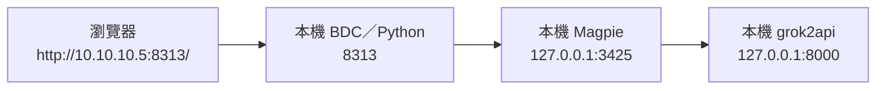

# 本機 Mac Studio 透過 Magpie 使用 BDC 的操作說明

日期：2026-11-01（Asia/Shanghai）。本說明依目前工作電腦實際網卡、監聽埠、容器及 HTTP 請求結果編寫，不沿用先前示例的 `192.168.1.*` 地址。

## 1. 已確認的本機環境

| 項目 | 實際位置／地址 | 本次檢查結果 |
| --- | --- | --- |
| 目前工作電腦 | Mac Studio，區域網絡 IP `10.10.10.5` | `en0` 網卡已確認 |
| BDC 專案 | `/Users/linus/CODE/bdc` | 本機原始碼位置 |
| grok2api | 此 Mac 的 Docker／OrbStack 容器 `grok2api`，主機埠 `8000` | `127.0.0.1:8000/v1/models` 及 `10.10.10.5:8000/v1/models` 不帶 Key 均回 401，表示可達但需要認證 |
| Magpie | 此 Mac 的 `magpie` 程序，埠 `3425` | 本機 GET `/v1/models` 不帶 Key 回 200，共 32 個模型 |
| Magpie 中的 grok2api 模型 | `grok2api/grok-4.20-fast`、`grok2api/grok-4.3-fast` | 本次模型列表確認存在 |
| 已有 BDC 部署 | `http://10.10.10.149:8001/` | 網頁與 `main.js` 均回 200；頁面標題為「背单词应用」 |
| 本說明新開的本機 BDC | `http://10.10.10.5:8313/` | 僅在下面的命令執行期間提供；本次臨時驗證已停止 |

`8000`、`3425`、`8313` 是同一台 Mac 上不同服務的埠號，並非三台電腦。`10.10.10.149` 則是另一個已有 BDC 入口。

## 2. 建議先採用的連線方式

Magpie 已保存 grok2api 的供應商設定，因此先讓 BDC 接 Magpie，可以復用它已有的上游配置，毋須重新輸入 grok2api Key。



瀏覽器的對話與模型請求先到 `10.10.10.5:8313/v1/...`。Python 再向本機 Magpie 的 `127.0.0.1:3425/v1/...` 發出請求；選擇 `grok2api/...` 模型後，由 Magpie 路由到 grok2api。

Python 這一段不轉送瀏覽器的 `Origin`。本次實測本機 Magpie 的模型列表允許這種不帶 Key 的本機請求。grok2api 自身需要的 Key 已由 Magpie 的供應商配置處理。

## 3. 在哪裡執行、執行甚麼

在 **IP 為 `10.10.10.5` 的這台 Mac Studio** 開啟「終端機」，執行：

```bash
cd /Users/linus/CODE/bdc
python3 scripts/serve.py --lan --ai-proxy http://127.0.0.1:3425
```

這條 Python 命令同時做兩件事：

1. 在 `8313` 提供本機資料夾中的 BDC 網頁。
2. 把到達這個入口的 `/v1/*` 請求轉送到 Magpie 的 `3425`。

參數含義：

| 部分 | 含義 |
| --- | --- |
| `scripts/serve.py` | 執行專案現有的本機網頁服務及代理程式 |
| `--lan` | 讓其他同網段裝置也能透過 `10.10.10.5:8313` 開啟此 BDC |
| `--ai-proxy` | 指定這份 BDC 的 `/v1/*` 要轉送到哪個上游 |
| `http://127.0.0.1:3425` | Python 從這台 Mac 連它自己的 Magpie |

終端機要保持運行；停止時按 `Control+C`。這個操作會另外啟動本機 BDC 服務，並不會自動變更 `10.10.10.149:8001` 的現有部署或公網入口。

## 4. 瀏覽器要開哪個網址

在 Mac 的瀏覽器開啟：

```text
http://10.10.10.5:8313/
```

這一步需要切換到上述本機 BDC 網址，因為代理就位於這個服務。仍停留在原來的公網 BDC 或 `10.10.10.149:8001`，不會自動使用新開的本機代理。

## 5. BDC 供應商具體填法

在這份本機 BDC 內，開啟「設定 → AI 供應商 → 我的供應商 → 添加供應商」（簡體介面相應顯示「设置」）。

| 欄位 | 填寫內容 |
| --- | --- |
| 服務地址 | `http://10.10.10.5:8313/v1` |
| API Key | 留空 |
| 協議 | 可先自動識別；手動設定時選 OpenAI Chat Completions 相容格式 |
| 認證方式（進階設定） | 無需認證（簡體介面「无需认证」） |
| 模型 | 連接後選 `grok2api/grok-4.20-fast` 或 `grok2api/grok-4.3-fast` |
| 預設模型 | 如要日常任務使用它，設為個人預設模型 |

操作順序：輸入服務地址、API Key 留空 → 按「連接」→ 在模型列表篩選 `grok2api/` → 選需要的模型及預設 → 按供應商表單的儲存按鈕。

此處是**新增供應商表單**的儲存操作；全域一般設定維持即時保存，不需要新增額外儲存按鈕。

模型列表會包括 Magpie 的其他供應商，本次共 32 個；要經 grok2api，就選帶 `grok2api/` 前綴的模型。前綴是 Magpie 路由識別的一部分，不要刪掉。

供應商地址填 `8313`，是因為瀏覽器先把請求交給 BDC 自己。上游 Magpie 的 `3425` 已經在終端機命令中設定。這兩個地址分別使用在不同位置。

## 6. 甚麼叫「同源」

本說明的兩個地址：

```text
網頁：http://10.10.10.5:8313/
API： http://10.10.10.5:8313/v1
```

兩者的協議 `http`、主機 `10.10.10.5`、埠 `8313` 全部相同，只有路徑不同。因此瀏覽器可以把 API 視為同一來源的請求，Python 再處理對外轉送。

例如請求模型列表時，實際轉送為：

```text
瀏覽器請求 http://10.10.10.5:8313/v1/models
Python 轉送 http://127.0.0.1:3425/v1/models
```

普通對話則是：

```text
瀏覽器請求 http://10.10.10.5:8313/v1/chat/completions
Python 轉送 http://127.0.0.1:3425/v1/chat/completions
Magpie 按 grok2api/ 模型前綴選用 grok2api 供應商
```

若網頁開 `http://127.0.0.1:8313/`，則供應商亦應填 `http://127.0.0.1:8313/v1`。為避免混淆，Mac 與手機均建議先統一使用 `10.10.10.5` 這組地址。

## 7. 手機／平板的用法

手機／平板與 Mac 位於能互通的同一區域網絡時，亦開啟 `http://10.10.10.5:8313/`，供應商仍填 `http://10.10.10.5:8313/v1`。

手機不要填 `127.0.0.1:8313`，因為那會指向手機自己。但是終端機命令中的 `--ai-proxy http://127.0.0.1:3425` **維持原樣即可**：發出這一段請求的是 Mac 上的 Python，這裡的 `127.0.0.1` 指向 Mac，與手機無關。

此方案需要 Mac、Magpie、grok2api 及 Python 服務保持運行。Mac 的區網 IP 若日後改變，網頁及供應商地址要一起更新。

## 8. 若要直接接 grok2api

上面的建議方案經過 Magpie。若希望直接接 grok2api，先停止正在運行的本機 Python 服務，再改為：

```bash
cd /Users/linus/CODE/bdc
python3 scripts/serve.py --lan --ai-proxy http://127.0.0.1:8000
```

網頁及 BDC 供應商地址仍分別是 `http://10.10.10.5:8313/`、`http://10.10.10.5:8313/v1`；API Key 改為 grok2api 自身的 API Key，認證選 Bearer；模型名稱使用 grok2api 自己返回的名稱，不帶 Magpie 的供應商前綴。此路徑不再經 Magpie。

此方法不能留空 Key，因為本次已確認 grok2api 的模型列表在未提供認證時回 401。本次沒有讀取或輸出使用者的 grok2api／Magpie Key，也沒有驗證帶 Key 的直接連接。

`--ai-proxy` 的地址不要追加 `/v1`，程式會自動接上瀏覽器的 `/v1/...` 路徑。現有程式每次只設定一個固定上游；切換啟動命令會改變 `8313/v1` 背後的服務。

## 9. 資料與現有服務的關係

`10.10.10.5:8313` 是另外一個 BDC 網站來源，瀏覽器的 localStorage／IndexedDB 與原本公網或 `10.10.10.149:8001` 分開。第一次開啟時，原地址保存的詞書、供應商與偏好未必會出現。要搬移資料，可使用既有匯出／匯入或在同步服務允許該來源時登入同步。

Magpie 已有的供應商配置保留在 Magpie，本說明透過它的網關復用；這與 BDC 自己的帳戶同步是兩件事。毋須在 `ai-config.js` 寫入 AI 地址、Key 或模型。

## 10. 本次驗證範圍

已實際暫時執行本說明的 Magpie 代理命令，確認：

- BDC 首頁 `http://127.0.0.1:8313/` 回 200。
- 分別以 `http://127.0.0.1:8313` 及 `http://10.10.10.5:8313` 作為請求地址及 `Origin`，GET `/v1/models` 均回 200。
- 不帶 Authorization 可經代理取得 Magpie 的 32 個模型，包含上列兩個 grok2api 模型。
- 臨時 Python 服務已終止，沒有變更已有服務、私人設定或 BDC 應用程式碼。

本次只驗證首頁及模型列表傳輸，沒有發送推理請求或執行瀏覽器 UI 操作。後續可在供應商表單用「測試模型」驗證生成，但該操作會呼叫實際上游。

現有 Python 代理把完整回應讀完才傳回，因此可先用普通請求打通路徑；助手等 SSE 串流會延遲到完整返回，長請求也可能碰到前端逾時。以上是現有代理的限制。

## 11. 保留 149 主環境的正式用法

補充日期：2026-11-02。149 的原有 BDC 可以採用同一原理使用本地供應商，毋須把主要使用入口搬到 `10.10.10.5:8313`。上面的 `8313` 方案用於在工作 Mac 上驗證請求路徑；要沿用主環境，應把轉送能力加到 149 現有的網頁服務。

目前專案的 `Dockerfile` 使用 Nginx，`deploy/nginx.conf` 只提供靜態檔案，沒有 AI 的 `proxy_pass` 路由。本次檢查 `http://10.10.10.149:8001/v1/models` 回 404，與該設定一致；原站目前並未提供本說明使用的 `/v1` 代理。

要讓原主環境支援此方式，資料路徑應改成：


具體應在 149 的 BDC Nginx 入口增加固定上游的 AI 轉送路由，確認 149 容器能連接 `10.10.10.5:3425`，正確轉送認證、處理來源標頭，並支援 SSE 串流。若原公網入口會將 `/v1` 一併轉送到同一個 BDC 服務，亦可沿用原來的公網網址。

完成路由配置後，供應商地址應配合實際開啟的網頁來源：

| 瀏覽器開啟的 BDC | 供應商地址 |
| --- | --- |
| `http://10.10.10.149:8001/` | `http://10.10.10.149:8001/v1` |
| 原來的公網 HTTPS BDC 網址 | 該同一 HTTPS 網域及埠下的 `/v1` |

公網 HTTPS 瀏覽器只需要訪問同源 HTTPS API；後面 `149 → 10.10.10.5` 的 HTTP 連線由伺服器執行，無須由瀏覽器直接連私人 IP。家中兩台主機、Magpie 與實際上游服務仍須保持運行。

認證亦須與前述本機驗證區分：本次 `127.0.0.1:3425/v1/models` 無 Key 回 200，但以 `10.10.10.5:3425/v1/models` 無 Key 請求回 401。149 是另一台主機，不能把本機無 Key 的行為直接套用到它；應配置有效的 Magpie 網關 Key，並沿用供應商認證機制轉送。公開反代須保留上游認證，不能無條件替匿名請求注入可用 Key。

本次僅核對專案設定與上述 HTTP 結果，尚未修改或部署 149 的 Nginx，也尚未從 149 容器內實測到 Magpie 的出站連線。
