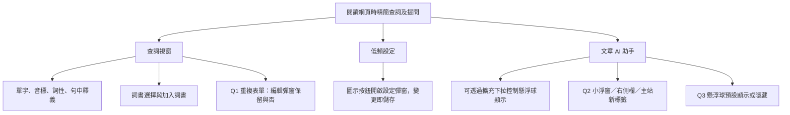

# 擴充套件精簡介面與文章 AI 助手設計訪談

狀態：全部推薦與追加需求已實作，已完成雙語及整合驗證。追加文章／詞書互跳、舊資料來源相容及右鍵獨立文章視窗。

## 使用者已明確提出的目標

- 參考主站查詞視窗，繼續精簡及美化擴充套件的查詞介面。
- 移走重複的語境查詢區域；低頻設定改為按需開啟的設定彈窗。
- 以圖示呈現適合精簡的操作，保留可發現性與無障礙標籤。
- 增加可顯示／隱藏的懸浮球，方便在閱讀網頁時開啟 AI 助手並對文章提問。
- 擴充下拉提供助手顯示開關；主站現有助手與單詞內助手作為功能／互動參考。
- 由 DeepSeek Harness 協助介面、由「代碼執行」（assistant_id=1）協助測試。
- 遵守共用 AI 請求入口、帳戶隔離、即時儲存及 zh-CN／zh-HK 雙語規範。

## 已核對的程式事實

- `extension/lookup.html` 同時用於工具列下拉、獨立頁與頁內查詞 iframe。
- `extension/inline-panel.js` 已提供 compact／expanded 模式，以及查詞編輯／文章草稿的離開保護。
- `extension/page-lookup.js` 負責選詞按鈕及錨定小窗；目前沒有文章助手懸浮球。
- `extension/ai-controls.js` 將 AI 模型及思考設定插入查詞 UI，目前即使收合也會顯示摘要列。
- `extension/lookup.js` 的帳戶設定按鈕目前呼叫 `chrome.runtime.openOptionsPage()`；編輯選詞會展開較大查詞表單。
- 主站 `features/article/article.js` 已有發音、加入詞書、標記、AI、更多等圖示操作。
- 主站 `features/assistant/word-chat.js` 有詞卡內對話與放大視窗；助手綁定主站閱讀狀態，擴充套件需要可信頁面接入。
- `modules/settings.js` 既有主站助手預設為啟用；擴充介面的懸浮球偏好尚待設計。
- `extension/modules/`、`extension/locales/`、`extension/shared/` 為打包產物；共用邏輯及雙語文案須修改根目錄原始碼後再封裝。
- 目前沒有擴充套件助手對話 UI 或 assistant 任務接線；文章擷取可重用，對話、串流、停止／重試、頁面會話及帳戶切換需要接入。
- 既有選詞注入受 top-frame、http(s)、可信 extension iframe 及 ticket 驗證保護；無選詞開助手需要新增對應入口，沿用這些信任邊界。

## 協作勘察結論

- DeepSeek 已完成介面勘察：常駐 AI 摘要列與頂部文字按鈕可移入圖示／設定彈窗；加入詞書維持主要操作，帳戶與低頻表單按需開啟。保留必要 DOM id 能降低既有回歸腳本調整範圍。
- 圖示按鈕應使用 `data-i18n-title`／`data-i18n-aria-label`；不可將 `data-i18n` 直接掛在包含 SVG 的按鈕上，否則翻譯會覆蓋圖示。
- 代碼執行已完成測試勘察：既有查詞、收藏、文章擷取、模型／思考偏好及 iframe 邊界已有回歸；新懸浮球與對話需補上行為驗證及聊天 mock。
- 代碼執行回報頁面／workspace 的 Node 基線共 87 項通過；另執行既有 lookup 測試時觸發 `packageExtension()`，重建了 gitignored 的擴充副本，未修改受版本控制的應用原始碼。此項屬現況基線核對，非本次新功能驗收。
- Playwright 可用位置：`/Users/linus/.local/share/fnm/node-versions/v24.20.0/installation/lib/node_modules/@playwright/cli/node_modules/playwright`；根目錄仍無 npm scripts 工作流。
- 驗收時應沿用查詞、錨定浮窗、iframe 安全與帳戶隔離的既有測試，並實測兩種語言的浮球開關持久化、助手收放、輸入草稿及文章上下文。

## 設計樹與待決前沿

### Q1：重複的語境查詢表單

推薦：從擴充首頁移走整塊單詞／原句／附近語境輸入表單，保留查詞小窗鉛筆圖示，按需開啟編輯彈窗。

替代：連手動輸入與編輯入口也移除。

狀態：使用者已確認推薦選項。

### Q2：懸浮球打開助手的主要佈局

推薦：留在目前網頁的小浮窗，可展開為右側欄；從查詞 AI 圖示進入時帶上當前單詞與原句。

替代：固定右側欄；或另開 BDC 主站標籤頁。

狀態：使用者已確認推薦選項。

### Q3：懸浮球的初始顯示

推薦：預設顯示，在擴充下拉提供可記住選擇的顯示開關。

替代：預設隱藏，由使用者在擴充下拉主動開啟。

狀態：使用者已確認推薦選項。

## 介面草案（使用者已確認）

- 查詞卡：保留單字、音標、詞性及句中釋義；操作以 AI、編輯、更多、關閉圖示呈現；詞書與加入操作保持直接可用。
- 低頻項目：模型、思考程度、帳戶與服務、語言等放入對應設定彈窗；不再常駐佔用查詞卡高度。
- 擴充下拉：集中顯示帳戶狀態、助手懸浮球開關、頁面／詞書的主要入口及設定入口。
- 文章助手：參考主站助手及詞卡內對話的簡潔樣式，提供引用提示、對話、輸入與送出、停止／重試等必要狀態。

## 協作與驗收準備

- DeepSeek：已完成介面核對及視覺／互動建議，任務 `6b770036-ff25-4b3f-b278-401981357bc4`。
- 代碼執行：已完成現有測試、Playwright 環境及文章助手接入勘察，任務 `50f6deae-c378-4e95-97fa-2556e2634ae9`。
- 設計已確認，介面、功能與正式回歸均已完成委派及整合。
- 驗收涵蓋：兩種語言、圖示標籤、設定即存、浮球開關持久化、文章上下文、串流／停止／重試、帳戶切換、既有查詞與加入詞書、文章草稿離開保護、浮動狀態列回歸。

## 訪談規則

本次依 grilling 先完成勘察與設計訪談；使用者回覆「全部按推薦」並追加需求後，已授權實作。後續實作與驗證見交付報告，不再有待確認的設計選項。

## 使用者確認後的追加範圍

- 文章詳解可直接查看綁定詞書；詞書可返回對應文章並查看原文連結。
- 優先復用既有 articleId、詞書關聯及原文 URL，支援可識別的舊匯入資料，不按相似標題猜測。
- 擴充新增右鍵 AI 提取及匯入文章詳解；提取進度、預覽及閱讀透過獨立視窗承載，不塞進工具列下拉。
- 主代理：擴充訊息協議、可信視窗、懸浮球、助手 runtime/UI 接線、右鍵入口與整合。
- DeepSeek：擴充 HTML/CSS、圖示化與設定／編輯對話框。
- 代碼執行：主站文章／詞書來源與路由，實作驗證及後續擴充回歸。

## 最終交付

- 操作說明：`docs/spec/20261106231952409_擴充套件精簡與文章助手操作說明.md`。
- 驗證報告：`docs/report/20261106233646798_擴充精簡文章助手與詞書關聯交付驗證.md`。
- 在最後驗證中補上獨立文章視窗等待 AI 設定完成才可操作，避免初開時搶先讀取尚未載入的模型。
- 手動修正保留來源網址，但會移除原本的精確 DOM 定位；取消編輯會復原原定位。
